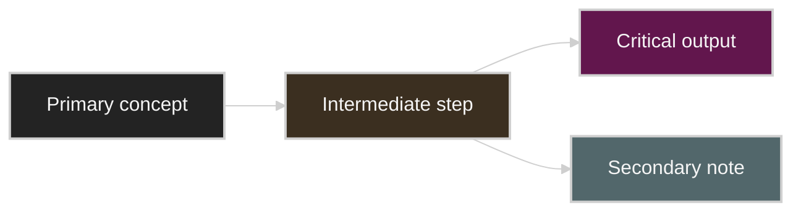

# Repository Guidelines

## Diagram and SVG Style

When creating or updating SVG diagrams in this repository, use the shared editorial diagram style unless a local file clearly uses a different established style.

### Palette

- Background: `#F3EFE7` or `#F5F1EA`
- Primary text: `#050505`
- Secondary text: `#6F6A63`
- Accent red/orange: `#D9392E`
- Main line: `#111111`
- Subtle border/grid: `#D8D1C7`

### Layout

- Prefer clean technical diagrams over slide-like hero layouts.
- Do not include a large title/subtitle inside the SVG when the README already introduces the figure.
- Keep diagrams flow-oriented, with thin line boxes and minimal filled color.
- Use accent red only for the most important warning, sync, loss, bottleneck, or critical path.
- Prefer whitespace, alignment, and line hierarchy over colored cards.
- Keep labels inside the viewBox; verify text is not clipped.
- Use large, bold text only for key numbers or core messages.
- Use small gray text for secondary explanations.

### Implementation

- SVGs should be hand-editable and use inline `<style>` classes.
- Avoid heavy shadows, gradients, decorative blobs, or multicolor palettes.
- Validate SVGs with:

```bash
xmllint --noout path/to/file.svg
```

- Before finishing, run:

```bash
git diff --check
```

## Mermaid Diagram Style

When creating or updating Mermaid diagrams in repository READMEs, apply the shared dark technical diagram style. Mermaid diagrams should feel like lightweight technical figures, not colorful slide graphics, and they must render cleanly in both GitHub README views and the Starlight GitHub Pages site.

### Mermaid Palette

Start every Mermaid block with the shared dark `init` directive. For flowcharts and other diagram types that support node classes, use dark `classDef` declarations inside each Mermaid block:



### Mermaid Layout

- Prefer `flowchart LR` for pipelines and generation flows; prefer `flowchart TB` for taxonomies, prompt structures, and stacked model families.
- Keep node labels short. Use `<br/>` for a controlled second line instead of long single-line labels.
- Use `primary` for the input, root concept, or final core object.
- Use `secondary` for ordinary processing steps.
- Use `note` for examples, caveats, side outputs, or supporting details.
- Use `accent` sparingly for the critical path, bottleneck, selected expert, final selected answer, unsafe/invalid path, or main trade-off.
- Avoid more than four visual classes in a Mermaid block unless the local diagram genuinely needs more.
- Use the shared `%%{init: ...}%%` directive shown above. Do not add `themeCSS` or alternate `themeVariables` unless a local diagram genuinely needs a checked exception.
- For `sequenceDiagram`, keep participant/message labels concise and rely on the shared dark init directive instead of per-diagram styling.
- Do not use gradients, icons, emojis, or multicolor class palettes unless a local file clearly established that style and the rendering has been checked in both GitHub and Pages.
- Keep arrows simple. Use dashed arrows only for feedback loops, optional links, or explanatory references.

### Mermaid Implementation

- Put the shared `init` directive and `classDef` declarations inside each Mermaid block so the diagram remains portable when copied into another README.
- Reuse class names consistently: `primary`, `secondary`, `note`, `accent`.
- Assign classes explicitly with `class ...` lines rather than relying on default Mermaid styling.
- Do not force a white SVG background with `themeCSS`. If a diagram needs a framed surface on the Pages site, solve it in site CSS around Mermaid containers rather than inside the Mermaid source.
- For lecture notes, prefer Mermaid for conceptual flow and taxonomy diagrams; use hand-editable SVG for dense architecture, matrix, cache, or routing diagrams where precise alignment matters.
- Before finishing, run:

```bash
git diff --check
```

## Practical Tips and Notes Sections

When adding a `Practical Tips and Notes` section to a chapter README, keep it clearly separate from the book summary.

### Purpose

- Use this section for field-tested operational guidance, implementation heuristics, and common failure modes that are relevant to the chapter but not necessarily stated in the source book.
- Do not present these notes as if they came from the book unless the book explicitly says them.
- Prefer practical judgment: what to measure, what can go wrong, what to baseline, and what trade-off to verify.

### Structure

- Add `Practical Tips and Notes` as a normal top-level section near the end of the chapter, usually after validation/checklist material and before roadmap/summary material.
- Add it to the table of contents.
- Use short `###` subsections with descriptive names instead of making every item a GitHub admonition.
- Keep the main content as normal paragraphs or compact tables.
- Use a final quick-reference table when it helps map symptoms to first checks.

### GitHub Admonitions

- Use `> [!TIP]` only for a small number of immediately actionable practices.
- Use `> [!WARNING]` only for risks that can cause incorrect conclusions, bad placement, data loss, wasted hardware, or major performance regressions.
- Avoid wrapping the whole section, or most of the section, in `TIP`, `NOTE`, or `WARNING` blocks. Too many admonitions make the section hard to scan.
- Prefer normal prose for ordinary explanatory notes.

### Content Style

- Keep tips concrete and measurable. Mention tools, metrics, commands, or observable symptoms when useful.
- Distinguish utilization from goodput, capacity from bandwidth, and allocation from topology.
- When discussing external images or references, prefer official sources for embedded images. Use third-party articles as additional references unless there is a strong reason to embed them.
- If a referenced image is similar but not the same system, add an explicit note explaining the difference.

## Blog

Standalone, dated posts live in the top-level `blog/` folder, not inside topic folders. The site shows them under the **Blog** menu, newest first, and publishes an RSS feed at `/blog/rss.xml`.

- Name each post `YYYY-MM-DD-slug.md`, where the date is the publish date, e.g. `2026-10-28-dgx-b200-rm-rf-recovery.ko.md`. The file name is the only place the date is written; the site URL drops it (`/blog/dgx-b200-rm-rf-recovery.ko/`), so keep the slug stable once published.
- Start each post with frontmatter, then the `# Title` heading:

  ```markdown
  ---
  topics: [gpu, systems-performance]
  description: "One-sentence summary shown in the blog lists and the RSS feed."
  ---

  # Title
  ```

- `topics` must use topic folder names: `network`, `gpu`, `storage`, `training`, `inference`, `mlops`, `systems-performance`.
- A Korean and English pair uses the same date and slug, `YYYY-MM-DD-name.ko.md` and `YYYY-MM-DD-name.md`, with the language toggle line under each H1.
- Put figures in `blog/assets/` with a topic prefix, e.g. `gpu-platform-numa-paths.svg`.
- Cite sources with GFM footnotes (`[^id]`) and end the post with a visible `## 참고 자료` (or `## References`) heading above the footnote definitions.
- Every Markdown file in `blog/` is published. Keep drafts and source exports outside the folder.
- After adding a post or changing its file name, title, topics, or description, run `npm run blog:index` in `.site`. It rewrites `blog/README.md` and the lists in topic READMEs between `<!-- blog:start ... -->` and `<!-- blog:end -->`. Do not edit those lists by hand. CI runs `npm run blog:check` and fails when they are stale.
- A topic README needs those markers once the topic has a post.

## Git Commits

Use Git Conventional Commits for commit messages.

Examples:

```text
feat: add week03 tensor parallelism diagrams
fix: adjust SVG label positions
docs: translate week03 README to Korean
style: apply repository SVG diagram palette
chore: update repository guidelines
```

Prefer concise scopes when useful:

```text
docs(week03): add practical training notes
fix(svg): prevent QKV label clipping
```
