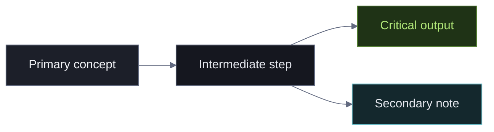

# Repository Guidelines

## Diagram and SVG Style

New figures follow the [restack design system](https://github.com/restack-ai/design-system), the same visual language as the site: charcoal panels, slate hairlines, one lime accent. Figures committed before 2026-11-26 use the earlier editorial style (cream paper, black lines, red accent). Leave those as they are, and do not mix the two styles inside one document.

### Palette

Every figure carries both faces. Colours are CSS custom properties on the root `<svg>`: the dark face by default, the light face under `@media (prefers-color-scheme: light)`. An SVG shown through `` takes the colour scheme of the page around it, so the figure follows the site's theme switch and GitHub's.

| Property | Dark | Light | Use |
| --- | --- | --- | --- |
| `--bg` | `#101218` | `#f6f7fa` | Figure ground, the same sunken panel as code blocks and Mermaid |
| `--panel` | `#15171f` | `#ffffff` | Boxes and nodes |
| `--panel-raised` | `#1c1f29` | `#f3f4f8` | Nested or grouped boxes |
| `--ink-strong` | `#f3f4f8` | `#0c0d12` | Key numbers and the rare figure heading |
| `--ink` | `#e6e8ef` | `#15171f` | Labels |
| `--ink-muted` | `#9fa6b8` | `#5a6175` | Secondary notes, axis ticks, captions |
| `--line` | `#303545` | `#d9dce5` | Structure: containers, gridlines, dividers |
| `--edge` | `#626a80` | `#7b8296` | Node edges, connectors, arrowheads |
| `--accent` | `#b2e879` | `#257a0c` | The one critical path, selection or bottleneck |
| `--accent-ground` | `#1f3316` | `#ecfadc` | Ground of the selected node |
| `--info` | `#70c5d0` | `#2b7f8a` | Information flow, a second voice |
| `--warning` | `#ecc35f` | `#8a5a00` | Waiting, degradation |
| `--danger` | `#f2867a` | `#b9473b` | Loss, failure, an error path |

Data series take the design system's order, dark / light: `#b2e879` / `#257a0c`, `#70c5d0` / `#2b7f8a`, `#e1ad7d` / `#a86224`, `#cf9be0` / `#8a4a9e`, `#d8cf89` / `#8a7d1f`, `#d89dbd` / `#a24f7c`, `#94aaa8` / `#5b706e`.

### Layout

- Prefer clean technical diagrams over slide-like hero layouts.
- Do not include a large title/subtitle inside the SVG when the README already introduces the figure.
- Depth is tone and hairline: 1px lines and panel fills one step off the ground. No shadows, gradients or glows.
- Corners step up with size: 3px for tags and cells, 5px for small boxes, 7px for panels.
- Use `--accent` once per figure, for the thing the figure is about. `--danger` marks loss or failure, not emphasis.
- A colour never carries meaning alone: keep a label or a legend beside it.
- Keep labels inside the viewBox; verify text is not clipped.
- Draw 960px wide or less. The site's reading column is about 650px, so text below 15px in the viewBox becomes hard to read.

### Typography

- Labels: `'DM Sans', Pretendard, 'Noto Sans CJK KR', 'Noto Sans KR', Arial, sans-serif`, weight 600 at most.
- Numbers, units and identifiers: `'IBM Plex Mono', 'Courier New', monospace`.
- An SVG inside `` cannot load the site's web fonts, so text falls back to installed fonts, often Arial. Size boxes for the wider fallback.

### Implementation

- SVGs should be hand-editable and use inline `<style>` classes that read the custom properties.
- Start from this skeleton, which draws two ordinary nodes and the one accented node:

```svg
<svg xmlns="http://www.w3.org/2000/svg" width="960" height="260" viewBox="0 0 960 260" role="img" aria-labelledby="title desc">
  <title id="title">Short name of the figure</title>
  <desc id="desc">What the figure shows, in one or two sentences, including every number it carries.</desc>
  <style>
    /* Dark face by default; the light face re-points the same names. */
    svg {
      --bg: #101218; --panel: #15171f; --ink-strong: #f3f4f8; --ink: #e6e8ef; --ink-muted: #9fa6b8;
      --line: #303545; --edge: #626a80; --accent: #b2e879; --accent-ground: #1f3316;
      --info: #70c5d0; --warning: #ecc35f; --danger: #f2867a;
    }
    @media (prefers-color-scheme: light) {
      svg {
        --bg: #f6f7fa; --panel: #ffffff; --ink-strong: #0c0d12; --ink: #15171f; --ink-muted: #5a6175;
        --line: #d9dce5; --edge: #7b8296; --accent: #257a0c; --accent-ground: #ecfadc;
        --info: #2b7f8a; --warning: #8a5a00; --danger: #b9473b;
      }
    }
    text { font-family: 'DM Sans', Pretendard, 'Noto Sans CJK KR', 'Noto Sans KR', Arial, sans-serif; }
    .bg { fill: var(--bg); }
    .node { fill: var(--panel); stroke: var(--edge); stroke-width: 1; }
    .node-selected { fill: var(--accent-ground); stroke: var(--accent); stroke-width: 1.5; }
    .label { fill: var(--ink); font-size: 18px; font-weight: 600; text-anchor: middle; }
    .label-selected { fill: var(--accent); font-size: 18px; font-weight: 600; text-anchor: middle; }
    .note { fill: var(--ink-muted); font-size: 15px; text-anchor: middle; }
    .mono { font-family: 'IBM Plex Mono', 'Courier New', monospace; }
    .link { fill: none; stroke: var(--edge); stroke-width: 1.5; marker-end: url(#arrow); }
    .head { fill: var(--edge); }
  </style>
  <defs>
    <marker id="arrow" viewBox="0 0 10 10" refX="9" refY="5" markerWidth="6" markerHeight="6" orient="auto">
      <path class="head" d="M0 0 L10 5 L0 10 Z"/>
    </marker>
  </defs>
  <rect class="bg" width="960" height="260"/>

  <rect class="node" x="60" y="80" width="220" height="80" rx="7"/>
  <text class="label" x="170" y="118">Input</text>
  <text class="note mono" x="170" y="142">256 KiB / token</text>

  <path class="link" d="M280 120 H360"/>
  <rect class="node" x="370" y="80" width="220" height="80" rx="7"/>
  <text class="label" x="480" y="118">Ordinary step</text>
  <text class="note" x="480" y="142">secondary note</text>

  <path class="link" d="M590 120 H670"/>
  <rect class="node-selected" x="680" y="80" width="220" height="80" rx="7"/>
  <text class="label-selected" x="790" y="118">Critical output</text>
  <text class="note" x="790" y="142">the one accent</text>
</svg>
```

- Check both faces: switch the site theme, or open the figure in a page with `color-scheme: dark` and then `color-scheme: light`.
- Validate SVGs with:

```bash
xmllint --noout path/to/file.svg
```

- Before finishing, run:

```bash
git diff --check
```

## Mermaid Diagram Style

When creating or updating Mermaid diagrams in repository READMEs, apply the shared dark technical diagram style. Mermaid diagrams should feel like lightweight technical figures, not colorful slide graphics, and they must render cleanly in both GitHub README views and the Starlight GitHub Pages site.

New diagrams use the restack palette below. Diagrams committed before 2026-11-26 use an earlier dark palette; leave them as they are. On the site, `.site/src/components/MermaidTheme.astro` re-colours both palettes to the design system's roles in either face, so the source palette is what GitHub shows.

### Mermaid Palette

Start every Mermaid block with the shared `init` directive. For flowcharts and other diagram types that support node classes, declare the four shared classes inside each Mermaid block:



### Mermaid Layout

- Prefer `flowchart LR` for pipelines and generation flows; prefer `flowchart TB` for taxonomies, prompt structures, and stacked model families. A wide `LR` flow shrinks to unreadable text in the site's reading column; switch to `TB` once a flow has more than four steps in a row.
- Keep node labels short. Use `<br/>` for a controlled second line instead of long single-line labels, and break lines between words yourself: Mermaid's automatic wrapping can split a Korean word.
- Use `primary` for the input, root concept, or final core object.
- Use `secondary` for ordinary processing steps.
- Use `note` for examples, caveats, side outputs, or supporting details.
- Use `accent` sparingly for the critical path, bottleneck, selected expert, final selected answer, unsafe/invalid path, or main trade-off. It is the lime selection colour, so one or two nodes at most.
- Avoid more than four visual classes in a Mermaid block unless the local diagram genuinely needs more.
- Use the shared `%%{init: ...}%%` directive shown above. Do not add `themeCSS` or alternate `themeVariables` unless a local diagram genuinely needs a checked exception.
- For `sequenceDiagram`, keep participant/message labels concise and rely on the shared init directive instead of per-diagram styling.
- Do not use gradients, icons, emojis, or multicolor class palettes unless a local file clearly established that style and the rendering has been checked in both GitHub and Pages.
- Keep arrows simple. Use dashed arrows only for feedback loops, optional links, or explanatory references.

### Mermaid Implementation

- Put the shared `init` directive and `classDef` declarations inside each Mermaid block so the diagram remains portable when copied into another README.
- Reuse class names consistently: `primary`, `secondary`, `note`, `accent`. The site re-colours a node by its classDef fill, so a new class must reuse one of the four fills or be added to `MermaidTheme.astro`.
- Assign classes explicitly with `class ...` lines rather than relying on default Mermaid styling.
- Do not force a white SVG background with `themeCSS`. If a diagram needs a framed surface on the Pages site, solve it in site CSS around Mermaid containers rather than inside the Mermaid source.
- For lecture notes, prefer Mermaid for conceptual flow and taxonomy diagrams; use hand-editable SVG for dense architecture, matrix, cache, or routing diagrams where precise alignment matters.
- Before finishing, run:

```bash
git diff --check
```

## Practical Tips and Notes Sections

When adding a `Practical Tips and Notes` section to a chapter README, keep it clearly separate from the book summary.

### Purpose

- Use this section for field-tested operational guidance, implementation heuristics, and common failure modes that are relevant to the chapter but not necessarily stated in the source book.
- Do not present these notes as if they came from the book unless the book explicitly says them.
- Prefer practical judgment: what to measure, what can go wrong, what to baseline, and what trade-off to verify.

### Structure

- Add `Practical Tips and Notes` as a normal top-level section near the end of the chapter, usually after validation/checklist material and before roadmap/summary material.
- Add it to the table of contents.
- Use short `###` subsections with descriptive names instead of making every item a GitHub admonition.
- Keep the main content as normal paragraphs or compact tables.
- Use a final quick-reference table when it helps map symptoms to first checks.

### GitHub Admonitions

- Use `> [!TIP]` only for a small number of immediately actionable practices.
- Use `> [!WARNING]` only for risks that can cause incorrect conclusions, bad placement, data loss, wasted hardware, or major performance regressions.
- Avoid wrapping the whole section, or most of the section, in `TIP`, `NOTE`, or `WARNING` blocks. Too many admonitions make the section hard to scan.
- Prefer normal prose for ordinary explanatory notes.

### Content Style

- Keep tips concrete and measurable. Mention tools, metrics, commands, or observable symptoms when useful.
- Distinguish utilization from goodput, capacity from bandwidth, and allocation from topology.
- When discussing external images or references, prefer official sources for embedded images. Use third-party articles as additional references unless there is a strong reason to embed them.
- If a referenced image is similar but not the same system, add an explicit note explaining the difference.

## Blog

Standalone, dated posts live in the top-level `blog/` folder, not inside topic folders. The site shows them under the **Blog** menu, newest first, and publishes an RSS feed at `/blog/rss.xml`.

- Name each post `YYYY-MM-DD-slug.md`, where the date is the publish date, e.g. `2026-10-28-dgx-b200-rm-rf-recovery.ko.md`. The file name is the only place the date is written; the site URL drops it (`/blog/dgx-b200-rm-rf-recovery.ko/`), so keep the slug stable once published.
- Start each post with frontmatter, then the `# Title` heading:

  ```markdown
  ---
  topics: [gpu, systems-performance]
  description: "One-sentence summary shown in the blog lists and the RSS feed."
  ---

  # Title
  ```

- `topics` must use topic folder names: `network`, `gpu`, `storage`, `training`, `inference`, `mlops`, `systems-performance`.
- A Korean and English pair uses the same date and slug, `YYYY-MM-DD-name.ko.md` and `YYYY-MM-DD-name.md`, with the language toggle line under each H1.
- Put figures in `blog/assets/` with a topic prefix, e.g. `gpu-platform-numa-paths.svg`.
- Cite sources with GFM footnotes (`[^id]`) and end the post with a visible `## 참고 자료` (or `## References`) heading above the footnote definitions.
- Every Markdown file in `blog/` is published. Keep drafts and source exports outside the folder.
- After adding a post or changing its file name, title, topics, or description, run `npm run blog:index` in `.site`. It rewrites `blog/README.md` and the lists in topic READMEs between `<!-- blog:start ... -->` and `<!-- blog:end -->`. Do not edit those lists by hand. CI runs `npm run blog:check` and fails when they are stale.
- A topic README needs those markers once the topic has a post.

## Git Commits

Use Git Conventional Commits for commit messages.

Examples:

```text
feat: add week03 tensor parallelism diagrams
fix: adjust SVG label positions
docs: translate week03 README to Korean
style: apply repository SVG diagram palette
chore: update repository guidelines
```

Prefer concise scopes when useful:

```text
docs(week03): add practical training notes
fix(svg): prevent QKV label clipping
```
