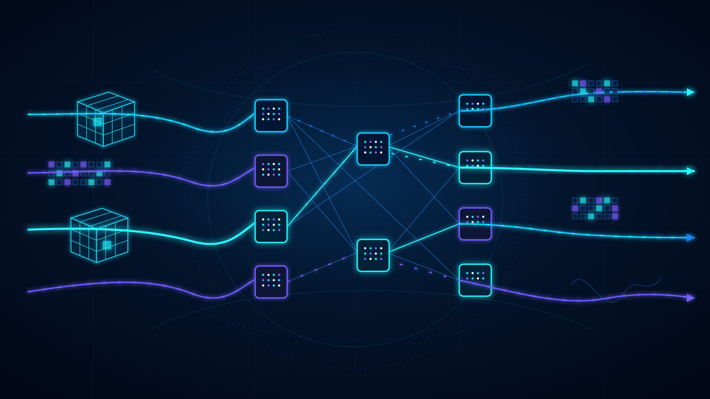

# AI Data Center Systems

> AI data center networking, LLM inference/training, MLOps, storage, and systems performance engineering — study notes.

  

  <a href="https://aidc.restack.tech/"><strong>Read on the web → aidc.restack.tech</strong></a>

## Contents

- [Network](./network/README.md) — RDMA, InfiniBand, RoCE, Clos fabric
- [GPU & Accelerators](./gpu/README.md) — architecture, CUDA, profiling, kernel analysis
- [Storage](./storage/README.md) — AI workload storage, checkpoint/data pipeline
- [Training](./training/README.md) — distributed training, LLM/MoE/LoRA workloads
- [Inference](./inference/README.md) — KV cache, batching, GPU profiling
- [MLOps](./mlops/README.md) — lifecycle, lineage, CI/CD/CT, deployment, monitoring
- [Systems Performance](./systems-performance/README.md) — GPU/CUDA/PyTorch performance engineering
- [Courses](./courses/cme295/README.md) · [Talks](./talks/)

The web wiki adds an AI Q&A panel over these docs and a bilingual (KO/EN) [knowledge graph](https://aidc.restack.tech/) ([3D view](https://aidc.restack.tech/knowledge-graph-3d/)) and plays focus background music 🎧.
