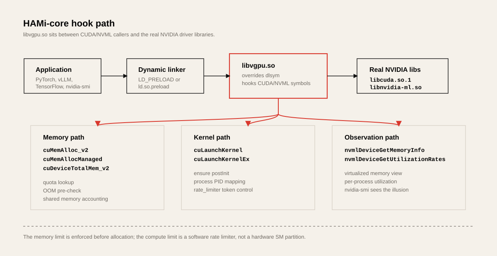

# HAMi-core 심층 분석: `libvgpu.so`는 GPU를 어떻게 나누는가

HAMi의 Kubernetes 구성 요소는 Pod를 배치하고 GPU 메모리·코어 quota를 정한 뒤,
컨테이너에 `libvgpu.so`를 주입한다. 그러나 GPU 분할의 핵심은 그다음에 있다.
컨테이너 안에서 `libvgpu.so`가 CUDA와 NVML 호출 경로에 개입해 애플리케이션이
인식하는 GPU의 크기와 사용할 수 있는 자원을 바꾼다.

HAMi-core는 이 역할을 맡는 컨테이너 내부 GPU 자원 제어기다. 공식 README도
HAMi-core를 CUDA 런타임과 CUDA 드라이버 사이의 API 호출을 가로채는 라이브러리로
설명한다. 이 글에서는 HAMi-core가 만드는 “가상 GPU”가 정확히 어느 지점에서
형성되는지와 그 한계를 코드 경로를 중심으로 살펴본다.

소스 기준은 2026년 7월 7일에 확인한 `Project-HAMi/HAMi` `2487a24`와
`Project-HAMi/HAMi-core` `8f3a89c`다. 구현은 계속 달라질 수 있으므로 세부 함수명보다
제어 흐름과 제한이 적용되는 위치를 파악하는 편이 좋다.

## 한 줄 요약

HAMi-core는 GPU를 하드웨어 수준에서 분할하지 않는다. 대신 컨테이너에
`libvgpu.so`를 미리 로드하고 CUDA 드라이버 API와 NVML API를 후킹해 다음 세 가지를
수행한다.

| 기능 | 구현 위치 | 성격 |
| --- | --- | --- |
| 메모리 가상화 | `cuDeviceTotalMem_v2`, NVML 메모리 조회 훅 | 애플리케이션에 GPU 메모리 크기가 quota인 것처럼 보이게 함 |
| 메모리 제한 | `cuMemAlloc_v2`, `cuMemAllocManaged`, 할당기·사용량 집계 | quota를 초과한 할당을 OOM으로 차단 |
| 연산 스로틀링 | `cuLaunchKernel`, `cuLaunchKernelEx`, `rate_limiter` | 커널 실행 경로에서 소프트웨어 속도 제한 적용 |

가장 중요한 점은 메모리와 연산의 제한 강도가 서로 다르다는 것이다. 메모리 할당은
명시적인 API 이벤트이므로 quota 검사와 사용량 집계를 적용하기 쉽다. 반면 연산은
SM을 물리적으로 분할하는 것이 아니라 커널 실행 시점에 소프트웨어적으로 조절하는
방식에 가깝다.



## Kubernetes에서 컨테이너 안으로 넘어오는 값

HAMi-core는 독립적으로 동작하지 않는다. Kubernetes 측 HAMi Device Plugin이
컨테이너가 시작되기 전에 필요한 값을 주입한다. NVIDIA Device Plugin의 `Allocate`
경로는 non-MIG 모드에서 대략 다음 항목을 컨테이너 응답에 넣는다.

| 주입 항목 | 의미 |
| --- | --- |
| `CUDA_DEVICE_MEMORY_LIMIT_<index>` | 논리 GPU별 메모리 quota. 예: `CUDA_DEVICE_MEMORY_LIMIT_0=12000m` |
| `CUDA_DEVICE_SM_LIMIT` | 연산 사용률 상한. 예: `40` |
| `CUDA_DEVICE_MEMORY_SHARED_CACHE` | 프로세스 간 메모리 사용량 집계에 쓰는 캐시 경로 |
| `CUDA_OVERSUBSCRIBE` | 메모리 배율·초과 할당 설정을 전달 |
| `LIBCUDA_LOG_LEVEL` | HAMi-core 로그 수준 |
| `/usr/local/vgpu/libvgpu.so` 또는 훅 경로의 `libvgpu.so` | 실제 훅 라이브러리 |
| `/etc/ld.so.preload` | 컨테이너 프로세스가 `libvgpu.so`를 먼저 로드하도록 하는 설정 |
| `/tmp/vgpulock` | 여러 프로세스가 공유하는 잠금 디렉터리 |

즉 HAMi 스케줄러가 “이 Pod에는 GPU 메모리 12GB, 코어 40%”를 할당하면, Device
Plugin은 이 결정을 환경 변수와 마운트로 바꿔 컨테이너에 전달한다. HAMi-core는 이
값을 읽어 애플리케이션 프로세스 안에서 제한을 적용하기 시작한다.

이 경계가 HAMi의 핵심이다.

```text
Kubernetes 스케줄러의 결정
  -> Pod annotation
  -> Device Plugin Allocate
  -> 환경 변수·마운트 주입
  -> libvgpu.so 런타임 훅
```

## 훅은 어디에서 적용되는가

HAMi-core의 진입점은 `src/libvgpu.c`다. 여기서 가장 눈에 띄는 부분은 `dlsym` 자체를
재정의한다는 점이다. 많은 CUDA 프레임워크는 CUDA 드라이버 심볼을 직접 연결하거나
`dlsym`으로 찾는다. HAMi-core는 `dlsym(handle, symbol)` 호출을 가로챈 뒤 심볼 이름이
`cu...`로 시작하면 CUDA 훅 테이블을, `nvml...`로 시작하면 NVML 훅 테이블을 먼저
확인한다.

단순화하면 다음과 같다.

```text
애플리케이션이 dlsym("cuMemAlloc_v2") 호출
  -> libvgpu.so의 dlsym 재정의
  -> 심볼이 "cu"로 시작하는지 확인
  -> HAMi-core의 cuMemAlloc_v2 래퍼 반환
  -> 래퍼가 quota 검사·사용량 집계 수행
  -> 허용되면 실제 cuMemAlloc_v2 호출
```

`libvgpu.c`에는 `DLSYM_HOOK_FUNC(cuMemAlloc_v2)`,
`DLSYM_HOOK_FUNC(cuDeviceTotalMem_v2)`, `DLSYM_HOOK_FUNC(cuLaunchKernel)` 같은 항목이
길게 나열되어 있다. 별도의 `src/cuda/hook.c`에 있는 `cuda_library_entry[]`는 후킹할
CUDA 심볼 목록을 관리한다. 이 목록에는 메모리 할당, 컨텍스트, 스트림, 커널 실행,
CUDA 그래프, 가상 메모리 API까지 포함된다.

NVML도 같은 방식으로 후킹한다. `__dlsym_hook_section_nvml()`는
`nvmlDeviceGetMemoryInfo`, `nvmlDeviceGetUtilizationRates`,
`nvmlDeviceGetComputeRunningProcesses` 같은 관측 API를 가로챈다. 따라서 `nvidia-smi`나
프레임워크의 NVML 기반 모니터링도 HAMi-core가 만든 메모리 뷰를 보게 된다.

## 초기화는 두 단계다

HAMi-core의 초기화는 `preInit()`과 `postInit()`로 나뉜다.

| 단계 | 호출 계기 | 주요 작업 |
| --- | --- | --- |
| `preInit()` | CUDA 심볼 조회 또는 `cuInit` 전후 | 로그 초기화, 실제 `dlsym` 확보, 실제 CUDA 라이브러리 로드, 훅 테이블 초기화 |
| `postInit()` | `cuInit` 성공 후 또는 커널 실행 전 `ensure_post_init()` | 할당기 초기화, 가시 장치 매핑, 호스트 PID 탐지, 사용률 감시자 초기화 |

이렇게 초기화를 나누는 이유는 CUDA 프로세스의 실제 상태가 `cuInit` 전후로 다르기
때문이다. CUDA 라이브러리 심볼을 후킹하는 작업은 일찍 해야 하지만, 프로세스가 어떤
GPU context를 만들었는지와 NVML에서 어떤 호스트 PID로 보이는지는 CUDA 초기화 후에야
안정적으로 알 수 있다.

`postInit()`에서 특히 중요한 단계는 호스트 PID 탐지다. 컨테이너 내부 PID와 호스트에서
NVML이 인식하는 PID가 다를 수 있으므로, HAMi-core는 NVML의 실행 중인 프로세스 목록을
비교하고 기본 컨텍스트를 유지한 뒤 새로 나타난 PID를 찾아 사용량 집계에 연결한다.
이 과정이 성공하면 `pidfound=1`이 되고 커널 실행 속도 제한기도 활성화될 수 있다.
실패하면 컨테이너 PID 기반 사용량 집계로 대체한다.

최근 코드에서는 `postInit()`의 호스트 PID 탐지를 공유 메모리 세마포어로 직렬화한다.
별도로 `utils.c`에는 `/tmp/vgpulock/lock`에 `flock()`을 거는 통합 잠금 구현도 남아
있다. 두 동기화 방식은 HAMi-core가 프로세스 로컬 라이브러리이면서도 노드와
프로세스 간 공통 사용량을 집계해야 한다는 구조적 특성을 보여 준다.

## 메모리 가상화: GPU가 작아 보이게 만들기

GPU 메모리 분할에서 첫 번째 가상화 효과는 “이 GPU의 총 메모리가 quota만큼만 있는
것처럼 보이게 하는 것”이다. 예를 들어 물리 GPU가 80GB여도 Pod가 `gpumem: 12000`을
받았다면, 애플리케이션은 12GB GPU를 받은 것처럼 동작해야 한다.

CUDA driver API 쪽에서는 `cuDeviceTotalMem_v2` hook이 이 역할을 한다. 원래 함수는
물리 GPU의 total memory를 돌려주지만, HAMi-core wrapper는
`get_current_device_memory_limit(dev)` 값을 `bytes`에 넣고 `CUDA_SUCCESS`를 반환한다.

이는 애플리케이션 호환성에 중요하다. 많은 프레임워크는 모델을 적재하기 전에
`total_memory`를 보고 배치 크기, 작업 공간, 캐시 정책을 결정한다. 여기서 물리 GPU의
전체 메모리가 보이면 프레임워크가 quota보다 큰 계획을 세우고 나중에 OOM을 만날 수
있다.

NVML 훅도 같은 이유로 필요하다. `nvidia-smi`와 모니터링 에이전트가 보는 메모리의
total/used/free 값이 quota와 맞아야 사용자 경험과 과금 지표가 일관된다.

하지만 이 단계는 어디까지나 관측값을 가상화하는 것이다. 실제 물리 GPU 메모리가
분할되어 별도의 주소 공간이 생긴 것은 아니다. 실제 제한은 할당 경로에서 적용된다.

## 메모리 제한: 할당 전에 OOM을 반환한다

메모리 quota 적용의 중심은 `src/cuda/memory.c`와 `src/allocator/allocator.c`다.

대표 경로는 다음과 같다.

```text
cuMemAlloc_v2(dptr, bytesize)
  -> ENSURE_RUNNING()
  -> allocate_raw()
  -> add_chunk()
  -> oom_check(dev, bytesize)
  -> real cuMemAlloc_v2 or cuMemoryAllocate
  -> add_gpu_device_memory_usage()
```

`oom_check(dev, addon)`는 현재 장치 메모리 사용량과 quota를 비교한다. 새 할당을
더했을 때 한도를 넘으면 `CUDA_ERROR_OUT_OF_MEMORY` 계열 오류를 반환한다. 애플리케이션
입장에서는 일반적인 CUDA OOM처럼 보인다.

최근 할당기 구현에서 눈에 띄는 점은 비용이 큰 GPU 할당을 잠금 밖에서 수행하려는
구조다. `add_chunk()`는 먼저 OOM 사전 검사를 하고 실제 `cuMemAlloc_v2` 또는
`cuMemoryAllocate`를 호출한 뒤, 추적 목록과 공유 사용량 갱신은 mutex 안에서 처리한다.
중간에 다른 프로세스가 메모리를 사용했을 수 있으므로 추적 직전에 OOM 검사를 한 번
더 수행하고, 한도를 넘으면 방금 받은 할당을 해제한다.

이 설계에는 다음과 같은 절충점이 있다.

| 선택 | 장점 | 남는 위험 |
| --- | --- | --- |
| 할당 전 OOM 사전 검사 | quota 초과를 빠르게 차단 | 검사와 실제 할당 사이에 경쟁 상태가 생길 수 있음 |
| GPU 할당을 잠금 밖에서 수행 | 전역 잠금 유지 시간 감소 | 추적 직전 재검사가 필요함 |
| 공유 사용량 집계 | 여러 프로세스를 하나의 quota 아래 묶을 수 있음 | 종료된 프로세스 슬롯 정리와 잠금 경합이 필요함 |

`cuMemAllocManaged`, `cuMemAllocPitch_v2`, 호스트 메모리 할당 계열도 별도의 래퍼를
갖는다. 모든 CUDA 메모리 API가 완전히 같은 정확도로 집계되는 것은 아니므로, 새 CUDA
API가 추가될 때는 훅 테이블과 할당기 경로도 함께 따라가야 한다. HAMi-core에 CUDA
훅 일관성을 검사하는 스크립트가 있는 이유도 여기에 있다.

## 다중 프로세스 사용량 집계: 공유 영역이 필요한 이유

하나의 Pod 안에서도 GPU 프로세스는 여러 개일 수 있다. Python 데이터 로더, 모델 워커,
vLLM 엔진 프로세스, 프레임워크 자식 프로세스가 모두 GPU 메모리를 사용할 수 있다.
quota가 컨테이너 단위라면 프로세스별 사용량을 합산해야 한다.

HAMi-core는 이를 위해 공유 메모리 영역과 세마포어를 사용한다. `multiprocess`
디렉터리에는 메모리 한도, 사용률 감시자, 공유 영역 도구가 분리되어 있다. 핵심은
프로세스 로컬 할당기 목록만으로는 충분하지 않다는 점이다.

```text
프로세스 A가 4GB 할당
프로세스 B가 5GB 할당
프로세스 C가 6GB 할당 시도

quota = 12GB
현재 사용량 = 9GB
C는 지금까지 0GB를 할당했더라도 실패해야 함
```

따라서 할당 경로는 프로세스별 로컬 목록과 공유 사용량을 함께 갱신한다. 프로세스가
종료될 때는 종료 처리기가 슬롯을 정리해야 하며, 비정상 종료가 발생하면 오래된
슬롯을 정리해야 한다. `oom_check()`가 한도 초과 시 `clear_proc_slot` 계열 정리를
시도하는 이유도 여기에 있다.

운영 관점에서는 이 구조가 두 가지를 의미한다.

첫째, HAMi-core는 GPU 메모리 quota를 프로세스 로컬 한도로만 구현하지 않는다. 같은
quota를 공유하는 여러 프로세스를 함께 보기 때문에 추론 워커 풀과 같은
워크로드에 적합하다.

둘째, 공유 사용량 집계에서는 잠금과 정리 문제를 피할 수 없다. 고밀도 워크로드에서
많은 프로세스가 동시에 `cuInit`이나 메모리 할당을 수행하면, 시작 지연 시간이나
할당 지연 시간이 커질 수 있다.

## 연산 제한: SM 파티션이 아니라 속도 제한기다

`CUDA_DEVICE_SM_LIMIT` 또는 HAMi의 `gpucores`는 이름 때문에 하드웨어 SM 파티션처럼
오해하기 쉽다. 그러나 HAMi-core의 non-MIG 경로는 그렇게 동작하지 않는다.

커널 실행 래퍼를 보면 `cuLaunchKernel`과 `cuLaunchKernelEx`는
`ensure_post_init()`, `pre_launch_kernel()`, `rate_limiter(...)`를 거친 뒤 실제 CUDA
실행 함수를 호출한다. `rate_limiter`는 현재 장치, grid 수, block 수, 캐시된 SM 한도,
사용률 정책을 바탕으로 소프트웨어 토큰을 조정한다.

중요한 점은 이 제한이 “SM의 40%를 이 컨테이너에 독점 배정한다”는 뜻이 아니라는
것이다.
더 정확한 표현은 다음과 같다.

```text
커널 실행 흐름을 관찰하고 지연시켜
장기 평균 연산 사용량이 설정한 한도 부근에 머물도록 유도한다.
```

따라서 메모리 quota와 연산 quota의 실패 양상은 서로 다르다.

| 항목 | 메모리 quota | 연산 quota |
| --- | --- | --- |
| 개입 지점 | 할당 API | 커널 실행 API |
| 실패 형태 | `CUDA_ERROR_OUT_OF_MEMORY` | 실행 지연, 처리량 감소 |
| 강제력 | 비교적 명확함 | 워크로드 특성에 민감한 소프트 한도 |
| 하드웨어 격리 | 없음 | 없음 |
| 주요 관찰 지표 | 최대 메모리 사용량, OOM, 모델 적재 성공률 | p95/p99 지연 시간, 처리량, 인접 워크로드 영향 |

짧고 큰 커널을 드문드문 실행하는 워크로드와 작은 커널을 매우 자주 실행하는
워크로드는 같은 `gpucores` 값에서도 체감 성능이 다를 수 있다. 속도 제한기가 커널
실행 경로에 있기 때문이다.

## NVML 훅: `nvidia-smi`가 보는 세계

HAMi-core가 CUDA만 후킹했다면 애플리케이션의 메모리 할당은 제한할 수 있어도,
사용자와 운영자가 보는 GPU 상태는 물리 GPU 그대로였을 것이다. NVML 훅이 중요한
이유다.

NVML은 `nvidia-smi`, DCGM 계열 익스포터, 프레임워크 모니터링 코드가 GPU 상태를 읽는
주요 경로다. HAMi-core는 `nvmlDeviceGetMemoryInfo`, `nvmlDeviceGetUtilizationRates`,
`nvmlDeviceGetComputeRunningProcesses` 등 다수의 NVML 심볼을 후킹한다.

이 hook은 두 가지 목적을 갖는다.

| 목적 | 설명 |
| --- | --- |
| 사용자 경험 | 컨테이너 안의 `nvidia-smi`가 quota 기준 메모리를 표시하게 함 |
| 사용량 집계 | 호스트 PID, 프로세스 사용률, 메모리 사용량을 HAMi-core 공유 상태와 연결 |

이 때문에 HAMi-core는 “제한기”이면서 동시에 “관측값 변환기”이기도 하다. GPU를
실제로 나누는 것만큼, 사용자가 분할된 GPU를 받은 것처럼 보이게 만드는 일도
중요하다.

## 어디까지 믿을 수 있는 격리인가

HAMi-core의 구조를 보면 격리 수준을 과대평가하면 안 된다는 결론이 자연스럽게 나온다.

| 경계 | HAMi-core non-MIG에서의 의미 |
| --- | --- |
| 메모리 용량 | CUDA 할당 경로에서 quota를 적용 |
| SM·연산 | 커널 실행 경로에서 소프트 스로틀링 |
| L2 캐시·메모리 대역폭 | 강한 분리 없음 |
| PCIe/NVLink 대역폭 | 강한 분리 없음 |
| 장애 격리 | MIG/vGPU 같은 하드웨어·가상화 경계보다 약함 |
| 보안 경계 | 신뢰할 수 없는 테넌트 사이의 강한 경계로 보기 어려움 |

즉 HAMi-core는 사용률 개선과 운영상 quota 적용에는 매우 유용하지만 하드웨어
파티션은 아니다. 외부 고객이 섞이는 클라우드 테넌시, 강한 장애 격리, 인접 워크로드
간섭 차단이 중요하다면 MIG, vGPU, SR-IOV 같은 백엔드를 별도로 검토해야 한다.

반대로 같은 조직 안의 추론 서비스, 노트북, 배치 추론, 작은 모델 서빙 환경에서는
이러한 절충점은 꽤 매력적이다. 전체 GPU를 할당하면 낭비될 VRAM을 작은 quota로
나누고, 애플리케이션을 거의 수정하지 않은 채 기존 CUDA 프레임워크를 실행할 수 있기
때문이다.

## 실험으로 확인할 것

HAMi-core를 평가할 때는 문서의 기능 목록보다 실패 양상을 직접 확인하는 편이 낫다.

| 실험 | 확인할 것 |
| --- | --- |
| `cuDeviceTotalMem` 확인 | quota를 바꾸면 프레임워크와 `nvidia-smi`가 보는 총 메모리도 바뀌는가 |
| 할당 OOM | quota보다 큰 `cuMemAlloc`이 물리 여유와 무관하게 실패하는가 |
| 다중 프로세스 quota | 프로세스 A/B/C의 합산 메모리가 quota를 넘을 때 C가 실패하는가 |
| 비정상 종료 정리 | GPU 프로세스 강제 종료 후 오래된 사용량 기록이 정리되는가 |
| 커널 스로틀링 | `gpucores` 값을 바꾸면 처리량과 p99 지연 시간이 어떻게 변하는가 |
| 동시 기동 부하 | 수십~수백 개 프로세스가 동시에 `cuInit`을 호출할 때 지연 시간이 급증하는가 |
| NVML 일관성 | 컨테이너 내부 `nvidia-smi`, DCGM 익스포터, 프레임워크 지표가 서로 맞는가 |
| 우회 경로 | `/etc/ld.so.preload`, 정적 링크, 특권 컨테이너 같은 우회 경로를 통제하는가 |

특히 추론 플랫폼에서는 평균 처리량보다 꼬리 지연 시간을 봐야 한다. HAMi-core의
연산 제한은 커널 실행 경로의 소프트웨어 제어이므로, 인접 워크로드가 있을 때
p95/p99가 얼마나 흔들리는지가 실제 사용자 경험을 더 잘 보여 준다.

## 운영 팁

첫째, HAMi-core quota는 명목상 SKU 용량에만 맞추지 말고 워크로드의 최대 메모리
사용량을 기준으로 정해야 한다. LLM 서빙에서는 모델 가중치, KV 캐시, CUDA 그래프
캡처, 작업 공간, 메모리 할당기 단편화가 모두 최대 사용량에 영향을 준다.

둘째, `CUDA_DEVICE_SM_LIMIT`를 SLA로 표현하지 않는 편이 좋다. 사용자에게 “SM 40%를
독점”한다고 말하면 오해를 낳는다. “연산 사용량에 소프트 한도를 적용한다”는 운영
문구가 더 정확하다.

셋째, 노드 풀을 분리하는 편이 낫다. HAMi-core 소프트웨어 분할 노드와 MIG 노드,
전체 GPU 노드를 섞으면 스케줄러 정책과 사용자 기대가 복잡해진다. 워크로드
클래스별로 노드 풀을 분리하면 실패 양상도 단순해진다.

넷째, 관측 체계를 HAMi 기준으로 맞춰야 한다. 물리 GPU 전체 사용률만 보면 플랫폼
효율은 보이지만 테넌트별 quota 준수 여부는 알 수 없다. Pod별 요청 quota, 실제 메모리
사용량, OOM, 시작 지연 시간, p99 지연 시간을 함께 봐야 한다.

다섯째, CUDA 버전을 올릴 때는 훅 적용 범위를 확인해야 한다. CUDA 드라이버 API가
늘어나거나 프레임워크가 새로운 할당 경로를 사용하면, 훅 테이블과 사용량 집계 경로가
이를 따라가지 못할 수 있다.

## 결론

HAMi-core의 본질은 “CUDA/NVML을 속이는 라이브러리”가 아니라 Kubernetes가 정한 GPU
quota를 CUDA 프로세스 내부에서 실행 가능한 정책으로 바꾸는 런타임 제한 계층이다.
메모리는 관측값 가상화와 할당 시점의 OOM으로 비교적 직접적으로 제한한다. 연산은
커널 실행 경로에서 속도를 제한하는 소프트웨어 제어다.

그래서 HAMi-core를 평가할 때는 “GPU를 쪼갠다”는 말보다 다음 질문이 더 정확하다.

```text
이 워크로드의 메모리 할당 경로와 커널 실행 패턴을
libvgpu.so가 안정적으로 관찰하고 제한할 수 있는가?
```

이 질문에 “그렇다”라고 답할 수 있다면 HAMi-core는 GPU 사용률을 크게 높일 수 있다.
그렇지 않다면 MIG, vGPU, 전체 GPU 할당, 워크로드 수준의 배칭·배치를 다시 검토해야
한다.

## 참고 자료

- [Project-HAMi/HAMi-core](https://github.com/Project-HAMi/HAMi-core)
- [HAMi-core README](https://github.com/Project-HAMi/HAMi-core/blob/master/README.md)
- [HAMi-core `src/libvgpu.c`](https://github.com/Project-HAMi/HAMi-core/blob/master/src/libvgpu.c)
- [HAMi-core `src/cuda/memory.c`](https://github.com/Project-HAMi/HAMi-core/blob/master/src/cuda/memory.c)
- [HAMi-core `src/allocator/allocator.c`](https://github.com/Project-HAMi/HAMi-core/blob/master/src/allocator/allocator.c)
- [HAMi-core multiprocess memory limit](https://github.com/Project-HAMi/HAMi-core/blob/master/src/multiprocess/multiprocess_memory_limit.c)
- [HAMi NVIDIA device plugin allocation path](https://github.com/Project-HAMi/HAMi/blob/master/pkg/device-plugin/nvidiadevice/nvinternal/plugin/server.go)
