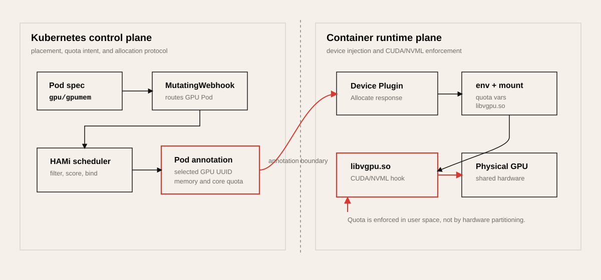
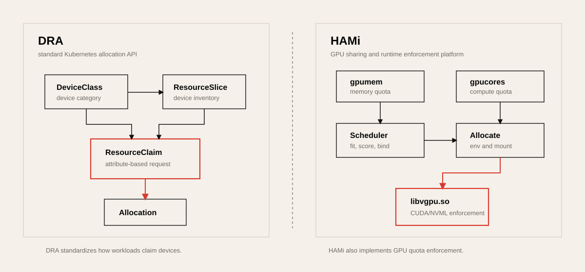

# DRA와 HAMi로 보는 Kubernetes GPU 분할

Kubernetes에서 GPU를 나누어 쓰려면 두 가지 문제를 풀어야 한다.

첫째, “어떤 GPU를 어떤 Pod에 할당할 것인가?” 둘째, “하나의 GPU 안에서 메모리와
연산 사용량을 실제로 어떻게 제한할 것인가?” Dynamic Resource Allocation(DRA)은
첫 번째 문제를 Kubernetes 표준 API로 해결하려는 체계다. HAMi는 두 번째 문제까지
아우르며 실제 GPU 공유 플랫폼으로 동작하는 구현체다.

```text
DRA  = Kubernetes가 장치를 지능적으로 선택하는 표준 할당 API
HAMi = GPU 메모리·코어 공유, 스케줄링, 런타임 제한을 아우르는 운영 플랫폼
```

이 차이를 놓치면 “DRA가 있으니 HAMi는 필요 없는가?”라는 의문이 생기기 쉽다.
결론부터 말하면 그렇지 않다. DRA가 vGPU를 자동으로 만들어 주는 것은 아니다.
DRA 드라이버나 백엔드가 장치 인벤토리를 게시하고, claim을 해석하며, 실제 런타임
제한을 구현해야 한다. HAMi는 이러한 백엔드 역할의 상당 부분을 Device Plugin,
Scheduler Extender, admission webhook, `libvgpu.so`로 이미 구현한 프로젝트다.

## 기존 Device Plugin의 한계

Kubernetes Device Plugin 모델은 GPU를 클러스터 자원으로 노출하는 데 성공했지만,
기본적으로 표현할 수 있는 것은 장치의 “개수”에 가깝다.

```yaml
resources:
  limits:
    nvidia.com/gpu: 1
```

이 모델만으로는 다음 요구를 자연스럽게 표현하기 어렵다.

| 필요한 판단 | Device Plugin 기본 모델의 한계 |
| --- | --- |
| VRAM이 24GiB 이상인 GPU 선택 | 스케줄러가 장치 속성을 표준 방식으로 확인할 수 없음 |
| H100 또는 A100만 선택 | 벤더별 annotation이나 scheduler extender가 필요함 |
| NVLink·토폴로지 조건 반영 | 기본 자원 개수만으로는 표현하기 어려움 |
| 특정 MIG 프로파일 선택 | 별도의 플러그인 정책이나 사용자 정의 자원이 필요함 |
| 여러 Pod가 같은 claim을 공유 | 컨테이너별 장치 요청 중심이라 표현력이 부족함 |

이 때문에 많은 GPU 플랫폼은 Node annotation, scheduler extender, admission webhook,
사용자 정의 자원을 조합해 장치 정보를 보완해 왔다. HAMi도 이 계열에 속한다.

## DRA가 표준화하려는 것

DRA를 사용하면 Kubernetes가 장치를 단순한 “정수 개수”가 아니라 “속성 조건에 따라
요청할 수 있는 대상”으로 다룰 수 있다. Kubernetes 공식 문서에 따르면 DRA 핵심 기능은
`resource.k8s.io/v1` API 그룹의 `DeviceClass`, `ResourceClaim`,
`ResourceClaimTemplate`, `ResourceSlice`를 사용하며, Kubernetes v1.35부터
안정화된 기능으로 표시되어 있다.

핵심 객체는 다음처럼 볼 수 있다.

| 객체 | 의미 |
| --- | --- |
| `DeviceClass` | 클러스터 관리자가 제공하는 장치 종류. 예: `h100-highmem`, `cost-optimized-gpu` |
| `ResourceClaim` | 워크로드가 요구하는 장치 claim |
| `ResourceClaimTemplate` | Deployment나 Job처럼 Pod마다 독립된 claim이 필요할 때 사용하는 템플릿 |
| `ResourceSlice` | DRA 드라이버가 API 서버에 게시하는 실제 노드·장치 인벤토리 |

사용자는 “GPU 1개” 대신 “특정 class에 속하면서 주어진 attribute 조건을 충족하는
장치”를 요청할 수 있다. 예를 들면 다음과 같다.

```yaml
apiVersion: resource.k8s.io/v1
kind: ResourceClaimTemplate
metadata:
  name: h100-inference
spec:
  spec:
    devices:
      requests:
      - name: gpu
        exactly:
          deviceClassName: h100-highmem
```

이 모델의 장점은 표준성이다. GPU뿐 아니라 NPU, FPGA, DPU, SmartNIC 같은 장치를
하나의 API 계열로 다룰 수 있다. 장기적인 관점에서 플랫폼 API를 새로 설계한다면,
사용자에게 벤더별 annotation을 직접 노출하기보다 DRA 방식의 claim 모델을
고려하는 편이 바람직하다.

하지만 DRA 자체가 GPU 메모리 quota를 강제하거나 SM 사용량을 조절하고 CUDA 호출을
가로채는 것은 아니다. DRA는 할당 API이며, 실제 제한은 드라이버와 백엔드가
책임진다.

## HAMi가 실제로 하는 일

HAMi는 Kubernetes에서 GPU를 더 작은 단위로 공유하기 위해 여러 확장 지점을 함께
사용한다.



사용자는 기존 Kubernetes 자원 제한과 비슷한 문법으로 GPU를 요청한다.

```yaml
resources:
  limits:
    nvidia.com/gpu: 1
    nvidia.com/gpumem: 12000
    nvidia.com/gpucores: 40
```

HAMi의 non-MIG 동작 경로를 단순화하면 다음과 같다.

1. Device Plugin이 물리 GPU 하나를 여러 개의 논리 GPU 슬롯처럼 kubelet에 알린다.
2. Scheduler Extender가 Node annotation에 담긴 GPU 메모리, 코어, 모델, 상태 정보를
   바탕으로 Pod를 배치한다.
3. 선택 결과를 Pod annotation으로 남긴다.
4. Device Plugin의 `Allocate`가 annotation을 읽고 컨테이너에 장치, 환경 변수,
   마운트를 주입한다.
5. 컨테이너 안의 `libvgpu.so`가 CUDA/NVML 호출 경로를 후킹해 VRAM quota와
   연산 제한을 적용한다.

핵심은 마지막 단계다. HAMi의 소프트웨어 기반 GPU 공유는 MIG처럼 하드웨어를
물리적으로 분할하지 않는다. Kubernetes 컨트롤 플레인에서는 replica ID와
annotation을 사용해 GPU가 “나뉜 것처럼” 보이게 하고, 런타임에서는 `libvgpu.so`가
CUDA/NVML 경로를 가로채 제한을 적용한다.

## HAMi 구현 경로를 조금 더 자세히 보면

HAMi를 단순히 “GPU를 쪼개는 도구”라고 설명하면 중요한 부분을 놓치게 된다. 실제로는
Kubernetes 컨트롤 플레인과 컨테이너 내부의 런타임 훅이 정해진 프로토콜로 연결된
구조다. 컨트롤 플레인은 각 Pod가 사용할 물리 GPU와 논리 슬롯을 결정하고,
런타임 플레인은 컨테이너 안에서 해당 quota를 강제한다.

| 계층 | 대표 모듈 | 하는 일 |
| --- | --- | --- |
| 설정 | `cmd/device-plugin/nvidia/vgpucfg.go` | `deviceSplitCount`, 메모리·코어 배율, 코어 제한 비활성화 등의 옵션을 정의 |
| admission | `pkg/scheduler/webhook.go` | GPU 자원을 요청한 Pod를 감지해 HAMi 스케줄러 경로로 전달 |
| 스케줄러 캐시 | `pkg/scheduler/scheduler.go`, `pkg/scheduler/nodes.go` | Node annotation과 Pod 할당 상태를 모아 전체 GPU 현황을 유지 |
| 스케줄러 정책 | `pkg/scheduler/score.go`, `pkg/scheduler/policy/*` | 노드·장치 적합성, binpack·spread 점수, 메모리·코어 단편화를 계산 |
| 장치 모델 | `pkg/device-plugin/nvidiadevice/nvinternal/rm/devices.go` | 물리 GPU의 replica ID, 메모리, NUMA, 상태 정보를 관리 |
| 할당 | `pkg/device-plugin/nvidiadevice/nvinternal/plugin/server.go` | kubelet의 `Allocate` 요청에 장치, 환경 변수, 마운트 정보로 응답 |
| 런타임 훅 | `libvgpu` / `HAMi-core` | CUDA/NVML API를 후킹해 메모리 quota와 연산 제한을 적용 |
| 동적 MIG | NVIDIA MIG 관련 관리자 및 `mig-parted` 연동 | 소프트웨어 분할 대신 하드웨어 MIG 인스턴스를 조정 |

이 표에서 가장 중요한 경계는 스케줄러와 Device Plugin 사이다. 일반적인 Kubernetes
스케줄러는 Device Plugin이 선택한 개별 장치의 세부 정보를 충분히 전달할 수 없다.
따라서 HAMi는 Pod annotation을 내부 프로토콜처럼 사용한다. 스케줄러는 “이 Pod가
이 GPU UUID에서 사용할 메모리와 코어의 양”을 annotation에 기록하고, Device
Plugin은 kubelet의 `Allocate` 호출 시 이 값을 읽어 실제 컨테이너 응답을 만든다.

즉 HAMi의 컨트롤 플레인은 다음 세 가지 문제를 동시에 해결한다.

| 문제 | HAMi의 처리 |
| --- | --- |
| Kubernetes에는 GPU 개수만 보이는 문제 | Device Plugin이 여러 개의 논리 replica로 등록 |
| 스케줄러가 VRAM·코어 잔여량을 모르는 문제 | Node annotation에 장치 인벤토리와 사용량을 유지 |
| kubelet 할당 단계에 quota 정보가 부족한 문제 | Pod annotation을 통해 스케줄러의 결정 결과를 Device Plugin에 전달 |

이 구조는 실용적이지만 표준 API만으로 완결되지는 않는다. 장기적으로 DRA가
매력적인 이유도 여기에 있다. DRA의 `ResourceSlice`와 `ResourceClaim`은 이러한
annotation 프로토콜을 Kubernetes API 안에서 표준화하려는 방향을 보여 준다.

## 스케줄링의 핵심은 개수가 아니라 단편화다

HAMi 스케줄러가 살피는 핵심 자원은 단순한 `nvidia.com/gpu` 개수가 아니다.
각 GPU에는 남은 논리 슬롯과 메모리, 코어 비율이 있으며, 스케줄러 정책은 이를
바탕으로 노드와 장치를 선택한다.

예를 들어 80GB GPU 한 장을 논리 슬롯 10개로 게시하더라도 모든 슬롯의 상태가
같지는 않다. 어떤 Pod는 4GB만 사용하고, 다른 Pod는 40GB를 사용하며, 또 다른
Pod는 코어 100%를 요구할 수 있다. 이때 스케줄러가 풀어야 할 문제는 “남은 슬롯이
몇 개인가”가 아니라 다음 질문에 가깝다.

```text
이 Pod의 gpumem/gpucores 요청을 넣었을 때
어느 노드와 물리 GPU에서 단편화가 가장 적게 발생하는가?
```

HAMi의 binpack/spread 정책은 이 판단을 바꾼다.

| 정책 | 직관 | 적합한 상황 |
| --- | --- | --- |
| `binpack` | 이미 사용 중인 GPU나 노드에 더 채워 넣음 | 빈 GPU·노드를 남겨 큰 작업을 수용할 가능성을 높이고 싶을 때 |
| `spread` | 여러 GPU나 노드에 분산 | 인접 워크로드 간 경합과 발열·전력 집중을 줄이고 싶을 때 |

따라서 HAMi를 도입할 때는 “논리 GPU가 몇 개 생겼는가”보다 “작은 Pod들이 메모리와
코어를 어떻게 단편화하는가”를 살펴야 한다. 작은 추론 Pod를 무작정 많이 배치하면
평균 사용률은 높아질 수 있지만, 나중에 큰 모델을 올릴 연속된 VRAM 공간이 부족해질
수 있다. 이는 Kubernetes의 CPU 스케줄링에서 나타나는 단편화와 비슷하지만,
GPU에서는 VRAM이 훨씬 직접적인 상한으로 작용한다.

## Device Plugin `Allocate`가 주입하는 것

HAMi의 실제 제한은 kubelet이 Device Plugin의 `Allocate`를 호출한 뒤부터 적용된다.
이때 Device Plugin은 컨테이너에 GPU 장치 파일만 넘기는 것이 아니라 HAMi 런타임에
필요한 환경 변수와 마운트도 함께 주입한다.

대표적으로 중요한 값은 다음과 같다.

| 주입 항목 | 의미 |
| --- | --- |
| `CUDA_DEVICE_MEMORY_LIMIT_<index>` | 컨테이너가 해당 논리 GPU에서 인식할 메모리 quota |
| `CUDA_DEVICE_SM_LIMIT` | `gpucores` 요청으로 지정한 연산 quota |
| `CUDA_OVERSUBSCRIBE` | 초과 할당 설정의 활성화 여부를 런타임에 전달 |
| `LIBCUDA_LOG_LEVEL` | HAMi-core 로그 수준 |
| `libvgpu.so` 마운트 | CUDA/NVML 호출을 후킹하는 런타임 라이브러리 |
| 공유 캐시·잠금 디렉터리 | 여러 프로세스의 사용량 집계와 초기화 동기화에 사용 |

이러한 주입 방식 덕분에 HAMi는 애플리케이션 코드를 변경하지 않고도 동작한다.
사용자는 PyTorch, vLLM, TensorFlow 코드를 수정할 필요가 없다. 컨테이너가 시작되면
HAMi-core가 동적 링커와 CUDA 드라이버 API 경로에 먼저 개입한다.

그러나 이는 동시에 HAMi의 한계이기도 하다. 하드웨어 레지스터나 GPU 펌웨어의 독립된
파티션이 아니라 사용자 공간의 라이브러리 훅으로 제한을 적용하기 때문이다. 따라서
HAMi non-MIG의 quota는 운영에는 유용하지만 보안 경계로 간주해서는 안 된다.

## `libvgpu.so`가 제한하는 방식

HAMi-core는 CUDA/NVML 호출 경로를 가로채 두 종류의 가상화 효과를 만든다.

첫째는 관측값의 가상화다. 컨테이너 안에서 `nvidia-smi`나 NVML 메모리 조회를
실행하면 물리 GPU의 전체 VRAM이 아니라 quota에 맞춘 값이 표시되도록 할 수 있다.
사용자에게는 “12GB GPU”처럼 보이지만, 실제로는 80GB 물리 GPU의 일부를 사용하는
것이다.

둘째는 할당량 제한이다. `cuMemAlloc_v2`, `cuMemAllocManaged`,
`cuMemoryAllocate` 같은 메모리 할당 함수가 호출되기 전에 현재 사용량과 quota를
비교하고, 한도를 넘으면 CUDA OOM과 유사한 오류를 반환한다. 메모리 할당 요청은
개별 이벤트로 발생하므로 사전 검사와 사용량 집계를 적용하기가 비교적 쉽다.

연산 제한은 이보다 더 미묘하다. SM을 하드웨어 수준에서 분할하지 않고 커널 실행,
사용률 샘플링, 토큰 또는 스로틀링 계열의 정책으로 장기 평균 사용량을 조절하는
방식에 가깝다. 따라서 `gpucores: 40`은 “SM의 40%를 이 Pod에 독점 할당한다”는
뜻이 아니다. 정확히는 “HAMi 런타임이 이 워크로드의 장기 평균 연산 사용량을 40%
안팎으로 제한하려 한다”는 의미에 가깝다.

이 차이는 지연 시간에 민감한 추론 워크로드에서 특히 중요하다.

| 자원 | 제한 성격 | 관찰해야 할 지표 |
| --- | --- | --- |
| VRAM | quota를 초과한 할당을 비교적 명확하게 차단 | 할당 실패, 모델 적재 실패, 최대 메모리 사용량 |
| 연산 | 소프트 스로틀링과 스케줄링의 영향이 큼 | 처리량, p95/p99 지연 시간, 인접 워크로드의 영향 |
| PCIe/NVLink | HAMi quota로 직접 분리되지 않음 | H2D/D2H 복사 시간, NCCL 지연 시간, DMA 경합 |
| L2 캐시·메모리 대역폭 | 소프트웨어 분할로 강하게 격리하기 어려움 | 커널 실행 시간 편차, 실효 대역폭, 꼬리 지연 시간 |

따라서 HAMi를 단순한 “VRAM 분할” 용도로 사용할 때와 “연산 격리”까지 기대할 때는
검증 수준을 달리해야 한다.

## 동적 MIG는 같은 제품 안의 또 다른 백엔드다

HAMi가 MIG를 지원하더라도 non-MIG 방식의 `libvgpu.so` 분할과 MIG가 같은 격리
모델인 것은 아니다. 두 방식은 하나의 운영 프레임워크 안에서 제공될 수 있지만,
자원이 분할되는 위치가 서로 다르다.

```text
HAMi non-MIG:
Kubernetes replica + annotation + libvgpu.so 훅

HAMi 동적 MIG:
HAMi 컨트롤 플레인 + MIG 프로파일·인스턴스 조정 + 하드웨어 파티션
```

MIG 지원 GPU에서는 하드웨어 GPU 인스턴스가 생성되므로 장애 격리와 자원 예측
가능성이 non-MIG 소프트웨어 분할보다 높다. 반면 프로파일 단위가 고정되어 있으며,
동적으로 재구성할 때는 기존 워크로드의 재배치와 드레인, 프로파일 전환 비용을
고려해야 한다.

운영적으로는 다음처럼 구분하는 편이 명확하다.

| 요구 사항 | 더 적합한 백엔드 |
| --- | --- |
| 4GB, 8GB처럼 세분화된 SKU를 다양하게 구성하고 싶음 | HAMi non-MIG |
| 같은 조직의 개발·추론 워크로드를 혼합해 사용률을 높이고 싶음 | HAMi non-MIG |
| 테넌트 간 장애 전파와 성능 간섭을 크게 줄이고 싶음 | MIG |
| A100/H100에서 프로파일 기반 분할을 자동화하고 싶음 | HAMi 동적 MIG |
| VM 상품이나 외부 고객을 위한 보안 경계가 중요함 | vGPU/SR-IOV 계열 |

## DRA와 HAMi의 차이

| 관점 | DRA | HAMi |
| --- | --- | --- |
| 성격 | Kubernetes 표준 API·프레임워크 | GPU 공유 구현체·운영 플랫폼 |
| 핵심 목적 | 속성 기반 장치 할당 | GPU 메모리·코어 단위의 공유와 스케줄링 |
| 실제 VRAM 제한 | DRA 자체는 하지 않음 | `libvgpu.so` 훅으로 제한 |
| 연산 제한 | DRA 자체는 하지 않음 | `gpucores` 기반 소프트 스로틀링 |
| 스케줄러 통합 | kube-scheduler 및 표준 API와 통합 | scheduler extender와 annotation 중심 |
| 사용자 경험 | `ResourceClaim`, `DeviceClass` | `nvidia.com/gpumem`, `nvidia.com/gpucores` |
| 멀티 벤더 지원 | 표준 API에는 적합하지만 드라이버 생태계가 필요함 | 여러 가속기 백엔드를 직접 지원하는 방향 |
| 초과 할당 | DRA 자체 기능은 아님 | HAMi의 주요 기능 중 하나 |
| 격리 강도 | 백엔드에 따라 다름 | non-MIG는 소프트웨어 훅 기반이므로 보안 경계로는 약함 |

따라서 두 기술은 경쟁 관계라기보다 서로 다른 계층을 담당한다. DRA는 Kubernetes가
장치를 표현하고 요청하는 표준 언어로 자리 잡을 가능성이 높다. HAMi는 그 위나
옆에서 실제 GPU 공유와 사용량 제한을 제공하는 백엔드 또는 플랫폼 역할을 한다.

HAMi 프로젝트도 이러한 흐름을 반영하고 있다. HAMi-DRA 하위 프로젝트는 기존
HAMi 사용자가 Device Plugin 기반 요청에서 DRA 기반 요청으로 전환할 수 있게 하는
경로로 볼 수 있다. 다만 현재 운영 환경에서는 기존 HAMi 자원 모델이 더 직관적이며,
SKU, quota, 과금, RBAC 체계와 연결하기도 쉽다.



## 클라우드 사업자가 HAMi를 먼저 쓸 이유

클라우드나 사내 AI 플랫폼에서 흔히 원하는 운영 모델은 다음과 같다.

```text
80GB GPU 한 장을
4GB / 8GB / 16GB / 40GB 같은 상품이나 quota 단위로 나누고 싶다.
```

또는:

```text
여러 개의 작은 추론 워크로드를 한 GPU에 배치하되,
각 Pod가 지정된 VRAM quota를 넘지 못하게 하고 싶다.
```

DRA만으로는 이러한 운영 모델을 곧바로 구현할 수 없다. DRA 호환 드라이버가 논리
장치나 소비 가능한 용량을 표현하고 런타임 제한까지 구현해야 한다. HAMi는 이미
`gpumem`, `gpucores`, 스케줄러, `libvgpu.so`를 통해 이 모델을 제공한다.

DaoCloud의 CNCF 사례는 이러한 선택의 실무적 배경을 잘 보여 준다. 공개된 내용에
따르면 DaoCloud는 D.run Compute Cloud와 DaoCloud Enterprise에서 HAMi를 사용해
10곳 이상의 데이터센터에 걸쳐 10,000장 이상의 GPU 용량을 운영했다. 또한 vGPU
도입 후 평균 GPU 사용률이 80%를 넘었으며, GPU 관련 운영 비용은 20~30% 절감했다고
보고했다. vGPU 조각을 마켓플레이스 SKU로 제공하고 quota와 RBAC도 vGPU 단위로
통합했다.

이 관점에서는 다음 구분이 중요하다.

```text
DRA ResourceClaim = 잘 설계된 Kubernetes API
HAMi gpumem/gpucores = 곧바로 SKU로 구성하기 쉬운 운영 단위
```

## HAMi, MIG, time-slicing, MPS, vGPU의 위치

GPU 공유 기술을 선택할 때는 “무엇을 나누는가”보다 “어느 계층에서 격리가
이루어지는가”를 살펴야 한다.

| 접근 | 분할 위치 | 격리 강도 | 적합한 경우 |
| --- | --- | --- | --- |
| HAMi non-MIG | Kubernetes + 사용자 공간 CUDA/NVML 훅 | 중하 | 같은 신뢰 경계 안의 추론, 노트북, 배치 추론 |
| HAMi 동적 MIG | HAMi가 MIG 구성을 동적으로 조정 | 높음 | MIG 지원 GPU에서 하드웨어 분할과 자동화를 함께 원할 때 |
| NVIDIA MIG | GPU 하드웨어 인스턴스 | 높음 | 테넌트 격리, 예측 가능성, 장애 격리가 중요할 때 |
| NVIDIA time-slicing | 시간 분할 방식의 초과 할당 | 낮음 | 짧게 자원을 사용하는 버스트 워크로드, 단순한 공유 |
| MPS | CUDA 프로세스의 동시 실행 최적화 | 낮음~중간 | 동일한 신뢰 경계에 있는 HPC·멀티프로세스 워크로드 |
| NVIDIA vGPU/SR-IOV 계열 | 하이퍼바이저·VF·vGPU 관리자 | 높음 | VM 기반의 강한 보안 경계와 상품화 |

HAMi non-MIG를 보안 경계로 이해해서는 안 된다. 컨테이너 안에 물리 장치와 훅
라이브러리를 주입하고 CUDA/NVML 호출 경로에서 제한을 적용하는 구조이기 때문이다.
자원 활용률을 높이는 데는 효과적이지만, 신뢰할 수 없는 테넌트를 서로 격리하는
강한 경계가 필요하다면 MIG, vGPU, SR-IOV 계열을 검토해야 한다.

## 운영상 주의할 점

첫째, 초과 할당이 대기열 처리를 보장하는 것은 아니다. HAMi 설정에서 논리 용량을
늘릴 수 있더라도, 물리 VRAM이 부족할 때 워크로드가 정상적으로 대기하는지 아니면
OOM으로 실패하는지는 별도로 검증해야 한다. 실제 HAMi issue #1128에는
`deviceSplitCount`, `deviceMemoryScaling`, `deviceCoreScaling`을 크게 잡은 상태에서
물리 VRAM 여유가 부족하자 `cuMemoryAllocate failed`와 OOM이 발생한 사례가 올라와
있다. 이 사례의 핵심은 “10배의 가상 용량”이 “10배의 워크로드를 대기열에 넣었다가
언젠가 실행할 수 있다”는 뜻은 아니라는 점이다.

둘째, 동시 기동 지연을 측정해야 한다. HAMi-core는 컨테이너 내부 초기화와 사용량
집계를 위해 공유 파일, 잠금, 백그라운드 감시자를 사용한다. 수백 개 프로세스가
동시에 `cuInit`을 호출하는 고밀도 추론 환경에서는 시작 지연 시간이 병목이 될 수
있다. issue #1662에는 40~50개 Pod가 각각 4~5개의 자식 프로세스를 실행해 노드당
200~300개의 CUDA 초기화가 동시에 발생했을 때, `libvgpu.so` 초기화 잠금 경합으로
약 1분의 지연이 관찰되었다는 보고가 있다. 최신 코드에서는 잠금 구현이 달라질 수
있지만, 노드 단위의 공유 사용량 집계와 초기화 직렬화 지점이 성능 병목이 될 수
있다는 구조적인 경고로는 여전히 유효하다.

셋째, `gpucores`는 하드웨어 SM 파티션을 의미하지 않는다. HAMi의 연산 제한은
소프트 스로틀링에 가까우며, 짧은 버스트나 커널 특성에 따라 체감 격리 수준이 달라질
수 있다. 평균 처리량뿐 아니라 p95/p99 지연 시간과 인접 워크로드의 영향도 함께
살펴야 한다.

넷째, DRA 전환은 단순한 API 교체가 아니다. Kubernetes 컨트롤 플레인 버전,
스케줄러와 kubelet의 feature gate, DRA 드라이버, quota·RBAC·과금 연동, 사용자
교육을 모두 고려해야 한다. DRA가 장기적으로 적합한 방향이더라도 기존 HAMi 운영
환경을 곧바로 전환하는 데 드는 비용은 작지 않다.

다섯째, 관측 체계를 먼저 정해야 한다. HAMi를 비용 절감이나 사용률 개선 목적으로
도입하면 평균 GPU 사용률에만 주목하기 쉽다. 그러나 실제 운영 판단에는 다음 지표도
함께 필요하다.

| 지표 | 이유 |
| --- | --- |
| Pod별 요청·사용 VRAM | quota가 지나치게 크거나 작은 SKU를 찾는 데 필요 |
| 모델 적재 실패율 | 메모리 quota가 실제 워크로드 특성에 맞는지 확인 |
| p95/p99 지연 시간 | 인접 워크로드와의 경합이 사용자 경험에 미치는 영향 확인 |
| 시작 지연 시간 | `libvgpu.so` 초기화와 잠금 경합의 영향 확인 |
| GPU 메모리 대역폭·복사 시간 | VRAM quota 이외의 병목을 찾는 데 필요 |
| 스케줄러의 Pending 사유 | 단편화와 quota 부족을 구분하는 데 필요 |

여섯째, 실패 유형을 사용자에게 명확히 알려야 한다. 전체 GPU를 할당할 때는 실패
양상이 비교적 단순하다. GPU가 없으면 Pending 상태가 되고, 메모리가 부족하면
애플리케이션에서 OOM이 발생한다. HAMi에서는 논리 슬롯, `gpumem`, `gpucores`, 물리
가용 메모리, 훅 초기화, annotation 경쟁 상태, 장치 상태가 모두 영향을 미친다.
플랫폼 문서에서는 최소한 “Pending”, “할당 실패”, “컨테이너 시작 후 CUDA OOM”,
“시작 지연”을 서로 다른 문제 해결 경로로 구분하는 것이 좋다.

## 선택 기준

| 상황 | 우선 고려 |
| --- | --- |
| Kubernetes 1.35 이상으로 새 플랫폼을 구축하며 장기적인 표준 API가 중요함 | DRA 우선 설계 |
| GPU 외에 NPU, FPGA, DPU까지 같은 claim 모델로 관리하고 싶음 | DRA |
| 당장 GPU 메모리·코어 SKU를 만들고 사용률을 높여야 함 | HAMi |
| 여러 추론 Pod를 하나의 GPU에 배치하고 quota를 적용하고 싶음 | HAMi non-MIG |
| 테넌트 간 강한 격리와 장애 격리가 중요함 | MIG, vGPU, SR-IOV |
| H100/A100의 하드웨어 파티션 구성을 자동화해야 함 | MIG 또는 HAMi 동적 MIG |
| 짧은 버스트 워크로드를 단순히 더 많이 배치하고 싶음 | NVIDIA time-slicing |
| 하나의 작업 안에서 여러 CUDA 프로세스를 동시에 실행하는 것이 핵심임 | MPS |

결론은 간단하다. DRA는 Kubernetes의 장치 할당 언어를 표준화하는 체계이고, HAMi는
GPU를 실제로 공유하고 제한하는 운영 시스템이다. 장기적으로는 DRA 기반의 표준 API
위에 HAMi와 같은 백엔드가 결합하는 형태가 자연스럽다. 그러나 지금 GPU 클라우드나
사내 추론 플랫폼을 운영해야 한다면, “표준 API가 있는가”보다 “사용자에게 판매하거나
할당한 GPU 조각의 사용량을 실제로 제한할 수 있는가”가 더 중요하다. HAMi의
실용성은 바로 이 지점에서 드러난다.

## 검증 체크리스트

HAMi를 도입하거나 평가할 때는 최소한 다음 항목을 확인해야 한다.

| 검증 항목 | 확인할 것 |
| --- | --- |
| replica 노출 | `deviceSplitCount`만큼 논리 GPU가 할당 가능한 자원으로 보이는가 |
| 메모리 quota | `gpumem`을 초과한 할당이 일관되게 차단되는가 |
| 연산 quota | `gpucores` 값이 장기 평균 사용률과 지연 시간에 반영되는가 |
| 인접 워크로드의 영향 | 같은 GPU를 쓰는 다른 Pod가 p95/p99 지연 시간을 얼마나 흔드는가 |
| 초과 할당 실패 | 물리 VRAM 부족 시 대기, 재시도, 실패 중 어떤 결과가 발생하는가 |
| 동시 기동 | 수십~수백 개 프로세스의 동시 `cuInit`에서 시작 지연 시간이 허용 가능한가 |
| 보안 경계 | 신뢰할 수 없는 테넌트에 non-MIG HAMi를 노출하지 않는 정책이 있는가 |
| quota·RBAC | vGPU 단위 quota와 부서·테넌트 권한 모델이 맞물리는가 |
| 관측 가능성 | Pod별 GPU 메모리·사용률 지표를 과금 및 운영 지표로 활용할 수 있는가 |
| 전환 계획 | DRA, HAMi-DRA, MIG, GPU Operator와의 장기 호환 계획이 있는가 |

## 후속으로 확장할 수 있는 주제

DRA와 HAMi의 관계를 이해했다면 구현, 성능, 운영 모델을 각각 더 깊이 살펴볼 수
있다. 특히 프로덕션 GPU 플랫폼에서는 API 선택보다 스케줄러의 동작, 런타임 제한,
SKU 설계, 전환 계획이 실제 운영 품질을 좌우한다.

| 주제 | 다룰 내용 |
| --- | --- |
| HAMi 스케줄러 상세 분석 | `fitInDevices`, binpack·spread 점수 계산, Node annotation 프로토콜 |
| [HAMi-core 상세 분석](hami-core-deep-dive.ko.md) | `libvgpu.so`, CUDA/NVML 훅, 메모리 사용량 집계, 잠금 경합 |
| HAMi와 MIG 벤치마크 | 같은 워크로드를 non-MIG HAMi, MIG, time-slicing으로 비교 |
| GPU SKU 설계 노트 | 4GB·8GB·16GB SKU, quota, 과금, admission 정책 설계 |
| DRA 전환 계획 | HAMi 자원 모델을 DRA `DeviceClass`·`ResourceClaim`으로 옮기는 방법 |

## 참고 자료

- [Dynamic Resource Allocation - Kubernetes](https://kubernetes.io/docs/concepts/scheduling-eviction/dynamic-resource-allocation/)
- [GPU Virtualization Principles - HAMi](https://project-hami.io/docs/core-concepts/gpu-virtualization)
- [Project-HAMi/HAMi](https://github.com/Project-HAMi/HAMi)
- [Project-HAMi/HAMi-DRA](https://github.com/Project-HAMi/HAMi-DRA)
- [DaoCloud CNCF case study](https://www.cncf.io/case-studies/daocloud/)
- [HAMi issue #1662: libvgpu.so concurrent initialization latency](https://github.com/Project-HAMi/HAMi/issues/1662)
- [HAMi issue #1128: GPU oversubscription and OOM behavior](https://github.com/Project-HAMi/HAMi/issues/1128)
