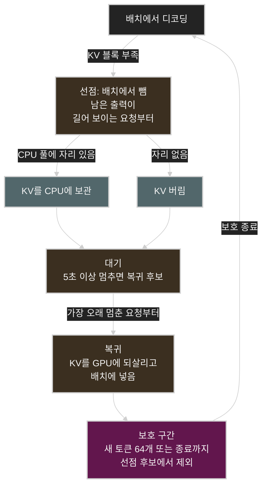
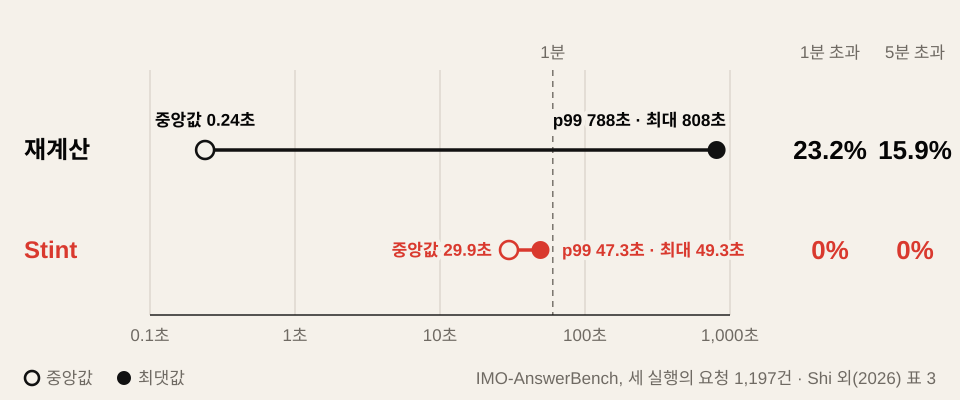

# GPU는 바쁜데 내 응답은 왜 멈췄을까? — 긴 LLM 추론과 KV 캐시 선점

21.5초 동안 출력이 없었다. 겨우 28토큰이 나온 뒤 같은 응답이 다시 26.3초 멈췄다. 연결이 끊긴 것도, 서버 전체가 멈춘 것도 아니었다. 다른 요청들은 계속 토큰을 만들고 있었고, 이 요청만 GPU에서 거듭 밀려났다.


이 타임라인은 [Stint 논문](https://arxiv.org/abs/2611.20106)의 그림 2(b)에 나온다. 저자들은 Qwen3-32B로 LiveCodeBench 코딩 요청 200개를 재생하면서 GPU의 KV 캐시 용량을 줄이고, Stint의 복귀 관리 기능을 껐다. 밀려난 요청 가운데 누구를 먼저 다시 실행할지 고르고, 다시 실행된 요청을 한동안 보호하는 기능이다. 선점이 되풀이되는 모습이 잘 보이도록 일부러 조건을 바꾼 실험이라, 운영 서버가 흔히 이만큼 멈춘다는 뜻은 아니다. 그래도 장애를 진단할 때 던져야 할 질문 하나를 잘 보여 준다. **서버가 일하고 있다는 것과 이 요청이 앞으로 나아가고 있다는 것을 어떻게 구별할까?**

이 글은 직접 겪은 장애의 회고가 아니라 2026년 11월 15일 arXiv에 공개된 논문을 정리한 것이다. 아직 심사 중인 프리프린트 한 편에 기댄 글이므로, 수치는 이 논문의 실험 조건에서 나온 값으로 읽어야 한다. 앞부분에서는 서빙 엔진의 스케줄러가 요청을 밀어내고 다시 들이는 과정과 Stint의 설계를 살펴보고, 뒷부분에서는 vLLM을 운영하는 팀이 자기 환경에서 같은 문제를 확인하는 방법을 제안한다.

## 목차

1. [스케줄러는 왜 요청을 밀어낼까](#1-스케줄러는-왜-요청을-밀어낼까)
2. [다시 배치에 넣은 요청은 새 토큰 64개를 낼 때까지 선점하지 않는다](#2-다시-배치에-넣은-요청은-새-토큰-64개를-낼-때까지-선점하지-않는다)
3. [가장 긴 멈춤은 줄었지만 보통의 요청은 더 오래 멈췄다](#3-가장-긴-멈춤은-줄었지만-보통의-요청은-더-오래-멈췄다)
4. [운영 환경에서 출력 공백을 추적하는 법](#4-운영-환경에서-출력-공백을-추적하는-법)
5. [대기를 어디에 둘지 결정한다](#5-대기를-어디에-둘지-결정한다)

## 1. 스케줄러는 왜 요청을 밀어낼까

LLM 서빙 엔진은 여러 요청을 한 배치로 묶어, 스텝마다 각 요청의 다음 토큰을 하나씩 만든다. 이 스텝을 되풀이하며 답을 이어 쓰는 단계가 디코딩이고, 매 스텝 어떤 요청을 배치에 넣을지는 엔진의 스케줄러가 정한다.

배치에 들어간 요청은 GPU 메모리에 자기 KV 캐시를 갖고 있어야 한다. KV 캐시는 지금까지 처리한 토큰마다 attention 계산에 쓰는 key와 value를 저장해 둔 것으로, 다음 토큰을 만들 때마다 이 값을 다시 읽는다. 모델 가중치를 올리고 남은 GPU 메모리를 요청들의 KV 캐시가 나눠 쓰기 때문에, 가중치가 다 올라갔다고 해서 긴 답변을 동시에 몇 개까지 만들 수 있는지가 정해지지는 않는다. 논문 표 1에 따르면 Qwen3-32B의 BF16 KV 데이터는 토큰당 256 KiB다. 입력과 출력을 합쳐 10,000토큰이면 요청 하나가 약 2.44 GiB를 차지한다. 여러 GPU로 나누기 전의 크기이며, 블록 패딩과 메타데이터는 뺀 값이다.

KV 캐시는 답이 길어질수록 커진다. 이미 실행 중인 요청도 토큰을 하나 만들 때마다 공간이 조금씩 더 필요하다. vLLM 같은 엔진은 이 공간을 고정 크기 블록 단위로 나눠 주는데, 블록이 모자라면 스케줄러는 일부 요청을 배치에서 잠시 빼고 그 블록을 회수한다. 이것이 **선점(preemption)**이다. GPU에서 돌고 있는 CUDA 커널을 중간에 끊는 것이 아니라, 다음 스텝의 배치에서 그 요청을 빼는 스케줄링 결정이다.

밀려난 요청은 나중에 다시 배치에 들어가야 한다. 이 글에서는 이것을 **복귀**라고 부른다. 복귀하려면 먼저 KV 캐시를 GPU에 되살려야 하는데, 방법은 두 가지다. 선점할 때 KV를 버렸다면 지금까지의 문맥을 처음부터 다시 계산한다. 현재 vLLM도 [기본적으로 이 방식](https://docs.vllm.ai/en/stable/configuration/optimization/)을 쓴다. CPU 메모리에 옮겨 두었다면 재계산은 필요 없지만, GPU로 다시 복사할 시간과 그 KV를 올릴 GPU 공간이 필요하다.

문제는 그 공간이 쉽게 나지 않는다는 점이다. 요청 A가 기다리는 동안 배치에 남은 요청 B와 C도 답이 길어지면서 공간을 더 차지한다. A가 겨우 복귀하더라도 곧 다시 공간이 모자라 또 밀려날 수 있다. 그러면 서버는 KV를 옮기고 다시 계산하는 데 시간을 쓰고도 A의 사용자에게는 새 토큰을 거의 보내지 못한다. 저자들은 이렇게 **선점과 복귀가 되풀이되는 동안 새 출력이 거의 나오지 않는 상태**를 *KV thrashing*이라고 부른다. 도입부의 요청이 바로 그런 경우다. 복귀할 때마다 22토큰, 28토큰만 내고 다시 밀려났다.

선점 횟수와 멈춤 길이도 함께 움직였다. 같은 실험에서 요청별 최장 멈춤의 중앙값은 한 번도 선점되지 않은 요청이 0.09초, 한 번 선점된 요청이 22.1초, 여러 번 선점된 요청이 39.7초였다(논문 그림 2(c)). 다만 세 집단은 출력 길이와 메모리 압박도 달라서, 선점 한 번마다 정해진 만큼 늦어진다는 뜻은 아니다. 또 선점이 한 번 일어났거나 캐시 점유율이 높다는 것만으로는 thrashing이라고 할 수 없다. 같은 요청이 새 출력 없이 선점과 복귀를 되풀이하는지를 봐야 한다.

## 2. 다시 배치에 넣은 요청은 새 토큰 64개를 낼 때까지 선점하지 않는다

KV를 CPU에 보관해 두면 재계산은 피할 수 있다. 하지만 복귀한 요청이 몇 토큰 만들지 못하고 다시 밀려나는 일까지 막지는 못한다. Stint는 스케줄러가 내리는 세 가지 결정을 함께 바꿨다([논문 그림 5와 §5.3](https://arxiv.org/pdf/2611.20106#page=7)).

- **누구를 밀어낼까:** KV를 얼마나 차지했는지만 보지 않고, 남은 출력이 가장 길어 보이는 요청을 고른다. 곧 끝날 요청은 조금만 더 두면 KV 공간을 통째로 돌려주므로 밀어내지 않는 편이 낫다. 남은 길이는 모델의 은닉 상태(hidden state)로 추정한 예측값이라 틀릴 수 있다.
- **밀어낸 요청의 KV를 어디에 둘까:** CPU 메모리의 KV 풀로 옮겨 재계산을 피한다. 풀에 자리가 없으면 KV를 버리고 복귀할 때 재계산한다.
- **누구를 다시 넣고, 얼마 동안 지킬까:** 기본 설정에서는 5초 이상 멈춘 요청 가운데 가장 오래 멈춘 요청부터 복귀시킨다. 복귀한 요청은 **새 토큰 64개를 만들거나 끝날 때까지 선점 후보에서 빠진다.** 다시 불러오거나 재계산한 부분은 세지 않고 새로 만든 토큰만 센다.

세 번째 결정이 이 절 제목의 규칙이다. 복귀에 들인 비용이 적어도 64토큰만큼의 진척으로 이어지게 하려는 장치다. Stint를 쓰지 않더라도, 서빙 엔진을 비교할 때 복귀한 요청이 얼마만큼의 진척을 보장받는지 따져 볼 만하다.



도입부의 실험은 이 마지막 결정, 즉 복귀 선정과 보호를 끈 상태였다. 보호가 켜져 있으면 복귀한 요청은 새 토큰 64개를 내거나 끝날 때까지 밀려나지 않는다. 22토큰, 28토큰만 내고 다시 밀려난 도입부의 요청이 이 규칙이 막으려는 바로 그 경우다.

5초는 복귀 후보가 되는 기준일 뿐, 5초 안에 출력이 다시 나온다는 보장이 아니다. 후보가 된 뒤에도 더 오래 멈춘 요청이 먼저 복귀하고, KV를 되살리는 데도 시간이 걸린다. 운영 로그에 복구 완료 이벤트만 남기면, KV 복구가 끝났으니 기다림도 끝났다고 착각하기 쉽다. 사용자의 기다림이 끝나는 시각은 KV 복사가 끝난 때가 아니라 **다음 출력이 도착한 때**다.

## 3. 가장 긴 멈춤은 줄었지만 보통의 요청은 더 오래 멈췄다

이 결과를 해석하려면 [표 2](https://arxiv.org/pdf/2611.20106#page=11)와 [표 3](https://arxiv.org/pdf/2611.20106#page=13)을 함께 봐야 한다. 이 실험은 도입부의 코딩 실험과 달리 올림피아드 수학 문제 399개(IMO-AnswerBench)를 정해진 출력 길이대로 재생했다. Qwen3-32B를 H200 2장씩 묶은 복제본 4개로 띄우고, 평균 초당 4요청이 도착하게 해서 세 번 실행했다. 비교 대상인 재계산 구성은 같은 vLLM 0.9.2 기반 빌드에서 CPU KV 풀 없이, 밀려난 요청을 재계산으로 복귀시킨다. KV를 CPU에 보존하는 LMCache와 SGLang HiCache도 재계산과 마찬가지로 요청의 21~23%가 1분 넘게 멈췄다. 적어도 이 실험에서는 KV를 CPU에 보존하는 것만으로 긴 멈춤이 줄지 않았다.

| 관측 지표 | 재계산 | Stint |
|---|---:|---:|
| 전체 출력 처리량 | 4,100 tok/s | 4,592 tok/s |
| TPOT p99 | 104.5 ms | 51.5 ms |
| 출력 청크 간격 p99 | 47.9 ms | 78.0 ms |
| 요청별 최장 출력 공백의 중앙값 | 0.24초 | 29.9초 |
| 실험 전체에서 가장 긴 출력 공백 | 808초 | 49.3초 |

- **TPOT(time per output token):** 요청마다 첫 토큰 이후 토큰 하나에 걸린 평균 시간. 표의 값은 이 값들의 p99다.
- **출력 청크 간격:** 클라이언트가 받은 출력 청크 사이의 간격. 모든 요청의 간격을 한데 모아 p99를 구했다.
- **최장 출력 공백:** 요청마다 새 출력이 가장 오래 끊긴 시간.

앞의 세 행은 실행별 값의 평균이고, 뒤의 두 행은 요청 1,197건을 모은 값이다. 처리량 12% 증가는 정해진 작업을 더 빨리 끝냈다는 뜻이지, 감당할 수 있는 트래픽이 12% 늘었다는 뜻은 아니다.

**두 p99 지표는 30초짜리 멈춤을 잘 드러내지 못한다.** 간격 1,000개 중 999개가 40 ms이고 한 번만 30초인 응답이라면, 이 요청의 TPOT는 약 70 ms이고 30초는 모은 간격의 p99에도 걸리지 않는다. 그래도 사용자는 30초를 기다렸다. 요청별 최장 출력 공백을 따로 봐야 하는 이유다. 두 p99가 반대로 움직인 이유도 짐작할 수 있다. TPOT p99는 십여 분짜리 멈춤이 사라지면서 내려갔고, 청크 간격 p99는 선점이 재계산보다 2.7배 잦아져 짧은 끊김이 늘면서 올라간 것으로 보인다.



쉽게 말해 몇몇 요청이 십여 분씩 멈추던 문제를 없앤 대신, 대부분의 긴 요청이 30초쯤 한 번 멈추게 됐다. 저자들의 표현을 빌리면 드물지만 끝을 알 수 없는 멈춤을, 잦지만 상한이 있는 멈춤으로 바꿨다. 멈춤 한 번이 요청 수명의 8.4%를 넘은 적은 없었다. 재계산에서는 가장 나쁜 요청이 수명의 72%를 멈춤 한 번에 썼다.

Stint가 치른 비용은 다음과 같다.

- **첫 토큰까지 걸린 시간(TTFT):** 평균 49.4 → 56.7 ms, p99 67.9 → 246.7 ms로 늘었다.
- **호스트 메모리:** 샘플링한 노드·cgroup 최대 사용량의 평균이 328 GiB에서 1,357 GiB로 약 네 배가 됐다. KV 데이터 크기나 프로세스 RSS를 잰 값은 아니다.
- **출력이 짧은 워크로드:** 이득이 없었고, arXiv 논문 요약 요청을 높은 도착률로 재생했을 때는 처리량이 재계산보다 19~21% 낮았다.

결과를 일반화할 때는 다음도 감안해야 한다.

- 출력 길이 예측기는 평가에 쓴 399문제 중 100문제로 학습했다. 처음 보는 워크로드에서는 예측이 이만큼 맞지 않을 수 있다.
- Llama-3.1-8B로 AIME 문제를 재생한 실험에서는 LMCache보다 처리량이 낮고 TPOT도 높았다.
- 49.3초는 이 실험의 최댓값이지, 다른 엔진 버전이나 워크로드에서도 지켜지는 상한이 아니다.

## 4. 운영 환경에서 출력 공백을 추적하는 법

여기서부터는 논문 재현이 아니라 운영 계측에 대한 제안이다. 대시보드의 첫 패널에는 GPU 사용률 대신 **첫 출력을 보낸 뒤 어떤 요청이 얼마 동안 아무것도 보내지 못했는지**를 둔다.

스트리밍 경로의 한 지점(예: API 게이트웨이)에서 요청 ID와 출력 청크의 도착 시각을 기록한다. 실제 출력이 담긴 청크만 세고, 연결 유지용 heartbeat와 종료 표시는 뺀다. 시각은 시스템 시계 조정에 영향을 받지 않는 단조 시계(monotonic clock)로 잰다. 청크 하나에 토큰이 여러 개 묶일 수 있으니, 이 값은 '토큰 지연'이 아니라 '출력 청크 공백'이라고 부르는 편이 정확하다. 다음 SQL은 이렇게 모은 트레이스에서 공백이 긴 요청을 찾는 예다. `stream_chunks` 테이블에는 응답별 순번(`chunk_seq`)과 수신 시각(`received_ms`)을 가진 출력 청크만 들어 있다고 가정한다.

```sql
WITH gaps AS (
  SELECT request_id,
         received_ms - LAG(received_ms) OVER (
           PARTITION BY request_id ORDER BY chunk_seq
         ) AS gap_ms
  FROM stream_chunks
)
SELECT request_id, MAX(gap_ms) AS longest_gap_ms
FROM gaps
WHERE gap_ms IS NOT NULL
GROUP BY request_id
ORDER BY longest_gap_ms DESC
LIMIT 20;
```

이 쿼리는 **다음 청크가 끝내 오지 않은 요청**을 놓친다. 아직 진행 중인 스트림은 '현재 시각 − 마지막 출력 시각'을 따로 추적하고, 취소나 타임아웃으로 끝난 요청도 마지막 출력 이후 경과 시간을 남긴다. 첫 출력조차 없었던 요청은 TTFT와 입장 대기열 쪽에서 따로 본다.

대시보드에 올릴 때는 요청이 끝날 때 최장 공백을 히스토그램으로 기록하고, 진행 중인 스트림의 현재 공백 가운데 최댓값을 게이지로 내보내면 된다. 요청 ID는 트레이스에만 남기고 Prometheus 레이블로는 쓰지 않는다. 요청마다 새 시계열이 생겨 카디널리티가 폭증하기 때문이다.

원인을 좁힐 때는 같은 복제본, 같은 시간대의 지표를 비교한다. [vLLM 운영 지표](https://docs.vllm.ai/en/stable/usage/metrics/)에서는 KV 점유율(`vllm:kv_cache_usage_perc`), 누적 선점 횟수(`vllm:num_preemptions`), 실행 중·대기 중 요청 수(`vllm:num_requests_running`, `vllm:num_requests_waiting`)를 볼 수 있다. 요청마다 몇 번 선점됐는지를 모은 히스토그램(`vllm:request_num_preemptions`)도 있어서, 여러 번 선점된 요청이 늘었는지 바로 확인할 수 있다. 반면 토큰 간격 히스토그램(`vllm:inter_token_latency_seconds`)은 모든 간격을 한데 모은 분포라, 3절에서 본 것처럼 요청 하나의 긴 멈춤이 p99에 묻힐 수 있다. 지표 이름은 버전마다 다르고, 카운터는 Prometheus에서 `_total`이 붙은 이름으로 노출될 수 있으니 배포한 버전의 `/metrics`에서 확인한다.

| 같은 시간대에 보이는 신호 | 다음으로 확인할 것 |
|---|---|
| 특정 복제본의 KV 풀이 거의 찼고 선점과 긴 출력 공백이 함께 늘었다 | 샘플 요청 하나를 골라 선점·복귀 시점과 새 출력 시점을 나란히 놓는다. 같은 요청이 새 출력 없이 선점과 복귀를 되풀이하는지가 핵심이다. |
| 엔진은 출력을 계속 내보내는데 클라이언트에서만 긴 공백이 보인다 | 게이트웨이의 청크 병합·버퍼링과 클라이언트의 읽기 지연을 따로 본다. 캐시 정책부터 바꿀 근거는 없다. |
| 첫 토큰만 늦고, 일단 시작한 요청은 고르게 진행한다 | 입장 대기와 prefill 시간을 나눠 본다. 생성 도중에 멈추는 것과는 다른 문제다. |

## 5. 대기를 어디에 둘지 결정한다

대화형 서비스라면 시작 전에 2초 기다리는 것과 답을 읽다가 30초 멈추는 것을 같은 지연으로 보기 어렵다. 반대로 야간 평가 배치에서는 마지막 몇 요청이 십여 분 늦어져 GPU 반납이 밀리는 쪽이 더 비쌀 수 있다. 같은 결과표를 보고도 두 서비스는 서로 다른 스케줄링 정책을 고를 수 있다.

자체 검증은 새 엔진을 들이지 않고도 시작할 수 있다. 스테이징에서 **같은 요청 목록과 도착 시각은 그대로 두고 동시 실행 상한만 바꿔**(vLLM이라면 `--max-num-seqs`) 두 번 재생한다. 한 배치에 넣는 요청 수를 줄이면 필요한 KV 공간이 줄어 선점이 줄 수 있지만, 늦게 온 요청은 시작 전에 더 오래 기다린다. [vLLM 문서](https://docs.vllm.ai/en/stable/configuration/optimization/)도 선점이 잦을 때 쓸 수 있는 방법 가운데 하나로 이 값을 낮추는 것을 든다. 비교할 값은 세 가지다. 입장 대기를 포함한 첫 출력 시간, 요청별 최장 출력 공백, 마지막 요청이 끝날 때까지의 시간이다. 짧은 응답과 긴 응답을 나눠 보고, 취소된 요청도 따로 센다. 동시성을 낮췄더니 출력 공백은 줄고 첫 출력만 늦어졌다면, 대기를 없앤 것이 아니라 사용자가 기다리는 자리를 옮긴 것이다.

이 논문에서 대시보드로 가져갈 것은 처리량 개선율보다 단순하다. **"서버가 초당 몇 토큰을 만들었나?" 옆에 "이미 시작한 응답 가운데 새 출력이 가장 오래 끊긴 것은 몇 초인가?"를 함께 둔다.** 첫 번째 수치가 정상이어도, 두 번째 수치는 사용자가 왜 연결을 끊었는지 설명해 줄 수 있다.

## 참고 자료

| 자료 | 읽을 부분 |
|---|---|
| Ziji Shi 외, [Making Preemption Productive in Long-Output LLM Serving](https://arxiv.org/abs/2611.20106), 2026-11-15, arXiv v1(심사 중) | 그림 2의 단일 요청 기록, 그림 5의 복귀 보호, 표 2·3의 지표 차이, 부록 G의 비교 구성과 메모리 집계 |
| [vLLM Production Metrics](https://docs.vllm.ai/en/stable/usage/metrics/) | 엔진이 내보내는 캐시·선점·지연 지표. 클라이언트에서만 보이는 공백과 구분할 때 참고한다. |
| [vLLM 최적화 문서](https://docs.vllm.ai/en/stable/configuration/optimization/)의 Preemption 절 | 기본 선점 방식(재계산)과 선점을 줄이는 설정 |
| 이 사이트의 [추론 성능 지표](https://aidc.restack.tech/inference/efficient-llm-inference-systems/week01/) · [Transformer 추론과 KV 캐시](https://aidc.restack.tech/inference/efficient-llm-inference-systems/week03/) | TTFT·TPOT의 정의와 요청 길이에 따라 커지는 KV 메모리의 배경 |
