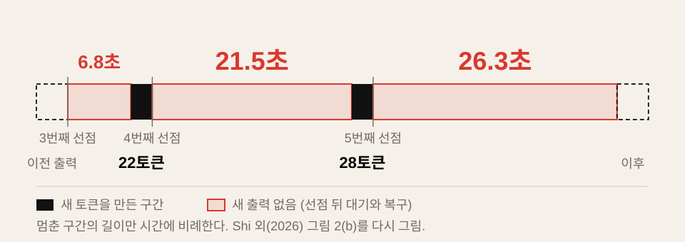
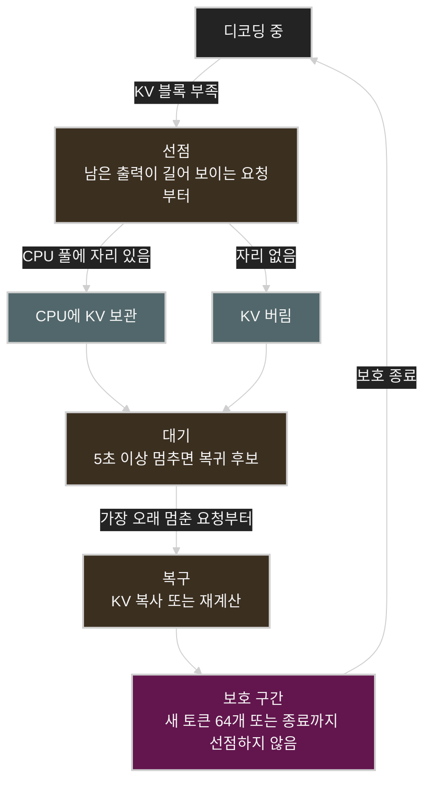

# GPU는 바쁜데 내 응답은 왜 멈췄을까? — 긴 LLM 추론과 KV 캐시 선점

21.5초 동안 출력이 없었다. 겨우 28토큰이 나온 뒤 같은 응답이 다시 26.3초 멈췄다. 연결이 끊긴 것도, 서버 전체가 멈춘 것도 아니었다. 다른 요청들은 계속 토큰을 만들고 있었고, 이 요청만 GPU에서 거듭 밀려났다.



이 타임라인은 [Stint 논문](https://arxiv.org/abs/2611.20106)의 그림 2(b)에 나온다. 저자들은 Qwen3-32B로 LiveCodeBench 코딩 요청 200개를 재생하면서 GPU의 KV 캐시 용량을 줄이고, Stint의 복구 기능(복귀할 요청 선정과 복귀 후 보호)을 껐다. 선점이 되풀이되는 모습이 잘 보이도록 일부러 조건을 바꾼 실험이라, 운영 서버가 흔히 이만큼 멈춘다는 뜻은 아니다. 그래도 장애를 진단할 때 던져야 할 질문 하나를 잘 보여 준다. **서버가 일하고 있다는 것과 이 요청이 앞으로 나아가고 있다는 것을 어떻게 구별할까?**

이 글은 직접 겪은 장애의 회고가 아니라 2026년 11월 15일 arXiv에 공개된 논문을 정리한 것이다. 앞부분에서는 저자들이 관측한 정체와 Stint의 설계를 살펴보고, 뒷부분에서는 vLLM을 운영하는 팀이 자기 환경에서 같은 문제를 확인하는 방법을 제안한다.

## 목차

1. [요청 하나가 GPU에서 자리를 잃으면](#1-요청-하나가-gpu에서-자리를-잃으면)
2. [돌아온 요청이 새 토큰을 만들 때까지 지켜 준다](#2-돌아온-요청이-새-토큰을-만들-때까지-지켜-준다)
3. [가장 긴 멈춤은 줄었지만 보통의 요청은 더 오래 멈췄다](#3-가장-긴-멈춤은-줄었지만-보통의-요청은-더-오래-멈췄다)
4. [운영 환경에서 출력 공백을 추적하는 법](#4-운영-환경에서-출력-공백을-추적하는-법)
5. [대기를 어디에 둘지 결정한다](#5-대기를-어디에-둘지-결정한다)

## 1. 요청 하나가 GPU에서 자리를 잃으면

모델 가중치가 GPU에 모두 올라갔다고 해서 긴 답변을 동시에 몇 개까지 만들 수 있는지가 정해지지는 않는다. 가중치를 올리고 남은 메모리를 요청들의 KV 캐시가 나눠 쓰기 때문이다. 디코딩 중인 요청은 저마다 앞선 토큰의 key와 value를 보관하고, 답이 길어질수록 이 KV 캐시도 커진다. 논문 표 1에 따르면 Qwen3-32B의 BF16 KV 데이터는 토큰당 256 KiB다. 입력과 출력을 합쳐 10,000토큰이면 요청 하나가 약 2.44 GiB를 차지한다. 여러 GPU로 나누기 전의 크기이며, 블록 패딩과 메타데이터는 뺀 값이다.

문제는 이미 실행 중인 요청도 토큰을 하나 만들 때마다 공간이 더 필요하다는 점이다. KV 블록이 모자라면 서빙 엔진의 스케줄러는 일부 요청을 다음 디코딩 배치에서 잠시 빼고 그 블록을 회수한다. 이것이 **선점(preemption)**이다. CUDA 커널을 강제로 멈추는 일이 아니라, 배치에 어떤 요청을 넣을지에 대한 스케줄링 결정이다.

밀려난 요청 A가 돌아오는 길은 두 가지다. 캐시를 버렸다면 지금까지의 문맥을 다시 계산해야 한다. CPU 메모리에 보존했다면 재계산은 필요 없지만, 캐시를 옮겨 오는 시간과 GPU에 다시 올릴 공간이 필요하다. 그사이 실행 중인 요청 B와 C도 답이 길어지면서 공간을 더 차지한다. A가 겨우 돌아오자마자 다시 밀려나면, 서버는 계산과 복사에 시간을 쓰고도 A의 사용자에게 새 토큰을 거의 보내지 못한다. 저자들은 이렇게 **퇴거와 복구가 되풀이되는 동안 새 출력이 거의 나오지 않는 상태**를 *KV thrashing*이라고 부른다.

선점 횟수와 멈춤 길이는 함께 움직였다. 같은 실험에서 요청별 최장 멈춤의 중앙값은 한 번도 선점되지 않은 요청이 0.09초, 한 번 선점된 요청이 22.1초, 여러 번 선점된 요청이 39.7초였다(논문 그림 2(c)). 다만 세 집단은 출력 길이와 메모리 압박도 달라서, 선점 한 번마다 정해진 만큼 늦어진다는 뜻은 아니다. 또 선점이 한 번 일어났거나 캐시 점유율이 높다는 것만으로는 thrashing이라고 진단할 수 없다. 같은 요청이 새 출력 없이 퇴거와 복구를 되풀이하는지를 봐야 한다.

## 2. 돌아온 요청이 새 토큰을 만들 때까지 지켜 준다

Stint에서 눈여겨볼 부분은 CPU 오프로딩 자체가 아니라 돌아온 요청을 지키는 방식이다([논문 그림 5와 §5.3](https://arxiv.org/pdf/2611.20106#page=7)). 캐시를 CPU에 보존하면 재계산은 피할 수 있지만, 돌아온 요청이 곧바로 다시 밀려나는 일까지 막지는 못한다. 그래서 Stint는 *무엇을 보존할지*와 *다음에 누구를 실행할지*를 함께 정한다.

- **밀어낼 때:** 현재 캐시 크기만 보지 않는다. 디코딩 중에 모델이 이미 계산하는 은닉 상태(hidden state)로 남은 출력 길이를 추정하고, 곧 끝날 것 같은 요청은 되도록 계속 실행한다. 추정치는 64스텝마다 갱신하는 예측값이라 틀릴 수 있다. 후보 가운데 예측값이 없는 요청이 있으면 캐시가 가장 큰 요청을 내보내는 방식으로 돌아간다.
- **보관할 때:** 실행에서 빠진 요청의 KV는 다시 실행될 때까지 자라지 않는다. 그래서 CPU에는 빠질 때의 크기만큼만 공간을 잡는다. GPU에 흩어진 블록은 GPU의 임시 버퍼에 모아 CPU로 한꺼번에 복사한다. 버퍼 두 개를 번갈아 써서, 한쪽을 복사하는 동안 다른 쪽에 다음 묶음을 모은다. CPU 풀에 자리가 없으면 재계산으로 돌아간다.
- **돌아올 때:** 기본 설정에서는 5초 이상 멈춘 요청 가운데 가장 오래 멈춘 요청을 먼저 복귀시킨다. 일단 고른 요청은 복구를 마치고 **새 토큰 64개를 만들거나 끝날 때까지** 다시 선점하지 않는다. 다시 불러온 KV나 재계산한 토큰은 이 64개에 세지 않는다.



5초는 복귀 후보가 되는 기준일 뿐, 5초 안에 응답이 다시 나온다는 보장이 아니다. 운영 로그에 복구 완료 이벤트만 남기면, 복구가 끝났으니 기다림도 끝났다고 착각하기 쉽다. 사용자의 기다림이 끝나는 시각은 캐시 복사가 끝난 때가 아니라 **다음 출력이 도착한 때**다.

## 3. 가장 긴 멈춤은 줄었지만 보통의 요청은 더 오래 멈췄다

도입 여부를 판단하려면 [표 2](https://arxiv.org/pdf/2611.20106#page=11)와 [표 3](https://arxiv.org/pdf/2611.20106#page=13)을 나란히 놓고 봐야 한다. 도입부의 코딩 실험과 달리, 이 실험은 올림피아드 수학 문제 399개(IMO-AnswerBench)를 정해진 출력 길이대로 재생했다. Qwen3-32B를 H200 8장에 2장씩 나눠 복제본 4개로 띄우고, 평균 초당 4요청이 도착하도록 해서 같은 조건으로 세 번 실행했다. 아래 표의 비교 대상은 같은 vLLM 0.9.2 기반 빌드에서 CPU KV 풀 없이 재계산하는 구성이다. 논문은 CPU에 KV를 보존하는 LMCache와 SGLang HiCache도 비교했는데, 재계산을 포함한 세 구성 모두 요청의 21~23%가 1분 넘게 멈췄다. 캐시를 CPU에 보존하는 것만으로는 긴 멈춤이 줄지 않았다는 뜻이다.

| 관측 지표 | 재계산 | Stint |
|---|---:|---:|
| 전체 출력 처리량 | 4,100 tok/s | 4,592 tok/s |
| 요청별 평균 출력 토큰 간격(TPOT)의 p99 | 104.5 ms | 51.5 ms |
| 모든 요청의 출력 청크 간격을 합친 p99 | 47.9 ms | 78.0 ms |
| 요청별 최장 출력 공백의 중앙값 | 0.24초 | 29.9초 |
| 실험 전체에서 관측한 가장 긴 출력 공백 | 808초 | 49.3초 |

앞의 세 행은 실행별 값의 평균이고, 뒤의 두 행은 세 실행의 요청 1,197건을 모아 계산한 값이다. 처리량이 12% 높다고 해서 감당할 수 있는 트래픽이 12% 늘었다는 뜻은 아니다. 이 처리량은 정해진 양의 작업을 마지막 요청까지 끝내는 속도다.

**두 p99 지표는 30초짜리 멈춤을 잘 드러내지 못한다.** TPOT는 요청마다 먼저 평균을 내고, 논문의 청크 간격 지표는 모든 요청이 받은 출력 간격을 한데 모은다. 간격 1,000개 중 999개가 40 ms이고 한 번만 30초인 응답을 생각해 보자. 이 요청의 TPOT는 약 70 ms다. 간격을 모아서 보면 30초는 1,000개 가운데 하나뿐이라 p99에도 걸리지 않는다. 그래도 사용자는 답을 읽다가 30초를 기다렸다. 표 3의 요청별 최장 출력 공백을 따로 봐야 하는 이유다.

두 p99가 반대로 움직인 것도 서로 다른 현상을 잡았기 때문으로 보인다. TPOT p99는 요청 평균을 크게 끌어올리던 십여 분짜리 멈춤이 사라지면서 내려갔다. 청크 간격 p99는 Stint가 재계산보다 2.7배 자주 선점하면서 짧은 끊김이 늘어 올라갔다. 논문도 잦아진 선점이 일반적인 지연을 늘렸다고 설명한다.


정리하면 Stint는 몇몇 요청이 십여 분씩 멈추는 문제를 없앤 대신, 더 많은 요청에 수십 초짜리 멈춤을 나눠 준 셈이다. 저자들의 말로는 드물지만 끝을 알 수 없는 멈춤을 잦지만 상한이 있는 멈춤으로 바꿨다. 긴 요청은 대부분 한 번쯤 약 30초 멈췄지만, 멈춤 한 번이 요청 수명의 8.4%를 넘은 적은 없었다. 재계산 구성에서는 가장 나쁜 요청이 수명의 72%를 멈춤 한 번에 썼다.

비용도 있다. 첫 토큰까지 걸린 시간(TTFT)은 평균 49.4 ms에서 56.7 ms로, p99는 67.9 ms에서 246.7 ms로 늘었다. 호스트 메모리는 노드·cgroup 단위로 샘플링한 최대 사용량의 평균이 328 GiB에서 1,357 GiB로 약 네 배가 됐다. 이 값은 KV 데이터 크기나 프로세스 RSS가 아니다. 출력이 짧은 워크로드에서는 이득이 없었고 처리량이 오히려 떨어지기도 했다. arXiv 논문 요약 요청을 높은 도착률로 재생한 구성에서는 재계산보다 처리량이 19~21% 낮았다.

결과를 그대로 옮겨 오기 어려운 이유도 있다. IMO 실험의 출력 길이 예측기는 평가에 쓴 399문제 중 100문제로 학습했으므로, 처음 보는 워크로드에서는 예측이 이만큼 맞지 않을 수 있다. Llama-3.1-8B로 AIME 문제를 재생한 실험에서는 LMCache보다 처리량이 낮고 TPOT도 높았다. 49.3초 역시 이 실험에서 관측된 최댓값이지, 다른 엔진 버전이나 워크로드에서도 지켜지는 상한은 아니다.

## 4. 운영 환경에서 출력 공백을 추적하는 법

여기서부터는 논문 재현이 아니라 운영 계측에 대한 제안이다. 대시보드의 첫 패널에는 GPU 사용률 대신 **첫 출력을 보낸 뒤 어떤 요청이 얼마 동안 아무것도 보내지 못했는지**를 둔다.

스트리밍 경로의 한 지점(예: API 게이트웨이)에서, 같은 단조 시계(monotonic clock)로 요청 ID와 실제 출력이 담긴 청크의 도착 시각을 기록한다. 연결 유지용 heartbeat와 종료 표시는 뺀다. 청크 하나에 토큰이 여러 개 묶일 수 있으니, 이 값은 '토큰 지연'이 아니라 '출력 청크 공백'이라고 부르는 편이 정확하다. 다음 SQL은 이렇게 모은 트레이스에서 공백이 긴 요청을 찾는 예다. `stream_chunks` 테이블에는 응답별 순번(`chunk_seq`)과 수신 시각(`received_ms`)을 가진 출력 청크만 들어 있다고 가정한다.

```sql
WITH gaps AS (
  SELECT request_id,
         received_ms - LAG(received_ms) OVER (
           PARTITION BY request_id ORDER BY chunk_seq
         ) AS gap_ms
  FROM stream_chunks
)
SELECT request_id, MAX(gap_ms) AS longest_gap_ms
FROM gaps
WHERE gap_ms IS NOT NULL
GROUP BY request_id
ORDER BY longest_gap_ms DESC
LIMIT 20;
```

이 쿼리는 **다음 청크가 끝내 오지 않은 요청**을 놓친다. 아직 진행 중인 스트림은 '현재 시각 − 마지막 출력 시각'을 따로 추적하고, 취소나 타임아웃으로 끝난 요청도 마지막 출력 이후 경과 시간을 남긴다. 첫 출력조차 없었던 요청은 TTFT와 입장 대기열 쪽에서 따로 본다.

대시보드에 올릴 때는 요청이 끝날 때 최장 공백을 히스토그램으로 기록하고, 진행 중인 스트림의 현재 공백 가운데 최댓값을 게이지로 내보내면 된다. 요청 ID는 트레이스에만 남기고 Prometheus 레이블로는 쓰지 않는다. 요청마다 새 시계열이 생겨 카디널리티가 폭증하기 때문이다.

원인을 좁힐 때는 같은 복제본, 같은 시간대의 지표를 비교한다. [vLLM 운영 지표](https://docs.vllm.ai/en/stable/usage/metrics/)로 KV 점유율(`vllm:kv_cache_usage_perc`), 선점 카운터의 증가량, 실행 중·대기 중 요청 수를 함께 볼 수 있다. 지표 이름은 버전마다 다를 수 있으니 배포한 버전의 `/metrics`에서 확인한다.

| 같은 시간대에 보이는 신호 | 다음으로 확인할 것 |
|---|---|
| 특정 복제본의 KV 풀이 거의 찼고 선점과 긴 출력 공백이 함께 늘었다 | 샘플 요청 하나를 골라 선점·복귀 시점과 새 출력 시점을 나란히 놓는다. 같은 요청이 새 출력 없이 선점과 복귀를 되풀이하는지가 핵심이다. |
| 엔진은 출력을 계속 내보내는데 클라이언트에서만 긴 공백이 보인다 | 게이트웨이의 청크 병합·버퍼링과 클라이언트의 읽기 지연을 따로 본다. 캐시 정책부터 바꿀 근거는 없다. |
| 첫 토큰만 늦고, 일단 시작한 요청은 고르게 진행한다 | 입장 대기와 prefill 시간을 나눠 본다. 생성 도중에 멈추는 것과는 다른 문제다. |

## 5. 대기를 어디에 둘지 결정한다

대화형 서비스라면 시작 전에 2초 기다리는 것과 답을 읽다가 30초 멈추는 것을 같은 지연으로 보기 어렵다. 반대로 야간 평가 배치에서는 마지막 몇 요청이 십여 분 늦어져 GPU 반납이 밀리는 쪽이 더 비쌀 수 있다. 같은 결과표를 보고도 두 서비스는 서로 다른 스케줄링 정책을 고를 수 있다.

자체 검증은 새 엔진을 들이지 않고도 시작할 수 있다. 스테이징에서 **같은 요청 목록과 도착 시각은 그대로 두고 동시 실행 상한만 바꿔**(vLLM이라면 `--max-num-seqs`) 두 번 재생한다. 비교할 값은 세 가지다. 입장 대기를 포함한 첫 출력 시간, 요청별 최장 출력 공백, 마지막 요청이 끝날 때까지의 시간이다. 짧은 응답과 긴 응답을 나눠 보고, 취소된 요청도 따로 센다. 동시성을 낮췄더니 출력 공백은 줄고 첫 출력만 늦어졌다면, 대기를 없앤 것이 아니라 사용자가 기다리는 자리를 옮긴 것이다.

이 논문에서 대시보드로 가져갈 것은 처리량 개선율보다 단순하다. **"서버가 초당 몇 토큰을 만들었나?" 옆에 "이미 시작한 응답 가운데 새 출력이 가장 오래 끊긴 것은 몇 초인가?"를 함께 둔다.** 첫 번째 수치가 정상이어도, 두 번째 수치는 사용자가 왜 연결을 끊었는지 설명해 줄 수 있다.

## 참고 자료

| 자료 | 읽을 부분 |
|---|---|
| Ziji Shi 외, [Making Preemption Productive in Long-Output LLM Serving](https://arxiv.org/abs/2611.20106), 2026-11-15, arXiv v1(심사 중) | 그림 2의 단일 요청 기록, 그림 5의 복귀 보호, 표 2·3의 지표 차이, 부록 G의 비교 구성과 메모리 집계 |
| [vLLM Production Metrics](https://docs.vllm.ai/en/stable/usage/metrics/) | 엔진이 내보내는 캐시·선점·지연 지표. 클라이언트에서만 보이는 공백과 구분할 때 참고한다. |
| 이 사이트의 [추론 성능 지표](https://aidc.restack.tech/inference/efficient-llm-inference-systems/week01/) · [Transformer 추론과 KV 캐시](https://aidc.restack.tech/inference/efficient-llm-inference-systems/week03/) | TTFT·TPOT의 정의와 요청 길이에 따라 커지는 KV 메모리의 배경 |
