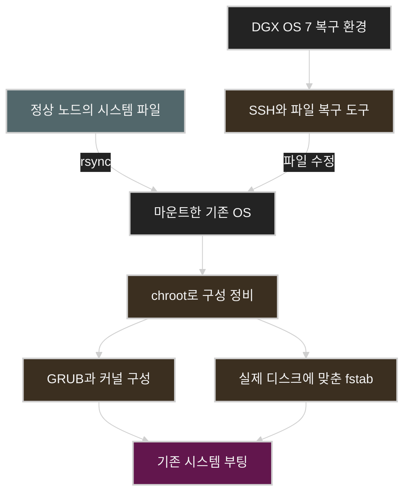

# rm -rf 사고로 손상된 DGX B200 노드 복구기

[English](dgx-b200-rm-rf-recovery.md) | **한국어**

2025년 어느 날, 운영하던 DGX B200 클러스터의 한 노드에서 시스템 파일을 대거 삭제했다. `/tmp/sriov_cni_env.txt` 하나만 지우려던 명령에 실수로 따로 떨어진 `*`가 들어갔고, 그 명령을 실행한 셸의 현재 디렉터리는 `/`였다.

이미 연결돼 있던 SSH 세션 하나는 살아 있었다. 새 접속은 되지 않아 그 세션으로 계정 파일을 복원했고, 한동안은 노드 사이의 SSH도 다시 동작했다. 그러나 정상 노드에서 시스템 파일을 가져오다가 경로가 중첩됐고, 라이브러리를 복사한 직후에는 `ls`와 `rsync`마저 segmentation fault로 실패했다.

결국 DGX OS 7 이미지로 부팅해 별도의 복구 환경을 마련했다. 손상된 OS를 마운트하고 정상 노드와 파일을 동기화한 뒤, `chroot` 안에서 부팅 구성을 정비하고 실제 디스크에 맞게 `/etc/fstab`을 수정했다. 그제야 기존 시스템이 다시 정상적으로 부팅됐다.

돌아보면 결과를 크게 좌우한 것은 각 명령이 어떤 환경에서 실행되느냐였다. **시스템을 고치려면 먼저 복구 명령과 도구가 제대로 실행되는 환경부터 갖춰야 한다.** 살아 있던 SSH 연결, 정상 노드의 파일, 복구용 이미지, 대상 디스크는 저마다 다른 역할을 했다.

이 글은 당시의 사고 기록과 복구 회고를 바탕으로 썼다. 회고를 쓴 날짜와 실제로 복구를 마친 날짜는 구분해서 적었다. 사고 당시의 명령과 관측 결과는 기록을 그대로 따랐고, 원리를 설명하기 위한 예시와 앞으로의 운영 개선안은 본문에서 따로 구분했다.

## 목차

1. [사고가 난 노드와 남아 있던 접근 경로](#1-사고가-난-노드와-남아-있던-접근-경로)
2. [공백 뒤의 별표가 삭제 대상을 바꿨다](#2-공백-뒤의-별표가-삭제-대상을-바꿨다)
3. [파일이 사라진 뒤에도 SSH 세션이 남은 이유](#3-파일이-사라진-뒤에도-ssh-세션이-남은-이유)
4. [계정 파일을 복구하고 SSH를 다시 연결했다](#4-계정-파일을-복구하고-ssh를-다시-연결했다)
5. [복구 과정에서 발생한 두 번째 장애](#5-복구-과정에서-발생한-두-번째-장애)
6. [DGX OS 7 복구 환경으로 전환했다](#6-dgx-os-7-복구-환경으로-전환했다)
7. [정상 노드와 파일을 동기화했다](#7-정상-노드와-파일을-동기화했다)
8. [복원한 파일을 부팅 가능한 시스템으로 만들었다](#8-복원한-파일을-부팅-가능한-시스템으로-만들었다)
9. [부팅 성공과 노드 복귀를 구분한다](#9-부팅-성공과-노드-복귀를-구분한다)
10. [이 사고를 운영 절차에 반영한다면](#10-이-사고를-운영-절차에-반영한다면)

## 1. 사고가 난 노드와 남아 있던 접근 경로

손상된 노드는 `dgx-b200-04`였다. 같은 클러스터의 `dgx-b200-05`에는 정상적으로 접속할 수 있어서, 초기 복구 때 이 노드를 비교 기준이자 파일을 가져올 곳으로 삼았다.

당시에는 tmux에서 여러 pane의 입력을 동기화해 놓고 작업하고 있었다. 사고 직후 프롬프트를 보니 04번 노드의 현재 디렉터리는 `/`였다. 다른 pane의 작업 디렉터리도 같았는지는 잘 기억나지 않는다.

삭제 후 디렉터리 목록을 정상 노드와 비교해 보니, 04번에는 `/etc`, `/bin` 같은 경로가 보이지 않았다. 나중에는 `kubelet` 유닛도 사라진 것을 확인했다. 반면 `/boot/efi`, 일부 `/dev` 항목, GPFS의 `.snapshots`에서는 삭제 실패 메시지가 나왔다.

다만 오류가 출력된 경로만 보고 피해 범위를 판단할 수는 없다. 삭제에 성공한 항목은 오류 메시지를 남기지 않을 수 있고, 상위 디렉터리가 남아 있다고 해서 그 안의 내용까지 온전하다는 뜻도 아니다. GPFS 스냅샷에서 삭제가 거부됐다고 해서 나머지 데이터가 모두 보존됐다고 볼 수도 없다.

초기 상황은 다음과 같았다.


| 대상             | 확인된 상태                  | 복구 관점                         |
| -------------- | ----------------------- | ----------------------------- |
| 04번의 기존 SSH 세션 | 연결된 세션이 남아 있음           | 상태를 확인하고 파일을 수정할 수 있는 접근 경로   |
| 04번 신규 SSH 접속  | 초기에는 실패                 | 기존 연결마저 끊기면 접근 수단이 더 줄어드는 상태  |
| 정상 05번 노드      | SSH 접속 가능               | 디렉터리 구조 비교와 복구용 파일 공급에 활용     |
| 일부 사용자 공간 도구   | 초기에는 `nano` 등을 실행할 수 있음 | 최소한의 파일 복구를 시작할 수 있음          |
| BMC            | 나중에 접근 가능함을 확인          | 호스트 OS와 별도로 복구 작업을 이어 갈 후보 경로 |


이 상태에서 먼저 따져야 했던 것은 시스템 전체가 정상인지가 아니라, 어떤 접근 경로와 도구가 아직 동작하는지였다. 기존 SSH 연결이 살아 있다고 해서 새 로그인이나 다음 부팅까지 보장되는 것은 아니었다.

## 2. 공백 뒤의 별표가 삭제 대상을 바꿨다

사고 당시 실행한 명령은 다음과 같다. 실제 기록을 그대로 옮겼다.

```text
root@dgx-b200-04:/# rm -rf /tmp/sriov_cni_env.txt *
```

`/tmp/sriov_cni_env.txt`와 `*` 사이에는 공백이 있다. 그래서 셸은 둘을 하나의 파일명 패턴으로 보지 않고, 파일 경로 하나와 별개의 glob 패턴으로 각각 처리한다.


| 입력                       | 실제 의미                    |
| ------------------------ | ------------------------ |
| `/tmp/sriov_cni_env.txt` | 명시한 파일 하나                |
| `*`                      | 현재 디렉터리에서 패턴과 일치하는 모든 이름 |
| 현재 디렉터리 `/`              | 패턴을 루트 디렉터리 기준으로 확장      |
| `-r`                     | 디렉터리 안으로 들어가 재귀 삭제       |
| `-f`                     | 확인 질문을 생략하는 강제 삭제 옵션     |


기본 설정의 Bash는 따옴표로 감싸지 않은 `*`를 현재 디렉터리에서 일치하는 항목으로 확장하며, 점으로 시작하는 이름은 이때 제외된다. 이 확장은 `rm`이 실행되기 전에 일어난다. [GNU Bash Filename Expansion](https://www.gnu.org/software/bash/manual/html_node/Filename-Expansion.html)

그 결과 `rm`에는 임시 파일뿐 아니라 `bin`, `boot`, `dev`, `etc`, `lib` 같은 루트 바로 아래 항목이 각각 별도의 인자로 전달됐다. 삭제 범위를 넓힌 것은 바로 이 `*`였다.

### 루트 보호 옵션이 막아주지 못한 이유

GNU `rm`은 기본적으로 `/` 자체를 재귀 삭제하라는 요청은 거부한다. 하지만 이 보호 장치가 루트 아래의 모든 경로를 지켜 주지는 않는다. 이번 명령에서는 셸이 미리 확장한 하위 항목이 각각 삭제 대상으로 넘어갔다. [GNU Coreutils rm](https://www.gnu.org/software/coreutils/manual/html_node/rm-invocation.html)

명령줄을 검토할 때는 입력한 문자열뿐 아니라 최종 인자 목록까지 확인해야 한다. `*`, 공백, 변수 확장, 현재 디렉터리가 맞물리면 둘은 크게 달라질 수 있다.

이 차이는 아무것도 지우지 않고 확인할 수 있다. 다음 명령은 인자가 어떻게 확장되는지만 출력하며, 결과는 현재 디렉터리에 따라 달라진다.

```bash
printf '<%s>\n' /tmp/sriov_cni_env.txt *
```

### tmux 동기화가 맞춰 주는 것과 그렇지 않은 것

tmux의 pane 동기화는 같은 입력을 여러 pane에 보낸다. 그렇다고 각 pane에서 실행 중인 셸의 호스트, 현재 디렉터리, 권한, 환경 변수까지 같아지지는 않는다. 같은 `*`를 입력해도 셸마다 다른 목록으로 확장될 수 있다. [tmux Manual](https://man.openbsd.org/tmux)

당시 04번 셸의 작업 디렉터리는 `/`였다. 여기에 root 권한과 따로 떨어진 wildcard가 겹치면서 삭제 범위가 시스템 경로까지 번졌다. 여러 터미널에 같은 글자가 찍힌다고 해서 실행 조건까지 같은 것은 아니었다.

## 3. 파일이 사라진 뒤에도 SSH 세션이 남은 이유

시스템 파일이 지워졌는데도 기존 SSH 세션이 살아 있었다는 점은 언뜻 모순처럼 보인다. 이를 이해하려면 디스크의 경로와 실행 중인 프로세스를 나누어 봐야 한다.

### 이름을 지우는 작업과 실행 중인 프로세스의 수명

Linux의 `unlink()`는 파일시스템에서 이름을 제거한다. 마지막 이름까지 제거돼도 파일을 열어 둔 참조가 남아 있으면 파일이 곧바로 사라지지 않을 수 있다. 실행 중인 프로세스가 매핑해 둔 파일도 경로명이 지워진다고 바로 없어지지는 않는다. [unlink(2)](https://man7.org/linux/man-pages/man2/unlink.2.html), [mmap(2)](https://man7.org/linux/man-pages/man2/mmap.2.html)

따라서 SSH 연결을 처리하던 프로세스와 셸, 필요한 커널 상태가 유지되면 기존 세션은 계속 동작할 수 있다. 그렇다고 필요한 파일이 모두 RAM에 올라가 있으니 안전하다고 생각하면 곤란하다. 프로세스는 이후에도 설정 파일을 읽거나 라이브러리를 추가로 불러올 수 있다.

당시 살아 있던 연결은 이미 만들어진 실행 상태를 활용할 수 있는 기회였다. 하지만 그 상태가 다음 로그인에서도 재현된다는 보장은 없었다.

### 새 프로그램을 실행할 때는 다시 필요한 것들이 있다

동적으로 링크된 ELF 실행 파일은 새로 시작할 때 `PT_INTERP`에 지정된 동적 로더를 거치고, 이 로더가 필요한 공유 라이브러리를 불러온다. 실행 파일이 남아 있어도 로더가 사라졌다면 `execve()`는 `ENOENT`로 실패할 수 있다. [execve(2)](https://man7.org/linux/man-pages/man2/execve.2.html)

즉, 살아 있는 셸에 프롬프트가 보인다는 것과 외부 명령을 새로 실행할 수 있다는 것은 별개의 문제다. 셸이 직접 처리하는 내장 명령과 외부 실행 파일도 의존성이 다르다. [GNU Bash Shell Builtin Commands](https://www.gnu.org/software/bash/manual/html_node/Shell-Builtin-Commands.html)

이번 사고에서는 초기에 `nano`가 실제로 동작했다. 쓸 수 있는 도구가 있었기에 파일 복구를 시작할 수 있었다. 어떤 도구가 아직 남아 있는지 확인하는 일이 복구 절차의 전제였다.

## 4. 계정 파일을 복구하고 SSH를 다시 연결했다

초기 복구에서는 정상 05번 노드를 참고해 다음 파일을 복원했다.

- `/etc/passwd`
- `/etc/group`
- `/etc/hosts`

세 파일에는 각각 사용자 계정, 그룹, 로컬 호스트 이름 해석에 필요한 정보가 들어 있다. `/etc/passwd`에는 계정의 UID·GID, 홈 디렉터리, 로그인 셸 등이 기록된다. 이 파일들이 SSH 키나 인증 설정 전체를 대신하지는 않지만, 정상적인 사용자 공간 환경을 이루는 기본 요소다. [passwd(5)](https://man7.org/linux/man-pages/man5/passwd.5.html), [group(5)](https://man7.org/linux/man-pages/man5/group.5.html), [hosts(5)](https://man7.org/linux/man-pages/man5/hosts.5.html)

2025년 4월 13일 13시 03분경, 당시 대화에 이렇게 남겼다.

> 이제 상호간 ssh 연결은 정상 동작해.

처음으로 얻은 확실한 진전이었다. 기존 세션 하나에 기대던 상태에서 벗어나 노드 간 SSH를 다시 쓸 수 있게 됐다. 이 결과도 당시 남아 있던 sshd와 인증 구성, 실행 파일이 받쳐 주었기에 가능했다.

그렇다고 시스템 전체가 복구된 것은 아니었다. SSH 접속은 여러 의존성이 맞아떨어져야 동작하는 기능 중 하나일 뿐이다. SSH가 살아났어도 다른 서비스의 설정과 실행 파일, 다음 부팅에 필요한 파일은 여전히 손상돼 있을 수 있다. 그래서 정상 노드에서 시스템 파일을 더 가져오는 작업을 이어 갔다.

아래는 당시 대화에 남은 보고 시각을 한국 시간 기준으로 정리한 것이다.


| 시각            | 조치 또는 관측                                                  |
| ------------- | --------------------------------------------------------- |
| 4월 N일 12:36경  | 04번에서 사고 명령과 삭제 결과 보고                                     |
| 12:48경        | 05번은 접속되지만 04번은 새 SSH 접속이 안 되는 상태                         |
| 12:59경        | `nano`가 동작하며 계정 파일부터 복원하겠다고 설명                            |
| 13:03경        | 세 파일 복원 후 양방향 SSH 정상화 보고                                  |
| 13:39경        | `/etc/etc` 중첩 경로 확인                                       |
| 13:49\~13:55경 | `/lib` 복사 후 연결이 끊기고 `ls`, `rsync`에서 segmentation fault 발생 |
| 16:27경        | BMC로 약 3.2GB OS 이미지를 불러오는 작업이 매우 느리다고 보고                  |
| 4월 N+3일       | 복구 모드에서 파일과 부팅 구성을 복원해 부팅에 성공했다고 회고                       |


## 5. 복구 과정에서 발생한 두 번째 장애

### 디렉터리 이름을 복사할지 내용을 복사할지

파일을 가져오는 과정에서 `/etc/etc`라는 경로가 생겼다. `/etc` 안에 `etc`가 하나 더 들어 있었던 것이다. 복구 도중에는 `/lib/lib` 경로도 나타났다.

당시 rsync에 넘긴 소스 경로에는 끝의 `/`가 빠져 있었다. 일반 디렉터리를 복사할 때는 이 `/` 하나가 목적지에 디렉터리 이름을 한 단계 더 붙일지를 결정한다. 다음 표는 대상 디렉터리 `/restore/`가 이미 있다고 가정한 예시다.


| 소스             | 대상          | 결과                     |
| -------------- | ----------- | ---------------------- |
| `/source/etc`  | `/restore/` | `/restore/etc/`에 복사    |
| `/source/etc/` | `/restore/` | 내부 항목을 `/restore/`에 복사 |


그래서 기존 `/etc/` 안에 소스 `/etc`를 복사하면 `/etc/etc`가 생길 수 있다. [rsync Manual](https://rsync.samba.org/ftp/rsync/rsync.1.html)

`/lib`는 링크 구조까지 고려해야 한다. merged `/usr` 구성에서는 `/lib`가 `/usr/lib`를 가리키는 심볼릭 링크일 수 있다. 복구 전후 소스와 대상의 링크 상태, 사용한 옵션에 따라 동작이 달라지므로, 일반 디렉터리인 `/etc`의 예시를 `/lib`에 그대로 적용하면 안 된다. 당시 관측한 중첩 경로를 배포판의 정상 디렉터리 구조와 함께 대조해 봐야 한다. [UAPI Linux File System Hierarchy](https://uapi-group.org/specifications/specs/linux_file_system_hierarchy/)

### 중첩된 라이브러리를 복사한 직후

나는 `/lib/lib` 안의 파일을 `/lib` 쪽으로 복사하려고 다음 명령을 실행했다. 이것도 당시 기록 그대로다.

```text
cp -a /lib/lib/* /lib/
```

실행 직후 접속이 끊겼다고 보고했다. 남아 있던 세션에서는 `ls`마저 다음 오류를 내며 실패했다.

```text
Segmentation fault (core dumped)
```

정상 노드에서 `/lib/`를 다시 가져오려던 rsync도 segmentation fault로 실패했다. 복구에 필요한 기본 도구까지 쓸 수 없게 된 것이다.

### 삭제된 파일을 사용하는 것과 덮어쓴 파일을 사용하는 것은 다르다

앞에서는 경로가 삭제돼도 기존 참조는 남을 수 있다고 설명했다. 그러나 이미 사용 중인 파일의 내용이나 크기를 직접 바꾸면 이야기가 달라진다.

일반적인 파일 복사 구현은 기존 목적지 파일을 열어 내용을 비운 뒤 다시 쓰기도 한다. GNU Coreutils의 `copy.c`에서도 조건에 따라 `O_TRUNC`로 목적지 파일을 여는 코드를 확인할 수 있다. `cp -a`가 속성을 보존해 준다고 해서 실행 중인 프로그램의 런타임까지 안전하게 교체해 주는 것은 아니다. [GNU Coreutils copy.c](https://github.com/coreutils/coreutils/blob/master/src/copy.c)

프로세스가 매핑한 파일을 직접 수정하거나 잘라내면 기존 매핑도 영향을 받을 수 있다. 다만 이번 기록만으로는 특정 libc 파일이 어떤 식으로 손상됐는지까지 확정할 수 없다. 매핑된 파일의 끝을 넘어 접근할 때 발생한다고 설명된 `SIGBUS`를 당시 관측한 `SIGSEGV`와 같은 현상이라고 단정할 수도 없다. [mmap(2)](https://man7.org/linux/man-pages/man2/mmap.2.html)

확인된 것은 복사 직후 장애가 심해졌다는 순서와 결과다. 사용 중인 라이브러리를 덮어썼거나, 복사가 중간에 끊겼거나, 로더와 라이브러리가 서로 맞지 않게 됐을 가능성을 생각해 볼 수 있다.

운영상 더 분명한 문제는 **복구에 쓰는 도구가 내가 고치고 있던 시스템 파일에 의존했다**는 점이었다. `/lib`를 고치는 작업이 `ls`, `cp`, `rsync`가 실행되는 기반 자체를 흔들 수 있었던 것이다.

## 6. DGX OS 7 복구 환경으로 전환했다

마지막 복구에서는 DGX OS 7 이미지를 내려받아 부팅한 뒤 복구 모드로 들어갔다. 이어서 IP를 할당하고 SSH 접속을 설정한 다음, 손상된 기존 시스템을 마운트했다.

이렇게 전환하자 파일을 수정하는 위치와 명령을 실행하는 환경을 분리할 수 있었다. 셸과 파일 전송 도구는 복구 환경에서 실행하고, 기존 OS는 따로 마운트한 복구 대상으로만 다루는 방식이다. 덕분에 정상 노드에서 파일을 받아 오는 작업이 더는 손상된 OS의 런타임에 기대지 않아도 됐다.

복구 환경의 셸과 대상 OS 안의 셸을 구분하는 것은 일반적인 Linux rescue mode에서도 쓰는 방식이다. 대상 OS 안에서 셸을 실행할 수 없으면 설치·복구 환경의 셸을 쓰면서 대상 파일시스템을 별도 경로에 마운트하면 된다. [Debian Recovering a Broken System](https://www.debian.org/releases/stable/amd64/ch08s06.en.html)

다음 그림은 이번 복구에 쓰인 요소들이 서로 어떻게 연결되는지 보여준다. 실제 마운트 경로와 장치 이름은 생략했다.



### BMC 접속만으로는 부족하다

사고 당일에는 BMC로 약 3.2GB짜리 OS 이미지를 불러오는 작업이 매우 느리다는 기록도 남겼다. 복구에 성공한 뒤 쓴 회고에는 이미지로 부팅했다는 내용은 있지만, 마지막에 어떤 방식으로 매체를 연결했는지는 적혀 있지 않다.

운영 관점에서 보면 복구 경로는 단계별로 나누어 확인해야 한다. BMC 로그인, 원격 콘솔, 부팅 매체 연결, 실제 이미지 부팅, 복구 환경의 네트워크 접근은 각각 따로 성공해야 하는 단계다. 로그인 화면이 열리는 것만 확인한 상태와 복구 환경에서 대상 디스크가 보이는 상태 사이에는 아직 해야 할 일이 남아 있다.

## 7. 정상 노드와 파일을 동기화했다

복구 환경을 마련한 뒤 정상 노드와 마운트한 대상 시스템을 rsync로 동기화했다. 회고에 따르면 이때 기존 명령에 `--checksum`과 `--delete`를 추가했다.

### 내용 비교와 대상 정리

`--checksum`은 파일 크기를 비교하고, 크기가 같으면 수정 시각 대신 내용 체크섬으로 갱신 여부를 판단한다. 이는 전송한 파일이 제대로 재구성됐는지 검증하는 단계와는 별개다. `--delete`는 동기화 범위 안에서 소스에 없는 파일을 대상에서 지운다. 실제로 전송되고 삭제되는 범위는 제외 규칙에 따라 달라진다. [rsync Manual](https://rsync.samba.org/ftp/rsync/rsync.1.html)

손상되거나 일부만 복원된 시스템에서는 파일이 있다는 것만으로 그 내용을 믿기 어렵다. 정상 노드와 다시 대조하면 그 불확실성을 줄일 수 있다. 아울러 잘못 생긴 경로나 남아 있는 파일을 어떻게 처리할지도 정해야 한다.

최종 rsync 명령 전체와 제외 목록은 회고에 남아 있지 않다. 그래서 이 글에는 `/` 전체를 대상으로 그대로 다시 실행할 수 있는 명령을 싣지 않는다. 소스와 대상 마운트, 별도 데이터 경로를 모르는 채 옵션만 옮기면 또 다른 삭제 사고로 이어질 수 있기 때문이다.

### 정상 노드의 파일과 손상 노드의 고유 상태

정상 노드의 파일을 구할 수 있다고 해서 모든 내용을 그대로 복제해도 되는 것은 아니다. 이번 일을 바탕으로 복구 계획을 다시 세운다면 적어도 다음 영역은 나눠서 다루겠다.


| 영역                    | 복구 계획에서 판단할 내용                                                     |
| --------------------- | ------------------------------------------------------------------ |
| OS 실행 파일과 공유 라이브러리    | 배포판·패키지·아키텍처와 파일 구성이 호환되는가                                         |
| 커널과 모듈                | 부팅할 커널과 모듈, 드라이버 구성이 맞는가                                           |
| 호스트 식별·네트워크 설정        | 대상 노드의 이름, 주소, 계정·인증 구성을 어떻게 보존하거나 재생성할 것인가                        |
| 디스크 설정                | 실제 대상 장치와 `/etc/fstab` 등의 참조가 일치하는가                                |
| Kubernetes와 애플리케이션 상태 | 해당 노드의 식별 정보와 상태를 다른 노드의 것으로 덮어쓰지 않는가                              |
| 런타임·외부 마운트            | `/proc`, `/sys`, `/dev`, `/run` 및 GPFS·데이터 마운트를 어디까지 복원 대상에 넣을 것인가 |


정상 노드는 공통 시스템 파일을 가져올 곳은 될 수 있어도, 실행 중인 그 노드의 상태 전체가 곧 손상 노드에 맞는 상태는 아니다.

이번에는 이 차이가 뒤이어 수정한 `/etc/fstab`에서 특히 분명하게 드러났다.

## 8. 복원한 파일을 부팅 가능한 시스템으로 만들었다

파일을 동기화한 뒤에는 대상 시스템으로 `chroot`해 GRUB과 커널 관련 구성을 정비했다. 그리고 `blkid`로 실제 디스크 정보를 확인해 `/etc/fstab`을 수정했다.

### chroot 안에서 보이는 루트

`chroot`는 호출한 프로세스와 그 자식 프로세스가 절대 경로를 해석할 때 쓰는 루트를 바꾼다. 복원한 OS를 루트로 삼아 그 안의 도구와 설정을 다룰 수 있지만, 커널은 여전히 복구 환경에서 부팅한 커널이다. [chroot(2)](https://man7.org/linux/man-pages/man2/chroot.2.html)

따라서 대상 시스템의 실행 파일과 라이브러리가 충분히 복원돼 있어야 그 안의 도구를 쓸 수 있다. 순서가 중요했던 이유다. 파일을 먼저 복원하고, 그다음에 대상 OS 안에서 부팅 관련 구성을 정비했다.

또한 `chroot` 안에서 보이는 실행 중인 커널과 대상 디스크에 설치된 커널을 혼동하면 안 된다. 예를 들어 `uname -r` 결과만으로는 대상 시스템이 다음 부팅 때 쓸 커널과 모듈이 맞는지 판단할 수 없다.

### GRUB과 커널 구성

부팅은 부트로더, 커널 이미지, 초기 사용자 공간, 디스크 접근에 필요한 구성이 맞물려야 이루어진다. initramfs는 실제 루트 파일시스템으로 넘어가기 전에 초기 부팅 작업을 처리하는 사용자 공간을 제공한다. [Linux Kernel initramfs](https://docs.kernel.org/filesystems/ramfs-rootfs-initramfs.html)

회고에 남긴 표현은 “grub와 커널 초기화”였다. 실제로 실행한 명령은 남아 있지 않으므로, 특정 `grub-install` 옵션이나 initramfs 갱신 명령을 당시에 실행한 것처럼 적을 수는 없다. EFI System Partition이나 별도 `/boot`가 어떻게 구성됐는지에 따라서도 실제 작업은 달라진다. [GNU GRUB Installation](https://www.gnu.org/software/grub/manual/grub/html_node/Installing-GRUB-using-grub_002dinstall.html)

그래도 이 단계의 목적은 분명하다. 복원한 파일을 노드가 다음 부팅 때 올바르게 찾아 쓸 수 있도록 부팅 구성을 맞추는 것이었다.

### blkid로 디스크를 확인하고 fstab을 수정한 이유

`blkid`는 블록 장치의 파일시스템 종류와 UUID 같은 속성을 확인하는 도구다. `/etc/fstab`에는 어떤 파일시스템을 어느 경로에 어떤 옵션으로 마운트할지 기록한다. [blkid(8)](https://man7.org/linux/man-pages/man8/blkid.8.html), [fstab(5)](https://man7.org/linux/man-pages/man5/fstab.5.html)

다른 노드의 OS 내용을 파일 단위로 가져와도 대상 파일시스템의 UUID가 그 노드와 같아지지는 않는다. 정상 노드의 설정이 대상 디스크에도 그대로 맞는지 확인해야 한다. 실제로 나는 `blkid` 결과에 맞춰 `/etc/fstab`을 수정했다.

이 단계는 “필요한 파일이 있다”와 “이 장비에서 그 파일과 장치를 올바르게 참조한다”의 차이를 보여준다. UUID가 맞지 않으면 파일 내용이 온전하더라도 그 노드에는 잘못된 설정이다. 부트로더의 루트 지정처럼 부팅에 쓰이는 다른 참조도 환경에 따라 따로 확인해야 한다.

4월 26일에 남긴 회고는 다음과 같이 끝난다.

> chroot로 진입하여, 해당 시스템에서 grub와 커널 초기화했어. /etc/fstab도 blkid로 맞게 다 수정하고. 그랬더니 부팅이 되더라구.

기존 디스크의 시스템이 다시 부팅되면서 이 복구 경로가 통했다는 것을 확인할 수 있었다.

## 9. 부팅 성공과 노드 복귀를 구분한다

이 사건에서 기록으로 확인할 수 있는 마지막 결과는 정상 부팅과 복구 성공 보고다. GPU·RDMA·Kubernetes를 후속 검증한 명령과 출력은 남아 있지 않다. 따라서 이 글에서 말하는 복구 결과는 OS가 다시 부팅되는 데까지로 한정한다.

GPU 노드를 운영에 다시 투입하는 기준을 세운다면 부팅 뒤에도 역할별로 검증해야 한다. 아래 표는 이번에 모두 수행한 내역이 아니라, 같은 유형의 장애를 겪은 뒤 복귀 절차에 넣을 검증 항목이다.


| 확인할 계층     | 답해야 할 질문                            | 증거 예시                            |
| ---------- | ----------------------------------- | -------------------------------- |
| OS와 디스크    | 의도한 커널로 부팅했고 필요한 파일시스템이 올바르게 마운트됐는가 | 부팅 로그, 마운트 정보, 주요 서비스 상태         |
| 계정과 원격 접근  | 새 연결에서도 올바른 계정으로 접근할 수 있는가          | 기존 세션과 무관한 새 SSH 접속              |
| GPU 런타임    | GPU와 드라이버가 기대한 구성으로 동작하는가           | 장치 인식, 지원되는 진단, 실제 CUDA 작업       |
| 네트워크와 RDMA | 노드 간 통신과 의도한 데이터 경로가 복구됐는가          | 링크 상태, 노드 간 전송과 통신 시험            |
| Kubernetes | 해당 노드의 식별 정보와 자원 등록이 정상인가           | kubelet 상태, 장치 자원 노출, 제한된 시험 Pod |
| 스토리지와 워크로드 | 데이터에 접근하고 실제 작업이 결과를 만들 수 있는가       | 의도한 경로의 읽기·쓰기와 작은 대표 작업          |


검증 항목은 장애 범위와 노드 역할에 맞게 정해야 한다. 접속이 되는지부터 시작해 실제 작업이 쓰는 경로까지 확인 범위를 넓혀 가면, 어느 단계에 문제가 남았는지 설명하기 쉽다. 이런 단계 구분은 [GPU 인프라 운영과 플랫폼 설계](https://adcs.restack.tech/gpu/articles/gpu-infrastructure-operations-and-platform-design.ko/)에서 다룬 노드 복귀 기준과도 이어진다.

## 10. 이 사고를 운영 절차에 반영한다면

사고의 직접 원인은 root 셸에서 잘못된 인자로 삭제 명령을 실행한 내 실수였다. 하지만 그 실수가 시스템 경로 전체로 번지고, 복구 도중 또 다른 장애로 이어지게 만든 조건도 있었다. 이런 작업의 운영 절차를 다시 설계한다면 다음을 바꾸겠다.

### 지울 대상에 맞는 최소한의 명령만 쓴다

파일 하나를 지우는 작업에는 재귀 삭제 옵션도, 따로 떨어진 wildcard도 필요 없다. 다음은 같은 임시 파일 하나만 지우는 예시다.

```bash
rm -- /tmp/sriov_cni_env.txt
```

이 예시에서 삭제 범위를 좁히는 핵심은 정확한 경로 하나만 지정하고 불필요한 재귀 옵션을 빼는 것이다. `--`는 뒤에 오는 인자를 옵션으로 해석하지 않게 할 뿐, 경로 자체를 검증해 주지는 않는다. [GNU Coreutils rm](https://www.gnu.org/software/coreutils/manual/html_node/rm-invocation.html)

반복 작업은 지울 경로와 대상 노드를 명시적으로 지정하는 형태로 바꾸겠다. 검토도 입력한 명령 문자열에서 끝내지 않고, 실제로 실행될 호스트와 권한, 작업 디렉터리, 확장된 대상까지 확인하겠다.

### 여러 노드에 보내는 변경은 한 노드에서 먼저 확인한다

tmux 동기 입력은 편리하지만, 각 pane의 작업 조건이 같은지까지 확인해 주지는 않는다. 특히 상대 경로나 wildcard가 들어간 변경은 셸의 상태에 따라 결과가 달라지기 쉽다.

삭제나 시스템 경로를 바꾸는 작업에서는 동기 입력을 끄고, 먼저 한 노드에서 경로와 결과를 확인한 뒤 변경 범위를 넓혀야 한다. 여러 노드에 반복 적용해야 하는 작업이라면 노드 목록과 변경 결과를 남길 수 있는 자동화로 옮기는 편이 나중에 검토하기에도 좋다.

### 복구 환경으로 전환할 조건을 미리 정한다

기존 세션을 지킨 것은 접근 수단을 잃지 않는 데 도움이 됐다. 하지만 기본 도구가 거듭 실패하는데도 같은 OS 안에서 라이브러리를 통째로 계속 바꾸면 복구 기반까지 흔들린다.

절차를 다시 만든다면 “복구에 필요한 외부 명령이 동작하는가”, “고치려는 파일을 복구 도구도 쓰고 있는가”, “실패했을 때 다른 실행 환경으로 넘어갈 수 있는가”를 판단 기준으로 삼겠다. 그 기준에 따라 복구용 매체와 별도의 접근 경로로 전환할 시점을 정하겠다.

### 공통 OS 구성과 노드 고유 상태를 따로 복원한다

이번 복구에서 정상 노드는 중요한 자원이었다. 이를 반복 가능한 운영 방식으로 만들려면, 공통 OS 파일과 패키지 구성뿐 아니라 각 노드의 디스크 식별 정보·네트워크·인증·클러스터 상태를 어떻게 복원할지도 정해 두어야 한다.

복구용 이미지와 구성 기록을 준비하고 실제 부팅·접근 경로까지 확인해 두면, 다음 장애 때는 파일을 가져올 곳과 실행 환경을 한꺼번에 찾아야 하는 부담을 덜 수 있다. 노드 전체를 다시 프로비저닝하는 편이 더 일관된 결과를 내는 환경이라면 그 방법도 함께 비교해야 한다. 이번 복구가 성공했다고 해서 모든 시스템에서 같은 파일 복제 방식을 택해야 하는 것은 아니다.

이번 사건에서 기존 SSH 세션은 상태를 확인하고 초기 복구를 시도할 시간을 벌어 주었다. 정상 노드는 필요한 파일을 내주었고, DGX OS 7 복구 환경은 그 파일을 다룰 실행 기반이 되었다. 마지막으로 `chroot`로 들어가 구성을 정비하고 디스크 설정을 고친 덕분에, 복원한 파일로 실제 장비가 다시 부팅될 수 있었다.

## 관련 글과 참고 자료

### 관련 글

- [GPU 인프라 운영과 플랫폼 설계: 하드웨어 장애 분석부터 멀티테넌시까지](https://adcs.restack.tech/gpu/articles/gpu-infrastructure-operations-and-platform-design.ko/)
- [GPU 기술 아티클 목록](https://adcs.restack.tech/gpu/articles/)

### 기술 문서


| 주제                | 자료                                                                                                                                                                                               |
| ----------------- | ------------------------------------------------------------------------------------------------------------------------------------------------------------------------------------------------ |
| 셸의 파일명 확장         | [GNU Bash Filename Expansion](https://www.gnu.org/software/bash/manual/html_node/Filename-Expansion.html)                                                                                        |
| 셸 내장 명령           | [GNU Bash Shell Builtin Commands](https://www.gnu.org/software/bash/manual/html_node/Shell-Builtin-Commands.html)                                                                                |
| 재귀 삭제와 루트 보호      | [GNU Coreutils rm](https://www.gnu.org/software/coreutils/manual/html_node/rm-invocation.html)                                                                                                   |
| tmux pane 동기화     | [tmux Manual](https://man.openbsd.org/tmux)                                                                                                                                                      |
| 삭제 후 파일의 수명       | [unlink(2)](https://man7.org/linux/man-pages/man2/unlink.2.html)                                                                                                                                 |
| 파일 매핑과 파일 변경      | [mmap(2)](https://man7.org/linux/man-pages/man2/mmap.2.html)                                                                                                                                     |
| 프로그램 실행과 동적 로더    | [execve(2)](https://man7.org/linux/man-pages/man2/execve.2.html)                                                                                                                                 |
| 계정과 이름 해석 파일      | [passwd(5)](https://man7.org/linux/man-pages/man5/passwd.5.html), [group(5)](https://man7.org/linux/man-pages/man5/group.5.html), [hosts(5)](https://man7.org/linux/man-pages/man5/hosts.5.html) |
| 디렉터리 복사와 동기화      | [rsync Manual](https://rsync.samba.org/ftp/rsync/rsync.1.html)                                                                                                                                   |
| 파일 복사 구현          | [GNU Coreutils copy.c](https://github.com/coreutils/coreutils/blob/master/src/copy.c)                                                                                                            |
| merged usr와 호환 경로 | [UAPI Linux File System Hierarchy](https://uapi-group.org/specifications/specs/linux_file_system_hierarchy/)                                                                                     |
| 독립적인 복구 환경        | [Debian Recovering a Broken System](https://www.debian.org/releases/stable/amd64/ch08s06.en.html)                                                                                                |
| 프로세스의 루트 변경       | [chroot(2)](https://man7.org/linux/man-pages/man2/chroot.2.html)                                                                                                                                 |
| 초기 부팅 환경          | [Linux Kernel initramfs](https://docs.kernel.org/filesystems/ramfs-rootfs-initramfs.html)                                                                                                        |
| 부트로더 설치 조건        | [GNU GRUB Installation](https://www.gnu.org/software/grub/manual/grub/html_node/Installing-GRUB-using-grub_002dinstall.html)                                                                     |
| 디스크 식별과 마운트 구성    | [blkid(8)](https://man7.org/linux/man-pages/man8/blkid.8.html), [fstab(5)](https://man7.org/linux/man-pages/man5/fstab.5.html)                                                                   |


참고한 기술 문서는 일반적인 동작을 설명하기 위한 것이며, 2025년 4월 당시 노드의 배포판·커널·드라이버 버전에 맞춰 고른 것은 아니다.