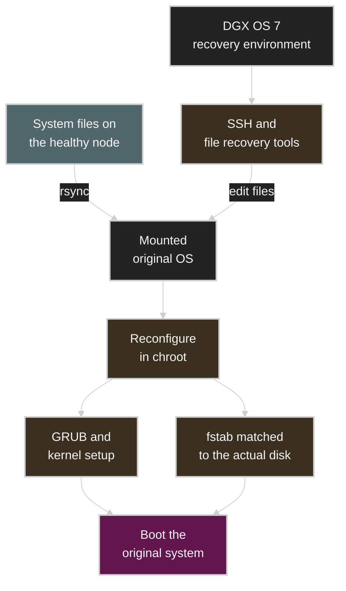

# Recovering a DGX B200 Node After an Accidental rm -rf

**English** | [한국어](dgx-b200-rm-rf-recovery.ko.md)

One day in 2025, I deleted a wide swath of system files on one node of a DGX B200 cluster I was running. A delete command meant for `/tmp/sriov_cni_env.txt` accidentally included a standalone `*`, and the shell that ran it had `/` as its current directory.

One SSH session that was already open survived. With new logins failing, I used that session to restore the account files, and for a while SSH between the nodes worked again. But while I was pulling system files over from a healthy node, I ended up with nested duplicate paths, and right after I copied libraries into place, even `ls` and `rsync` started failing with segmentation faults.

In the end, I booted a DGX OS 7 image to get a separate recovery environment. I mounted the damaged OS, synced its files with the healthy node, repaired the boot configuration from inside a `chroot`, and corrected `/etc/fstab` to match the actual disks. Only then did the node boot fully back into its original system.

Looking back, the environment each command ran in largely determined the outcome. **To repair a system, you first need an environment in which your recovery commands and tools run reliably.** The surviving SSH connection, the healthy node’s files, the recovery image, and the target disk each played a different role.

This post is based on the messages I exchanged while working at the time and the retrospective I wrote after the recovery. The commands and observations follow the records made at the time; examples that explain the underlying mechanisms, and the operational improvements I would make going forward, are identified as such where they appear.

## Contents

1. [The damaged node and the remaining access paths](#1-the-damaged-node-and-the-remaining-access-paths)
2. [An asterisk after a space changed what got deleted](#2-an-asterisk-after-a-space-changed-what-got-deleted)
3. [Why the SSH session survived after the files were gone](#3-why-the-ssh-session-survived-after-the-files-were-gone)
4. [Restoring account files and reconnecting SSH](#4-restoring-account-files-and-reconnecting-ssh)
5. [A second failure during recovery](#5-a-second-failure-during-recovery)
6. [Switching to a DGX OS 7 recovery environment](#6-switching-to-a-dgx-os-7-recovery-environment)
7. [Syncing files with the healthy node](#7-syncing-files-with-the-healthy-node)
8. [Turning the restored files into a bootable system](#8-turning-the-restored-files-into-a-bootable-system)
9. [A successful boot is not a return to service](#9-a-successful-boot-is-not-a-return-to-service)
10. [Turning the lessons into operating procedures](#10-turning-the-lessons-into-operating-procedures)

## 1. The damaged node and the remaining access paths

The damaged node was `dgx-b200-04`. I could still log in normally to `dgx-b200-05` in the same cluster, so during the early recovery I used it as both a reference for comparison and a source of files.

At the time, I was working in tmux with input synchronized across several panes. The prompt right after the incident showed that the shell on node 04 was in `/`. I don’t clearly remember whether the other panes were in the same working directory.

Comparing directory listings with the healthy node after the deletion, I found that paths such as `/etc` and `/bin` were missing on 04. Later I also confirmed that the `kubelet` unit was gone. Meanwhile, deletion failed with error messages for `/boot/efi`, some `/dev` entries, and GPFS’s `.snapshots`.

You can’t judge the extent of the damage from the paths that produced errors alone. Successful deletions may leave no message at all, and a surviving parent directory doesn’t mean its contents are intact. Likewise, the fact that deletion was refused in the GPFS snapshots doesn’t guarantee that all the data was preserved.

Here is where things stood at first:

| Item | Observed state | What it meant for recovery |
|---|---|---|
| Existing SSH session on 04 | Still connected | An access path for checking state and editing files |
| New SSH logins to 04 | Failing at first | If the existing connection dropped, access options would shrink further |
| Healthy node 05 | Reachable over SSH | Used to compare directory layouts and to source recovery files |
| Some userspace tools | `nano` and others still ran at first | Enough to start a minimal file restore |
| BMC | Later confirmed reachable | A candidate path for continuing recovery independently of the host OS |

At that point, the first thing to establish was not whether the whole system was fully healthy, but which access paths and tools still worked. A live SSH connection was, by itself, no guarantee of a new login, let alone a successful next boot.

## 2. An asterisk after a space changed what got deleted

This is the command I ran, taken verbatim from the incident record:

```text
root@dgx-b200-04:/# rm -rf /tmp/sriov_cni_env.txt *
```

There is a space between `/tmp/sriov_cni_env.txt` and `*`, so the shell doesn’t read them as one filename pattern. It handles a single file path and a separate glob pattern, each on its own.

| Input | How it is interpreted |
|---|---|
| `/tmp/sriov_cni_env.txt` | The one file I specified |
| `*` | Every name in the current directory that matches the pattern |
| Current directory `/` | The pattern expands relative to the root directory |
| `-r` | Descend into directories and delete recursively |
| `-f` | Force deletion, skipping confirmation prompts |

With default filename expansion settings, Bash expands an unquoted `*` into the matching entries in the current directory. Names that begin with a dot are excluded by default. The expansion happens before `rm` even runs. [GNU Bash Filename Expansion](https://www.gnu.org/software/bash/manual/html_node/Filename-Expansion.html)

As a result, `rm` received not only the temporary file but also top-level entries such as `bin`, `boot`, `dev`, `etc`, and `lib`, each as a separate argument. That standalone `*` is what widened the scope of the deletion.

### Why root protection didn’t stop it

By default, GNU `rm` refuses to recursively delete `/` itself. That safeguard is much narrower than a policy that blocks deleting everything under the root. In this case, `rm` was handed the root’s children, already expanded by the shell. [GNU Coreutils rm](https://www.gnu.org/software/coreutils/manual/html_node/rm-invocation.html)

When reviewing a command line, check both the string you typed and the final argument list. Once `*`, whitespace, variable expansion, and the current directory come together, the two can look very different.

You don’t need to delete anything to see this. The following non-destructive example prints what the arguments expand to; the output depends on the current directory.

```bash
printf '<%s>\n' /tmp/sriov_cni_env.txt *
```

### What tmux synchronizes and what stays separate

tmux’s pane synchronization sends the same input to multiple panes. It doesn’t make the shells in those panes share the same host, current directory, privileges, or environment variables. The same `*` can expand to a different list in each shell. [tmux Manual](https://man.openbsd.org/tmux)

At the time, the shell on 04 was in `/`. That, combined with root privileges and a standalone wildcard, extended the deletion into system paths. Seeing the same characters in several terminals didn’t mean the commands were running under the same conditions.

## 3. Why the SSH session survived after the files were gone

At first glance it seems contradictory: the system files were deleted, yet the existing SSH session survived. To make sense of it, you have to look at paths on disk and running processes separately.

### Removing a name vs. the lifetime of a running process

On Linux, `unlink()` removes a name from the filesystem. Even after the last name is removed, the file may not go away immediately if open references to it remain. Likewise, the file mappings that a running process uses don’t disappear the moment their pathnames are deleted. [unlink(2)](https://man7.org/linux/man-pages/man2/unlink.2.html), [mmap(2)](https://man7.org/linux/man-pages/man2/mmap.2.html)

So as long as the processes handling the SSH connection, the shell, and the necessary kernel state stay alive, the existing session can keep working. It would be a mistake, though, to read this as “everything is already in RAM, so it’s safe.” A process may still read configuration files or load additional libraries later.

The surviving connection was a chance to make use of execution state that had already been set up. There was no guarantee that the same state would be reproduced at the next login.

### Starting a new program needs those files again

When a dynamically linked ELF executable starts, it uses the dynamic loader named in its `PT_INTERP` program header, and the loader prepares the shared libraries the program needs. Even if the executable itself is still there, `execve()` can fail with `ENOENT` if the loader is gone. [execve(2)](https://man7.org/linux/man-pages/man2/execve.2.html)

In other words, seeing a prompt in a live shell and being able to launch new external commands are separate conditions. Builtins that the shell handles itself also have different dependencies from external executables. [GNU Bash Shell Builtin Commands](https://www.gnu.org/software/bash/manual/html_node/Shell-Builtin-Commands.html)

In this incident, `nano` did work early on. Having a usable tool is what let me start restoring files. Checking which tools were still available was a prerequisite for the entire recovery procedure.

## 4. Restoring account files and reconnecting SSH

In the first round of recovery, I restored the following files, using healthy node 05 as a reference:

- `/etc/passwd`
- `/etc/group`
- `/etc/hosts`

These files hold the information needed for user accounts, groups, and local hostname resolution. `/etc/passwd` contains each account’s UID and GID, home directory, login shell, and so on. The three files don’t replace SSH keys or the full authentication configuration, but they are basic building blocks of a working userspace environment. [passwd(5)](https://man7.org/linux/man-pages/man5/passwd.5.html), [group(5)](https://man7.org/linux/man-pages/man5/group.5.html), [hosts(5)](https://man7.org/linux/man-pages/man5/hosts.5.html)

Around 13:03 on April N, I wrote the following in my working notes:

> SSH between the nodes works both ways now.

That was the first solid progress. I had gone from depending on a single existing session to being able to use SSH between the nodes again. That success also depended on the state of the sshd, authentication configuration, and executables that remained at the time.

That didn’t mean the whole system was back, though. SSH access is one feature that works only when many dependencies line up. Even with that feature restored, other services’ configuration and executables, and the files needed for the next boot, could still be damaged. So I went on to pull more system files over from the healthy node.

The table below lists the times recorded in those notes, in Korea Standard Time (KST).

| Approx. time (KST) | Action or observation |
|---|---|
| April N, 12:36 | Recorded the incident command and the deletion output on 04 |
| 12:48 | 05 reachable; new SSH logins to 04 failing |
| 12:59 | `nano` still works; plan to restore the account files first |
| 13:03 | Three files restored; SSH confirmed working in both directions |
| 13:39 | Nested `/etc/etc` path discovered |
| 13:49–13:55 | Connection problems after copying `/lib`; `ls` and `rsync` hit segmentation faults |
| 16:27 | Found loading a roughly 3.2 GB OS image through the BMC extremely slow |
| April N+3 | Booted successfully after restoring files and boot configuration from recovery mode |

## 5. A second failure during recovery

### Copying a directory or its contents

While I was pulling files over, a path called `/etc/etc` appeared: the listing under `/etc` contained another `etc`. A `/lib/lib` path also turned up during the recovery.

The source path I gave rsync was missing its trailing `/`. When copying an ordinary directory, that difference decides whether the directory name is added as an extra level at the destination. The table below is an illustrative example in which the destination `/restore/` already exists.

| Source | Destination | Result |
|---|---|---|
| `/source/etc` | `/restore/` | Copied to `/restore/etc/` |
| `/source/etc/` | `/restore/` | Its contents copied directly into `/restore/` |

Copying a source `/etc` into an existing `/etc/` can therefore produce `/etc/etc`. [rsync Manual](https://rsync.samba.org/ftp/rsync/rsync.1.html)

`/lib` also involves link structure. On a merged-`/usr` system, `/lib` may be a symbolic link to `/usr/lib`. The behavior depends on the link state of the source and destination before and after the recovery steps, and on the options used, so the plain-directory `/etc` example shouldn’t be applied to `/lib` as is. The nested paths observed at the time have to be checked against the distribution’s normal directory layout. [UAPI Linux File System Hierarchy](https://uapi-group.org/specifications/specs/linux_file_system_hierarchy/)

### Right after copying the nested libraries

I ran the following command to copy the files in `/lib/lib` into `/lib`. This, too, comes from the record of what I ran at the time.

```text
cp -a /lib/lib/* /lib/
```

Right after it ran, the connection dropped. In the session that was still open, `ls` failed with this error:

```text
Segmentation fault (core dumped)
```

An rsync to pull `/lib/` back from the healthy node also failed with a segmentation fault. Now even the basic tools needed for recovery were unusable.

### Using a deleted file is different from using an overwritten one

Earlier I explained that existing references can survive even after a path is deleted. Things are different, though, when you directly change the contents or size of a file that is already in use.

Typical file-copy implementations include a code path that opens the existing destination file, truncates it, and writes into it again. In GNU Coreutils’ `copy.c`, you can see the destination file being opened with `O_TRUNC` under certain conditions. The attribute preservation in `cp -a` does not make it a safe way to swap out the runtime of programs that are already running. [GNU Coreutils copy.c](https://github.com/coreutils/coreutils/blob/master/src/copy.c)

Modifying or truncating a file that a process has mapped can affect the existing mapping as well. That said, my records alone can’t establish exactly how any particular libc file was damaged. Nor can I treat the `SIGBUS` described for accesses beyond the end of a mapped file as the same phenomenon as the `SIGSEGV` I actually observed. [mmap(2)](https://man7.org/linux/man-pages/man2/mmap.2.html)

What is confirmed is the sequence and the outcome: the failure got worse immediately after the copy. Overwriting libraries that were in use, a copy interrupted partway through, or a mismatch between the loader and the libraries are all possible explanations.

The clearer operational problem was that **the tools I was using for recovery depended on the very system files I was modifying**. Fixing `/lib` could undermine the foundation that `ls`, `cp`, and `rsync` needed in order to run.

## 6. Switching to a DGX OS 7 recovery environment

For the final recovery, I downloaded a DGX OS 7 image, booted from it, and entered recovery mode. I then assigned an IP address, set up SSH access, and mounted the damaged original system.

This switch separated where files were being modified from the environment where commands ran. The shell and file-transfer tools ran in the recovery environment, while the original OS was treated as a separately mounted recovery target. Receiving files from the healthy node no longer had to depend on the damaged OS’s runtime.

Keeping a shell running in the recovery environment distinct from a shell inside the target OS is also standard practice in ordinary Linux rescue modes. If you can’t run a shell inside the target OS, you can use the shell of the installer or rescue environment and mount the target filesystem at a separate path. [Debian Recovering a Broken System](https://www.debian.org/releases/stable/amd64/ch08s06.en.html)

The diagram below shows how the pieces used in this recovery fit together. Actual mount paths and device names are omitted.



### BMC access alone isn’t enough

On the day of the incident, I also noted that loading a roughly 3.2 GB OS image through the BMC was extremely slow. The retrospective on the final recovery records that I booted from the image, but not which method I ultimately used to attach the media.

From an operations standpoint, this means the recovery path has to be verified stage by stage. BMC login, the remote console, attaching boot media, actually booting the image, and network access from the recovery environment are each steps that must succeed. There is still work between having confirmed only that the login screen opens and being able to see the target disk from a recovery environment.

## 7. Syncing files with the healthy node

With the recovery environment in place, I used rsync to sync the mounted target system with the healthy node. According to the final retrospective, I added `--checksum` and `--delete` to the command I had been using.

### Comparing contents and cleaning up the destination

`--checksum` compares file sizes and, for files whose sizes match, decides whether to update them based on a checksum of their contents rather than their modification times. This is a separate decision from verifying that transferred files were reconstructed correctly. `--delete` removes files from the destination that don’t exist in the source, within the scope being synced. Exclude rules affect what is actually transferred and deleted. [rsync Manual](https://rsync.samba.org/ftp/rsync/rsync.1.html)

On a damaged or partially restored system, the mere existence of a file says little about whether its contents can be trusted. Re-checking against the healthy node is valuable because it reduces that uncertainty. At the same time, you have to decide what to do with wrongly created paths and leftover files.

The retrospective doesn’t preserve the full final rsync command or its exclude list. That is why this post doesn’t offer a ready-to-run command that targets all of `/`. Reusing the same options without knowing the source, the target mount, and any separate data paths could cause an entirely different deletion accident.

### Healthy-node files vs. the damaged node’s own state

Having the healthy node’s files doesn’t mean you can clone everything as is. If I were turning this incident into a recovery plan, I would separate at least the following areas:

| Area | What the recovery plan has to decide |
|---|---|
| OS binaries and shared libraries | Are the distribution, packages, architecture, and file layout compatible? |
| Kernel and modules | Do the kernel to boot, its modules, and the driver configuration match? |
| Host identity and network settings | How will the target node’s hostname, addresses, and account and authentication configuration be preserved or regenerated? |
| Disk configuration | Do references such as `/etc/fstab` match the actual target devices? |
| Kubernetes and application state | Does the plan avoid overwriting this node’s identity and state with another node’s? |
| Runtime and external mounts | How should `/proc`, `/sys`, `/dev`, `/run`, and GPFS and data mounts be scoped? |

A healthy node can supply the common system files, but that node’s full running state is not the correct state for the damaged node.

In this recovery, that difference showed up most clearly in `/etc/fstab`, which I fixed next.

## 8. Turning the restored files into a bootable system

After syncing the files, I entered the target system with `chroot` and repaired the GRUB and kernel-related configuration. Then I checked the actual disk information with `blkid` and corrected `/etc/fstab`.

### The root as seen from inside chroot

`chroot` changes the root directory that a process and its children use to resolve absolute paths. With the restored OS as the root, you can work with its tools and configuration, but the kernel is still the one the recovery environment booted. [chroot(2)](https://man7.org/linux/man-pages/man2/chroot.2.html)

So the target’s executables and libraries have to be sufficiently restored before you can use the tools inside it. The order matters: I restored the files first, and only then repaired the boot configuration from inside the target OS.

You also shouldn’t confuse the running kernel you see from inside the `chroot` with the kernel installed on the target disk. For example, `uname -r` alone can’t tell you whether the kernel and modules the target system will use on its next boot are the right ones.

### GRUB and kernel configuration

Booting ties together the bootloader, the kernel image, early userspace, and the configuration needed to reach the disks. The initramfs provides the userspace used for early boot work before control passes to the real root filesystem. [Linux Kernel initramfs](https://docs.kernel.org/filesystems/ramfs-rootfs-initramfs.html)

The retrospective’s wording was “initialized grub and the kernel.” Since the full commands weren’t recorded, I can’t present specific `grub-install` options or initramfs update commands as what I actually ran. The actual work also depends on how the EFI System Partition or a separate `/boot` is set up. [GNU GRUB Installation](https://www.gnu.org/software/grub/manual/grub/html_node/Installing-GRUB-using-grub_002dinstall.html)

The purpose of this step is clear, though: it aligned the boot configuration so that the node could correctly find and use the restored files on its next boot.

### Why I checked the disks with blkid and fixed fstab

`blkid` is a tool for inspecting block device attributes such as filesystem type and UUID. `/etc/fstab` records which filesystems to mount, where, and with which options. [blkid(8)](https://man7.org/linux/man-pages/man8/blkid.8.html), [fstab(5)](https://man7.org/linux/man-pages/man5/fstab.5.html)

Copying another node’s OS contents file by file doesn’t make the target filesystems’ UUIDs match that node’s. You have to check whether the healthy node’s configuration actually fits the target disks. In practice, I edited `/etc/fstab` to match the `blkid` output.

This step shows the difference between “the necessary files are present” and “this machine references those files and devices correctly.” A configuration with mismatched UUIDs is wrong for that node, even if the file itself is perfectly intact. Other boot references, such as the root device specified to the bootloader, also need to be checked separately depending on the environment.

The retrospective I wrote on April N+3 ends like this:

> I chrooted in and initialized grub and the kernel on that system. Fixed /etc/fstab to match blkid, too. And then it booted.

The system on the original disk booting again confirmed that this recovery path had worked.

## 9. A successful boot is not a return to service

The last outcome the records confirm is a normal boot and a record that the recovery succeeded. No follow-up verification commands or output for GPU, RDMA, or Kubernetes were preserved. The recovery result in this post is therefore limited to restoring the OS boot.

If you are designing the criteria for putting a GPU node back into service, you need role-specific verification beyond the boot itself. The table below is not a record of checks I performed this time; it lists checks to include in the return-to-service procedure after this type of failure.

| Layer to check | Question to answer | Example evidence |
|---|---|---|
| OS and disks | Did it boot the intended kernel, with the required filesystems mounted correctly? | Boot logs, mount information, status of key services |
| Accounts and remote access | Can a fresh connection log in with the right account? | A new SSH login, independent of any existing session |
| GPU runtime | Are the GPUs and the driver working in the expected configuration? | Device enumeration, supported diagnostics, a real CUDA job |
| Network and RDMA | Are inter-node communication and the intended data paths restored? | Link state, inter-node transfer and communication tests |
| Kubernetes | Are the node’s identity and resource registration correct? | kubelet status, advertised device resources, a restricted test Pod |
| Storage and workloads | Can it access data, and can a real job produce results? | Reads and writes on the intended paths, a small representative job |

Verification should be scoped to the extent of the failure and the node’s role. If you start from basic reachability and widen the checks toward the paths real workloads use, it becomes easier to explain at which stage a problem remains. This layering also ties into the node return-to-service criteria discussed in [GPU Infrastructure Operations and Platform Design](https://adcs.restack.tech/gpu/articles/gpu-infrastructure-operations-and-platform-design.ko/) (in Korean).

## 10. Turning the lessons into operating procedures

The direct cause of the incident was my own mistake: running a delete command with the wrong arguments in a root shell. But there were also conditions that let that mistake spread to system-wide paths and then led to another failure mid-recovery. If I were designing the operating procedure for this kind of work again, here is what I would change.

### Use the smallest operation that fits the target

Deleting a single file needs neither a recursive option nor a standalone wildcard. Here is an example that targets just that one temporary file:

```bash
rm -- /tmp/sriov_cni_env.txt
```

What limits the scope in this example is the exact single path and dropping the unnecessary recursive option. `--` only stops the arguments that follow from being parsed as options; it does not validate the path itself. [GNU Coreutils rm](https://www.gnu.org/software/coreutils/manual/html_node/rm-invocation.html)

For repetitive tasks, I would make the paths to delete and the target nodes explicit. The review also wouldn’t stop at the command string I typed; it would cover the actual host, privileges, working directory, and the expanded targets.

### Verify multi-node changes on one node first

tmux’s synchronized input is convenient, but it doesn’t verify that every pane is working under the same conditions. Changes involving relative paths and wildcards are especially sensitive to each shell’s state.

For deletions or changes to system paths, the procedure should be to turn off synchronized input, confirm the path and the result on one target node, and only then roll the change out further. If a task has to be applied repeatedly across many nodes, moving it into automation that records the node list and the results also makes later review easier.

### Decide in advance when to switch to a recovery environment

Keeping the existing session alive was useful for preserving access. But continuing to replace entire libraries inside that OS while basic tools keep failing destabilizes the very foundation of the recovery.

If I were writing the procedure again, I would use these as decision criteria: “Do the external commands needed for recovery still work?”, “Are the recovery tools themselves using the files I’m about to modify?”, and “If this fails, can I move to a different execution environment?” Those criteria would determine when to switch to recovery media and a separate access path.

### Restore common OS configuration and node-specific state separately

Having a healthy node was a key resource in this recovery. To turn that into a repeatable operating practice, you need to define how to restore each node’s disk identifiers, network, authentication, and cluster state, in addition to the common OS files and package configuration.

If you prepare a recovery image and configuration records in advance, and verify the actual boot and access paths, the next failure won’t force you to find a file source and an execution environment at the same time. In environments where reprovisioning the whole node gives more consistent results, that route is worth comparing too. The success of this recovery doesn’t mean every system should take the same file-copying approach.

In this incident, the existing SSH session bought time to assess the situation and attempt an initial recovery. The healthy node supplied the files I needed, and the DGX OS 7 recovery environment provided a working base for handling them. Finally, `chroot` and the disk configuration fixes turned the restored files into a machine that actually booted.

## Related articles and references

### Related articles

- [GPU Infrastructure Operations and Platform Design: From Hardware Failure Analysis to Multi-Tenancy](https://adcs.restack.tech/gpu/articles/gpu-infrastructure-operations-and-platform-design.ko/) (in Korean)
- [GPU Articles](https://adcs.restack.tech/gpu/articles/)

### Technical references

| Topic | Reference |
|---|---|
| Shell filename expansion | [GNU Bash Filename Expansion](https://www.gnu.org/software/bash/manual/html_node/Filename-Expansion.html) |
| Shell builtin commands | [GNU Bash Shell Builtin Commands](https://www.gnu.org/software/bash/manual/html_node/Shell-Builtin-Commands.html) |
| Recursive deletion and root protection | [GNU Coreutils rm](https://www.gnu.org/software/coreutils/manual/html_node/rm-invocation.html) |
| tmux pane synchronization | [tmux Manual](https://man.openbsd.org/tmux) |
| File lifetime after deletion | [unlink(2)](https://man7.org/linux/man-pages/man2/unlink.2.html) |
| File mappings and file modification | [mmap(2)](https://man7.org/linux/man-pages/man2/mmap.2.html) |
| Program execution and the dynamic loader | [execve(2)](https://man7.org/linux/man-pages/man2/execve.2.html) |
| Account and name-resolution files | [passwd(5)](https://man7.org/linux/man-pages/man5/passwd.5.html), [group(5)](https://man7.org/linux/man-pages/man5/group.5.html), [hosts(5)](https://man7.org/linux/man-pages/man5/hosts.5.html) |
| Copying and synchronizing directories | [rsync Manual](https://rsync.samba.org/ftp/rsync/rsync.1.html) |
| How file copying is implemented | [GNU Coreutils copy.c](https://github.com/coreutils/coreutils/blob/master/src/copy.c) |
| Merged `/usr` and compatibility paths | [UAPI Linux File System Hierarchy](https://uapi-group.org/specifications/specs/linux_file_system_hierarchy/) |
| Independent recovery environments | [Debian Recovering a Broken System](https://www.debian.org/releases/stable/amd64/ch08s06.en.html) |
| Changing a process’s root directory | [chroot(2)](https://man7.org/linux/man-pages/man2/chroot.2.html) |
| Early boot environment | [Linux Kernel initramfs](https://docs.kernel.org/filesystems/ramfs-rootfs-initramfs.html) |
| Bootloader installation requirements | [GNU GRUB Installation](https://www.gnu.org/software/grub/manual/grub/html_node/Installing-GRUB-using-grub_002dinstall.html) |
| Disk identification and mount configuration | [blkid(8)](https://man7.org/linux/man-pages/man8/blkid.8.html), [fstab(5)](https://man7.org/linux/man-pages/man5/fstab.5.html) |

These references are cited to explain general behavior. They reflect current documentation and were not matched to the distribution, kernel, and driver versions the nodes were running in April 2025.
