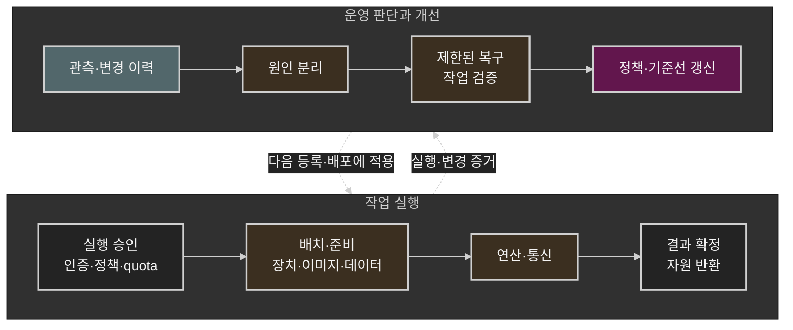
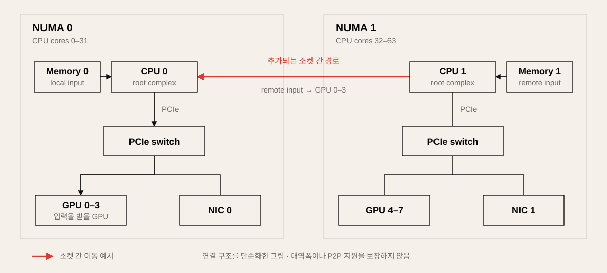
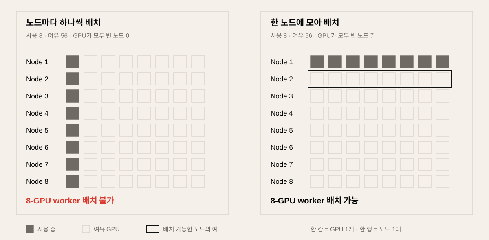
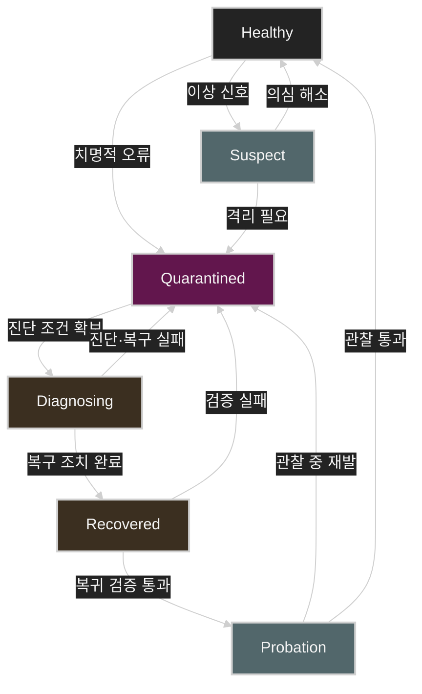
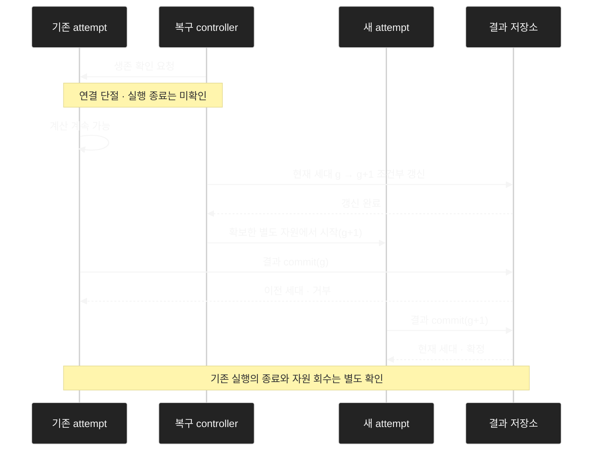

# GPU 인프라 운영과 플랫폼 설계: 하드웨어 장애 분석부터 멀티테넌시까지

GPU 노드를 재부팅한 뒤 학습이 다시 진행되고 step time도 기준선으로 돌아왔다고 하자. 당장의 장애는 수습했다. 하지만 작업을 다시 돌리는 것만으로 사건 처리가 끝나지는 않는다. 같은 구성을 쓰는 다른 노드에도 문제가 있는지, 재발 조건을 알고 있는지, 다음 패치에서도 이 문제를 잡아낼 수 있는지 확인해야 한다.

수백 대를 운영할 때는 이 후속 판단이 운영 품질을 가른다. 매번 같은 사람이 로그를 읽고 기억을 더듬어야 한다면 장비가 늘수록 그 사람에게 일이 몰린다. 복구에 사용한 증거와 판단을 노드 등록, 배치, 변경 검증, 복귀 절차에 남겨야 다음 담당자가 같은 문제를 처음부터 풀지 않아도 된다.

이 글은 Linux·NVIDIA·Kubernetes 공식 문서를 바탕으로 하드웨어 진단부터 멀티테넌트 운영까지 살펴본다. 장애 사례와 수치, 상태 모델은 설명을 위한 가상 예시다. 제품이 제공하는 기능과 운영자가 설계해야 할 절차를 구분했으며, 버전에 따라 달라지는 기능은 실제 운영 조합의 지원 조건을 확인해야 한다.

기술 문서 확인 기준: 2026년 10월.

## 목차

1. [작업의 실행 경로와 운영 책임](#1-작업의-실행-경로와-운영-책임)
2. [진단에서 남겨야 할 것](#2-진단에서-남겨야-할-것)
3. [하드웨어 진단과 노드 복귀](#3-하드웨어-진단과-노드-복귀)
4. [성능 기준선과 배치 정책](#4-성능-기준선과-배치-정책)
5. [Kubernetes 상태를 해석하는 법](#5-kubernetes-상태를-해석하는-법)
6. [검증된 조합으로 변경하기](#6-검증된-조합으로-변경하기)
7. [멀티테넌시의 서비스 계약과 격리](#7-멀티테넌시의-서비스-계약과-격리)
8. [자원 승인부터 반환까지](#8-자원-승인부터-반환까지)
9. [장치 복구와 작업 복구](#9-장치-복구와-작업-복구)
10. [관측성과 용량 계획](#10-관측성과-용량-계획)
11. [자동화에 넘길 판단과 남겨둘 판단](#11-자동화에-넘길-판단과-남겨둘-판단)
12. [사고가 바꿔야 할 것](#12-사고가-바꿔야-할-것)
13. [마무리](#마무리)
14. [관련 글과 참고 자료](#관련-글과-참고-자료)

## 1. 작업의 실행 경로와 운영 책임

### 느려졌다는 말을 측정 가능한 단계로 나눈다

“학습이 느려졌다”는 말만으로는 조사 범위를 정할 수 없다. 대기열에서 시간이 늘었는지, 첫 step까지 오래 걸리는지, 실행 중인 step이 느려졌는지부터 나눈다. 사용자는 모두 느리다고 느끼지만, 운영자가 손대야 할 곳은 각각 다르다.

| 구간 | 사용자가 경험하는 문제 | 우선 확인할 대상 |
| --- | --- | --- |
| 제출 → 실행 승인 | 대기열에서 오래 기다림 | quota, 우선순위, admission 정책 |
| 승인 → 자원 배치 | 승인됐지만 실행할 노드가 없음 | fragmentation, topology, 실제 가용 용량 |
| 배치 → 첫 유효 step | 시작이 늦거나 반복 실패 | 이미지·모델·데이터 준비, 초기화, worker 합류 |
| 정상 실행 | step time 또는 추론 지연 증가 | 입력 공급, GPU 연산, collective, 공유 자원 경합 |
| 중단 → 작업 재개 | 같은 계산을 반복하거나 복구가 지연됨 | checkpoint, 재시도, 자원 반환, 결과 일관성 |

구간을 나누면 확인할 대상이 좁아진다. 아직 GPU를 할당받지 못한 작업이라면 queue와 배치를 먼저 보고, 실행 중인 작업이라면 입력·연산·통신을 조사한다. 전체 경로를 그려두는 이유도 조사할 경계를 빨리 찾기 위해서다.



그림은 실행 단계를 묶어 표현한 것이다. 준비에는 CPU 전처리와 호스트 메모리 할당이, 결과 저장에는 checkpoint가 포함된다. 관측은 승인부터 자원 반환까지 각 단계에서 수집한다. 복구 과정에서 확인한 조건을 다음 등록·배포에 반영하는 피드백이 있어야 같은 조사와 판단을 반복하는 비용이 줄어든다.

### 각 경계에 성공 조건과 소유자를 둔다

각 단계에는 “여기까지 완료되었다”는 조건과 실패를 처리할 주체가 필요하다. 어느 팀의 코드인지보다, 문제가 생겼을 때 누가 결정을 내리고 누가 자원을 정리하는지가 더 급한 질문이다.

예를 들어 admission이 quota를 예약한 뒤에도 worker가 들어갈 노드가 없을 수 있다. 장치를 할당한 뒤 통신 초기화에서 멈출 수도 있다. 앞 단계의 성공을 다음 단계의 성공으로 넘겨짚으면, 작업은 멈춰 있는데 모든 구성 요소가 자기 일은 끝났다고 보고하는 상황이 생긴다.

다음은 팀 규모에 맞게 합칠 수 있는 책임 구분의 예다.

| 경계 | 보장할 조건 | 판단과 조치의 주체 | 남길 증거 |
| --- | --- | --- | --- |
| 노드 실행 풀 등록 | 지원하는 플랫폼 구성과 검증 결과가 일치함 | 노드 수명주기 관리 | 구성 revision, 진단 결과 |
| 작업 승인 | tenant 정책과 quota를 충족함 | admission 관리 | 승인 이유, 예약 내역 |
| 배치·장치 할당 | 요청한 자원 형태와 topology를 만족함 | scheduler와 장치 관리 | 노드, GPU UUID, 할당 관계 |
| 작업 시작 | 필요한 worker가 준비되고 유효 작업을 시작함 | workload 관리 | attempt, 준비 시각, 첫 진행 시각 |
| 장애 복구 | 기존 실행을 정리하고 유효 상태에서 재개함 | workload·노드 관리의 조정 주체 | checkpoint, 종료·격리 증거, 복귀 검증 |

이 책임을 반드시 서로 다른 팀에 나눌 필요는 없다. 다만 **같은 자원에 대한 최종 결정권은 명확해야 한다.** GPU health 감시, 드라이버 업그레이드, 노드 패치가 모두 같은 노드를 drain할 수 있다면 어느 작업이 진행 중인지 공유하고 중복 조치를 막아야 한다.

### 운영 중에도 유지해야 할 규칙을 정한다

운영 절차를 정할 때는 적어도 다음 조건을 명시해두는 편이 좋다.

- 노드의 실행 풀 복귀에는 지원 구성 확인과 workload 검증 결과가 필요하다.
- quota 예약, 실제 배치, worker 준비, 유효한 작업 진행을 각각 관측한다.
- 작업 재시도는 이전 실행의 생존 가능성과 결과 쓰기 권한을 함께 처리한다.
- 변경 확대는 사전에 정의한 검증과 중단 조건을 따른다.
- 자동 복구에는 대상 범위, 동시성, 재시도 횟수, 사람에게 넘길 조건이 있다.

예외는 생긴다. 긴급한 작업 때문에 검증 범위를 줄이거나, 한동안 특정 노드를 다른 정책으로 운영할 수도 있다. 그때 무엇을 완화했는지, 누가 책임지는지, 언제 다시 검토할지를 남긴다. 이 기록이 없으면 임시 조치가 언제부터 기본 설정이 되었는지 알기 어렵다.

## 2. 진단에서 남겨야 할 것

### 도구보다 먼저 가설을 구성한다

이미 정상임을 확인한 구간은 지나간다. OS에 접속할 수 있는데 PXE부터 확인할 이유는 없다. 단일 GPU에서는 정상이고 멀티노드에서만 실패한다면, 우선 그 차이를 만드는 경로에 집중한다.

```text
증상과 영향 범위 정의
  → 최근 변경과 정상 기준선 확보
  → 경쟁하는 가설 구성
  → 가설을 구별할 증거 수집
  → 가장 작은 범위의 조치
  → 사용자 관점의 복구 검증
  → 반복 가능한 통제로 반영
```

분산 학습이 느릴 때도 통신부터 원인으로 확정하지 않는다. 입력이 늦게 도착했는지, 한 rank의 연산이 늦는지, 통신 경로가 바뀌었는지, 재시작으로 같은 계산을 반복하는지 살펴본다. 같은 노드의 단일 GPU 작업과 노드 내부 collective를 비교하고, 문제가 특정 노드를 따라가는지 확인한다. NCCL 문제 해결 문서도 GPU·네트워크·런타임 경로를 나누어 조사한다. [NCCL Troubleshooting](https://docs.nvidia.com/deeplearning/nccl/user-guide/docs/troubleshooting.html)

명령 출력 옆에는 **무엇을 배제했고 무엇이 아직 불명확한지**를 적는다. 장애 중에는 원인을 끝까지 밝히기 전에 복구해야 할 때도 있다. 이때 “서비스 복구 완료”와 “원인 조사 완료”를 따로 기록해둔다. 재부팅 후 증상이 사라졌다는 사실만 남으면, 다음 사건에서는 재부팅이 원인에 맞는 조치였는지조차 판단하기 어렵다.

### 같은 실행과 같은 장치를 식별한다

한 로그의 GPU가 다른 로그의 어느 Pod에 해당하는지 찾는 데 시간을 쓰지 않도록, 다음 식별자를 사건 기록에 함께 남긴다.

| 범주 | 기록할 내용 | 필요한 이유 |
| --- | --- | --- |
| 작업 | tenant, job ID, attempt ID, rank | 재시도와 중복 실행을 구분 |
| 실행 환경 | image·model digest, 실행 옵션, platform revision | 코드·모델·시스템 변경을 구분 |
| 장치 | 노드 식별자, GPU UUID, PCI BDF, NIC·포트 | 오류가 장치와 위치 중 무엇을 따라가는지 추적 |
| 시간 | 발생 시각, 수집 시각, boot ID | 재부팅 전후와 지연 수집을 구분 |
| 배치 | CPU·NUMA·GPU·NIC 연결, 작업의 노드 집합 | 성능 경로와 장애 영역을 연결 |
| 변경 | 배포·패치·설정 변경 ID | 정상 기준선과 차이를 비교 |

GPU index와 PCI BDF는 배치·부팅 구성에 따라 달라질 수 있으므로 영구 식별자로 단독 사용하지 않는다. 관측 당시의 UUID·BDF·노드 매핑을 함께 보관한다. BMC와 호스트의 시계가 다르면 이벤트의 순서도 잘못 읽을 수 있으므로, 시각의 기준과 오차를 확인한다.

수집 경로도 장애를 겪는다. 호스트에 접속할 수 없을 때 BMC나 중앙 로그에서 무엇을 볼 수 있는지 미리 확인한다. 로그 보존 기간, 수집 timeout, 민감한 workload 인자의 제거 기준도 정해둔다. 평상시에 수집된다는 사실보다 장애 중에 필요한 증거를 꺼낼 수 있는지가 중요하다.

### 진단 결과를 다음 장애의 입력으로 만든다

한 번 해결한 문제를 runbook에 적을 때는 다음 항목을 남긴다.

```text
적용 가능한 플랫폼과 증상
필요한 사전 관측과 최근성
경쟁 가설과 구별 기준
허용하는 조치와 영향 범위
중단·상향 보고 조건
복구 후 검증과 관찰 기간
```

“Xid가 발생하면 재부팅” 정도의 기록으로는 다음 담당자가 안전하게 조치하기 어렵다. 적용되는 GPU·드라이버 조합과 오류, workload를 종료해야 하는 조건, 복구 후 검사까지 있어야 한다. 자동화로 옮길 때도 바로 이 정보가 필요하다.

## 3. 하드웨어 진단과 노드 복귀

### 부팅 경로와 관리 경로를 구분한다

BMC는 호스트 OS와 별도로 동작하는 관리 경로다. 센서, 이벤트 로그, 원격 콘솔, 전원 제어를 통해 호스트가 어디까지 진행했는지 확인한다. 호스트의 부팅 경로에서는 kernel/initramfs와 실제 root filesystem으로 전환한 뒤의 서비스 시작을 나누어 본다. [ipmitool Manual](https://manpages.debian.org/bookworm/ipmitool/ipmitool.1.en.html), [systemd bootup](https://www.freedesktop.org/software/systemd/man/latest/bootup.html)

```text
호스트 실행 경로:
전원 → Firmware/POST → 부팅 장치 선택 → Bootloader
     → Kernel/initramfs → Root filesystem → systemd
     → 네트워크·런타임·kubelet

별도 관리 경로:
BMC → 센서·이벤트 로그·원격 콘솔·전원 제어
```

“클러스터에 들어오지 않는다”는 증상은 마지막으로 성공한 단계에 따라 나뉜다.

| 관측된 상태 | 조사할 경계 | 확보할 증거 |
| --- | --- | --- |
| POST가 진행되지 않음 | 펌웨어·메모리·전원·PCIe 초기화 | BMC 이벤트, POST 코드, 콘솔 |
| 네트워크 부팅 이미지에 도달하지 못함 | 부팅 NIC·VLAN·DHCP·이미지 전달 | 부팅 서버와 DHCP 로그 |
| 커널 시작 후 root disk를 찾지 못함 | initramfs·스토리지 드라이버·장치 식별 | 부팅 콘솔, 커널 메시지 |
| OS는 정상이나 Node 객체가 없음 | kubelet·API 연결·TLS bootstrap | 서비스 로그, CSR, API 연결 |
| Node가 Ready가 아님 | 런타임·네트워크·노드 상태 | Node conditions, 런타임 로그 |
| Node는 Ready이나 GPU 자원이 없음 | 드라이버·장치 노출·Device Plugin | 장치 상태, plugin 로그, allocatable |

Node가 Ready여도 GPU 자원은 빠져 있을 수 있다. Device Plugin이 kubelet에 장치를 등록하고 건강 상태를 전달하는 경로까지 확인해야 한다. [Kubernetes Device Plugins](https://kubernetes.io/docs/concepts/extend-kubernetes/compute-storage-net/device-plugins/)

systemd와 containerd를 사용하는 노드에서는 서비스와 부팅 로그부터 확인한다.

```bash
# 대상 노드에서 실행
systemctl --failed
systemctl status kubelet containerd --no-pager
journalctl -b -u kubelet --no-pager
journalctl -b -u containerd --no-pager
ip -br address
ip route
timedatectl status
```

관리 터미널에서는 Node 조건과 등록 과정을 확인한다.

```bash
NODE=gpu-node-01

kubectl get node "$NODE" -o yaml
kubectl describe node "$NODE"
kubectl get csr
```

`connection refused`라면 연결 대상과 리스너를 본다. 인증서 오류라면 시간·CA·유효성·bootstrap 경로를, 런타임 오류라면 CRI endpoint와 서비스 상태를 확인한다. 오류 메시지에 따라 다음 검사가 달라져야 로그를 읽은 의미가 있다. [kubeadm Troubleshooting](https://kubernetes.io/docs/setup/production-environment/tools/kubeadm/troubleshooting-kubeadm/)

### 펌웨어 장애의 복구 수단을 미리 확보한다

BIOS 업데이트 후 POST에서 멈췄다면 아직 OS가 시작되지 않은 상태다. 관리망에서 전원·센서·이벤트를 읽고, 원격 콘솔에서 마지막 POST 단계를 확인한다.

```bash
BMC_HOST=192.0.2.10
BMC_USER=operator

# -a는 비밀번호를 대화형으로 입력받는다.
ipmitool -I lanplus -H "$BMC_HOST" -U "$BMC_USER" -a chassis status
ipmitool -I lanplus -H "$BMC_HOST" -U "$BMC_USER" -a sel elist
ipmitool -I lanplus -H "$BMC_HOST" -U "$BMC_USER" -a sensor list
```

전원을 다시 조작하기 전에 실제로 정지했는지, 업데이트 후 초기화가 진행 중인지 구분한다. 이후 업데이트 전후 설정, 지원 firmware 조합, PCIe 자원 배치와 BAR 구성을 비교한다. BIOS의 대형 BAR 처리와 플랫폼 호환성은 GPUDirect 구성에도 영향을 줄 수 있다. [GPUDirect RDMA](https://docs.nvidia.com/cuda/gpudirect-rdma/index.html)

BIOS rollback, recovery image, 이중 이미지 복구의 지원 여부는 서버별로 확인한다. BMC 재시작, 호스트 재부팅, BIOS rollback은 서로 다른 작업이다. 가상 미디어도 firmware가 해당 장치를 부팅할 수 있는 단계까지 진행해야 사용할 수 있다.

복구 방법은 장비 도입 때 확인해두는 편이 낫다. 관리 경로 접근성, firmware 기준 버전, 설정 백업, 지원되는 복구 절차를 인벤토리에 남긴다. 정작 부팅되지 않는 서버의 로컬 디스크에만 이 정보가 있으면 사용할 수 없다.

### PCI passthrough에서는 호스트와 게스트의 소유권을 분리한다

GPU가 보이지 않는다는 보고를 받으면 먼저 컨테이너에 노출한 장치인지, VM에 직접 할당한 장치인지 확인한다. full PCI passthrough에서는 장치 소유권이 다음처럼 나뉜다.

```text
호스트: GPU PCI device → vfio-pci → VM
게스트: GPU PCI device → NVIDIA driver → CUDA application
```

호스트에서 장치가 `vfio-pci`에 바인딩되어 있다면 해당 GPU가 호스트의 `nvidia-smi`에 나타나지 않는 것은 자연스럽다. VFIO는 IOMMU 보호 아래 장치의 직접 접근을 제공하며, IOMMU group은 하드웨어가 제공하는 격리 경계와 관련된다. [Linux VFIO](https://docs.kernel.org/driver-api/vfio.html)

```bash
# 호스트에서 장치 소유권과 PCIe·DMA 오류 확인
GPU_BDF=0000:65:00.0

lspci -nnk -s "$GPU_BDF"
sudo lspci -vv -s "$GPU_BDF"
readlink -f "/sys/bus/pci/devices/$GPU_BDF/driver"
readlink -f "/sys/bus/pci/devices/$GPU_BDF/iommu_group"
ls -l "/sys/bus/pci/devices/$GPU_BDF/iommu_group/devices"

sudo journalctl -k --since "-30 min" |
  grep -Ei 'vfio|iommu|dmar|aer|pcie'
```

게스트에서는 NVIDIA 드라이버와 애플리케이션 오류를 확인한다.

```bash
nvidia-smi -L
nvidia-smi -q
sudo journalctl -k --since "-30 min" | grep -Ei 'nvrm|xid'
```

“GPU가 사라졌다”는 보고를 다음 가설로 나누면 조사와 복구의 범위가 명확해진다.

| 가설 | 구별할 증거 |
| --- | --- |
| 애플리케이션·CUDA context 오류 | 특정 코드·입력에서의 재현, 게스트 오류 |
| 드라이버 문제 | 버전 변경과 발생 시점, Xid, 재현 범위 |
| PCIe·전원·하드웨어 경로 문제 | AER, 링크 변화, BMC 전원·온도 이벤트 |
| IOMMU·VFIO 매핑 문제 | 호스트 DMA fault, VFIO mapping 오류 |
| 메모리 고정·등록 실패 | 실제 프로세스 제한, 메모리 등록 오류 |

Xid 79는 드라이버가 PCIe 경로에서 GPU에 접근할 수 없는 상태를 나타낸다. 코드만으로 GPU 부품 불량을 확정하지 않고, 장치·드라이버 적용 범위와 직전 이벤트, 권장 복구 조치를 함께 본다. [NVIDIA Xid Catalog](https://docs.nvidia.com/deploy/xid-errors/analyzing-xid-catalog.html)

유지보수 환경에서 교차 검증할 때는 오류가 GPU를 따라가는지, 서버·슬롯·워크로드를 따라가는지 본다. 작업 중단이 필요하더라도 그전에 수집할 수 있는 증거는 확보한다. 진단은 재부팅 없이 할 수 있어도 장치 복구에는 중단이 필요할 수 있으므로, 두 범위를 나누어 설명하는 편이 정확하다.

### Memory pinning과 IOMMU 설정을 플랫폼별로 관리한다

VRAM 여유, 호스트 RAM 여유, 호스트 메모리를 고정할 수 있는 권한·한도, RDMA 메모리 등록 가능 여부는 별개다. GPU 메모리를 대상으로 하는 GPUDirect RDMA 등록도 호스트 메모리 등록과 동일한 경로로 가정하지 않는다.

```bash
PID=12345  # 실제 QEMU 또는 대상 프로세스 PID

grep -i 'locked memory' "/proc/$PID/limits"
grep -E 'VmRSS|VmLck|VmPin' "/proc/$PID/status"
```

현재 셸의 `ulimit -l`은 이미 실행 중인 서비스의 제한을 대신하지 않는다. `RLIMIT_MEMLOCK`의 적용은 권한과 경로에 따라 달라지며, `VmLck`·`VmPin`만으로 모든 드라이버의 메모리 등록 상태를 설명할 수 있는 것도 아니다. [getrlimit(2)](https://man7.org/linux/man-pages/man2/getrlimit.2.html)

IOMMU는 실행 환경을 확인한 뒤 판단한다. VM passthrough에는 DMA 격리가 필요하고, Linux bare-metal의 GPU PCIe P2P에는 NVIDIA가 명시한 IOMMU translation 제약이 있다. 가상화와 bare-metal의 지원 구성을 별도 profile로 관리하는 이유다. ACS나 IOMMU를 바꿀 때는 성능뿐 아니라 격리에 미치는 영향도 검증한다. [NCCL GPU Troubleshooting](https://docs.nvidia.com/deeplearning/nccl/user-guide/docs/troubleshooting/gpu_troubleshooting.html)

하드웨어 사건을 닫을 때는 장치별 오류 이력과 함께 복귀에 사용한 검사를 남긴다. 같은 구성의 노드를 새로 들이거나 다음에 복구할 때, 그 검사를 다시 사용할 수 있어야 한다.

## 4. 성능 기준선과 배치 정책

### GPU locality는 여러 자원을 함께 배치하는 문제다

설명을 위해 다음과 같은 이중 소켓 서버를 가정한다.



그림은 두 NUMA 영역과 PCIe switch를 가정한 연결 예시다. 선의 길이나 굵기는 대역폭을 뜻하지 않으며, 실제 서버의 root complex·switch·GPU·NIC 연결과 P2P 지원 여부는 별도로 확인해야 한다.

GPU 0을 사용하는 프로세스가 NUMA 1의 CPU에서 전처리하고 입력 버퍼도 NUMA 1에 할당하면 소켓 간 경로를 추가로 사용할 수 있다. GPU–NIC 통신에서도 PCIe switch, root complex, 소켓 간 경로가 성능과 지원 가능성에 영향을 준다. [GPUDirect RDMA](https://docs.nvidia.com/cuda/gpudirect-rdma/index.html)

```bash
lscpu
numactl --hardware
nvidia-smi topo -m
lspci -tv

PID=12345
numastat -p "$PID"
taskset -pc "$PID"

NIC=ens6f0
cat "/sys/class/net/$NIC/device/numa_node"
```

`numastat -p`는 프로세스 메모리의 NUMA 배치를 보여준다. 실제 원격 접근 비율과 지연을 그 출력만으로 확정하지는 않는다. CPU affinity를 바꾸어도 이미 할당된 메모리가 자동으로 가까워지는 것은 아니므로, 다음을 한 묶음으로 조사한다.

```text
GPU 선택 + CPU 실행 위치 + 호스트 메모리 배치
        + 데이터 로더 배치 + NIC 선택 + 통신 rank 배치
```

통제된 단일 GPU 실험에서는 실제 장치 근접 관계를 확인한 뒤 다음과 같이 비교할 수 있다.

```bash
# 유휴 실험 환경에서 실행하는 예시
CUDA_VISIBLE_DEVICES=0 \
  numactl --cpunodebind=0 --membind=0 \
  python train.py
```

이 실험에서는 모델·입력·배치·정밀도·프로세스 수와 clock·power 조건을 고정하고 locality만 바꾼다. 한 번 빨라졌다는 결과로 배치 정책을 바꾸기는 이르다. 반복해도 차이가 나는지, 입력·연산·통신 중 어느 구간이 줄었는지 확인한다.

### 노드 내부 정렬과 클러스터 배치를 구분한다

Kubernetes Topology Manager는 노드 내부의 CPU·메모리·장치 topology hint를 조정한다. scope와 provider 설정에 따라 정렬 범위가 달라지며, `single-numa-node` 정책은 조건을 만족하지 못하면 Pod admission을 거부할 수 있다. 클러스터 전체에서 적합한 노드를 고르는 기능과는 범위가 다르다. [Kubernetes Topology Manager](https://kubernetes.io/docs/tasks/administer-cluster/topology-manager/)

앞의 서버에서 Pod 하나가 GPU 8개를 요청하면 장치가 두 NUMA 노드에 걸친다. 단일 GPU worker에 적합한 정책을 노드 전체를 사용하는 worker에 그대로 적용하면 admission부터 실패할 수 있다.

그래서 workload 단위부터 정한다. 전용 CPU가 필요한지, 메모리 locality를 어떻게 유지할지, topology hint가 없는 장치를 허용할지 결정한다. 요구한 배치가 불가능할 때 기다릴지 거절할지도 함께 정해야 한다. 노드의 CPU 총량과 GPU 개수만 보고서는 이 결정을 내릴 수 없다.

### 평균 사용률보다 가장 늦는 참여자를 찾는다

동기식 학습을 통신과 연산이 겹치지 않는 단순 모델로 나타내면 다음과 같다.

$$
T_{\text{step}}
\approx
\max_i \left(T_{\text{input},i}+T_{\text{compute},i}\right)
+T_{\text{collective}}
$$

실제 구현에서는 통신과 연산이 겹치므로 critical path에 남은 시간을 봐야 한다. 여기서 살펴볼 것은 평균보다 늦게 도착하는 rank다. 평균 GPU 사용률이 높아도 한 rank의 입력 대기나 통신 지연이 전체 step을 늦출 수 있다.

진단 실험은 실패 경계를 좁히도록 구성한다.

```text
단일 GPU 애플리케이션
  → 같은 노드의 GPU 간 통신
  → 두 노드 사이의 통신
  → 같은 네트워크 영역의 여러 노드
  → 다른 영역을 포함한 전체 작업
```

다음은 MPI 지원으로 빌드한 `nccl-tests`와 동일한 실행 환경을 갖춘 유휴 노드 두 대의 예시다. 각 노드에는 GPU 8개가 있고 MPI 실행 경로가 준비되어 있다고 가정한다.

```bash
mpirun -np 16 \
  --host gpu-a:8,gpu-b:8 \
  -x NCCL_DEBUG=INFO \
  -x NCCL_DEBUG_SUBSYS=INIT,NET,GRAPH \
  ./build/all_reduce_perf \
  -b 8M -e 1G -f 2 -g 1
```

처리량 숫자를 보기 전에 실제 transport와 HCA가 예상대로 선택되었는지 확인한다. 경로가 바뀐 채 얻은 숫자는 같은 조건의 성능 비교가 아니다. 메시지 크기별 성능, 포트별 부하, 오류 카운터를 함께 기록하고 저수준 fabric과 collective를 각각 검증한다. [NCCL Networking Troubleshooting](https://docs.nvidia.com/deeplearning/nccl/user-guide/docs/troubleshooting/networking_troubleshooting.html)

GPUDirect RDMA 활성 여부를 `nvidia_peermem` 모듈 하나로 판단하지 않는다. GPU Operator 문서는 DMA-BUF와 legacy `nvidia-peermem` 경로를 설명하며 지원 조건을 만족하는 환경에서 DMA-BUF를 권장한다. 사용한 커널·드라이버 조합, 라이브러리 로그와 실제 데이터 전송을 함께 검증해야 한다. [GPU Operator GPUDirect RDMA](https://docs.nvidia.com/datacenter/cloud-native/gpu-operator/latest/gpu-operator-rdma.html)

### 대역폭 수치에는 측정 정의를 붙인다

`nccl-tests`의 AllReduce에서 데이터 크기를 $S$, 소요 시간을 $t$, rank 수를 $N$이라 하면 다음 관계를 사용한다.

$$
\text{algbw}=\frac{S}{t},
\qquad
\text{busbw}=\text{algbw}\times\frac{2(N-1)}{N}
$$

`busbw`는 collective 통신량을 반영한 보정 지표다. 특정 NIC 포트에서 직접 읽은 전송량이 아니다. rank 8개에서 `algbw`가 20 GB/s라면 `busbw`는 35 GB/s지만, 이를 곧바로 한 포트의 처리량으로 해석하면 안 된다. [nccl-tests Performance](https://github.com/NVIDIA/nccl-tests/blob/master/doc/PERFORMANCE.md)

400 Gb/s를 8로 나눈 50 GB/s도 단위 환산값이다. 애플리케이션이 그 처리량을 얻는다는 보장은 없다. 기준선에는 단위와 함께 노드·rank 수, 메시지 크기, GPU·NIC 구성, 선택된 경로를 저장한다.

### 성능 기준선도 버전이 있는 운영 자산이다

성능 분석 결과는 세 가지 형태로 남길 수 있다.

1. **인벤토리:** GPU·CPU·NIC·NUMA와 네트워크 영역의 관계.
2. **배치 규칙:** workload가 요구하는 locality와 허용할 수 있는 대안.
3. **검증 기준선:** 고정된 workload와 시스템 조합에서의 성능 분포.

기준선에는 정상 상태의 변동 폭이 들어가야 한다. warm-up, 데이터 캐시, 이웃 부하, 시간대 조건을 기록하고 반복 측정으로 허용 범위를 정한다. 최고 성능 한 번을 기준으로 잡으면 정상 변동에도 변경을 중단하게 된다. 하드웨어나 workload가 바뀌면 기존 기준선을 계속 쓸 수 있는지도 다시 판단한다.

같은 기준선을 장비 등록, 드라이버 변경, 장애 복구 후 복귀에 사용한다. 그러면 담당자마다 “이 정도면 정상”의 의미가 달라지는 일을 줄일 수 있다.

## 5. Kubernetes 상태를 해석하는 법

### ImagePullBackOff에서는 이미지를 가져오는 주체를 조사한다

`ImagePullBackOff`는 재시도를 기다리는 상태를 알려줄 뿐, 원인까지 알려주지는 않는다. 이미지 이름·digest, credential, 레지스트리 연결, 플랫폼 호환성, 로컬 저장소를 실제 오류 메시지에 따라 좁혀간다. pull을 수행하는 주체는 kubelet과 컨테이너 런타임이다. [Kubernetes Images](https://kubernetes.io/docs/concepts/containers/images/)

```bash
NS=training
POD=trainer-0

kubectl -n "$NS" describe pod "$POD"
kubectl -n "$NS" get pod "$POD" -o json |
  jq '{
    node: .spec.nodeName,
    images: [.spec.containers[].image],
    imagePullSecrets: .spec.imagePullSecrets,
    statuses: .status.containerStatuses
  }'
```

이벤트의 `unauthorized`는 credential 전달 경로를, 이름 해석 실패는 노드의 DNS를, timeout은 런타임의 프록시·라우팅·방화벽을 조사하는 근거다. `no space left on device`가 나타나면 이미지 저장 경로의 용량과 inode를 확인한다.

따라서 애플리케이션 Pod의 NetworkPolicy를 바꾸기 전에 노드 런타임의 연결 경로를 확인한다. 별도의 host policy가 적용되는지도 본다. 아직 시작하지 않은 컨테이너의 네트워크 설정만 보고 image pull 실패를 설명하면 조사 방향이 어긋날 수 있다.

시작 시간도 image pull, 모델 다운로드, 초기화, worker 합류로 나누어 기록해둔다. 여러 노드가 같은 registry에서 막혔다는 사실이 보이면 노드마다 복구를 시도할 이유가 줄어든다.

### DiskPressure와 디스크 사용률의 측정 범위를 맞춘다

`df -h`가 40%인데 `DiskPressure=True`라면 파일시스템과 시점을 먼저 맞춘다. kubelet은 바이트와 inode를 모두 관측하며, `nodefs`, `imagefs`, 지원되는 구성의 `containerfs`를 구분한다. `containerfs`는 런타임·버전·구성에 의존하므로 모든 containerd 노드에 별도로 존재한다고 가정하지 않는다. [Kubernetes Node-pressure Eviction](https://kubernetes.io/docs/concepts/scheduling-eviction/node-pressure-eviction/)

```bash
# 노드에서 실제 저장 경로 확인
df -hT
df -ih
findmnt -T /var/lib/kubelet
findmnt -T /var/lib/containerd
findmnt -T /var/log
sudo lsof -nP +L1
```

관리 권한이 있는 터미널에서는 kubelet이 본 값을 비교한다.

```bash
NODE=gpu-node-01

kubectl describe node "$NODE"
kubectl get --raw "/api/v1/nodes/${NODE}/proxy/stats/summary" |
  jq '.node | {fs: .fs, runtime: .runtime}'
```

여기서는 네 가지를 확인한다. 같은 파일시스템을 보고 있는지, inode가 부족한지, 이미 eviction이나 GC가 끝난 뒤의 값인지, pressure 전환 지연이 남아 있는지다.

삭제된 열린 파일은 `du`로 보이는 사용량보다 `df`의 사용량이 큰 상황을 설명할 수 있다. 동일한 파일시스템의 `df`가 실제로 40%라는 사실을 그것만으로 설명하지는 못한다. 또한 `DiskPressure`와 `Ready`는 별도 Node condition이다. Ready까지 바뀌었다면 그 시점의 kubelet·런타임·API 연결을 추가 조사한다.

평상시에도 저장 경로와 mount를 인벤토리에 연결해둔다. 바이트·inode·증가율·회수 이력을 함께 보면 경보가 어느 저장 경로에서 발생했는지 바로 찾을 수 있다. 이미지 캐시와 로그가 차지할 여유 공간도 이 경로별로 잡는다.

### 네트워크 지표를 비교할 때는 단위와 집계 지점을 맞춘다

호스트에서는 40G, 스위치에서는 4G가 보인다고 하자. 숫자를 설명하기 전에 같은 경로·방향·단위·평균 구간인지 맞춘다. bond 전체를 단일 포트와 비교하거나 호스트 TX를 스위치 TX와 비교하고 있다면, 차이를 원인 분석에 사용할 수 없다.

`iftop`은 협상된 링크 속도가 아니라 인터페이스에서 관측한 IP 트래픽을 표시한다. 기본 단위는 bit/s이고 `-B`는 byte/s다. bit와 byte는 8배 차이이므로 10배 차이의 원인을 그것만으로 확정할 수 없다. [iftop Manual](https://manpages.debian.org/bookworm/iftop/iftop.8.en.html)

```bash
NIC=ens6f0

ip -s link show dev "$NIC"
ethtool "$NIC"
ethtool -S "$NIC"
```

누적 바이트 카운터로 처리량을 구한다면 같은 구간의 차이를 사용한다.

$$
\text{bit/s}
=
\frac{\text{bytes}(t_2)-\text{bytes}(t_1)}{t_2-t_1}\times8
$$

카운터 reset과 wrap을 구분하고, 표준 인터페이스 통계와 드라이버별 통계의 의미를 확인한다. RDMA 데이터 경로 전체가 `iftop`에 보인다고 가정하지 않고 HCA·스위치 fabric 카운터와 함께 조사한다. [Linux Interface Statistics](https://docs.kernel.org/networking/statistics.html)

지표의 단위, 방향, 집계 범위, 표본 구간은 수집할 때 정해둔다. 장애 중에 대시보드 두 개의 숫자가 무엇을 뜻하는지부터 조사하는 시간을 줄일 수 있다.

### 시작 직후 OOM이 나면 실행 조건부터 비교한다

GPU 애플리케이션은 모델·activation·KV cache 같은 GPU 메모리뿐 아니라 데이터 로더, 캐시, pinned buffer 등의 호스트 메모리도 사용한다. Linux cgroup의 일반적인 `memory.max`와 CUDA device-memory 할당 실패는 다른 경로다.

```bash
NS=inference
POD=model-server-0
CONTAINER=server

kubectl -n "$NS" get pod "$POD" -o json |
  jq '.status.containerStatuses[] |
      {name, state, lastState, restartCount}'
kubectl -n "$NS" logs "$POD" -c "$CONTAINER" --previous
```

| 관측 | 조사할 경로 | 단독으로 확정할 수 없는 것 |
| --- | --- | --- |
| `OOMKilled` | 호스트 메모리 OOM | 어떤 limit 또는 노드 상황이 원인이었는지 |
| CUDA out-of-memory | GPU 메모리 할당 | 모델 크기만의 문제인지, 캐시·동시성·단편화 문제인지 |
| exit code 137 | SIGKILL 종료 | 종료 주체와 이유 |
| Node MemoryPressure | 노드 가용 메모리와 eviction | 특정 컨테이너의 limit 초과 여부 |

cgroup v2 호스트에서 실제 컨테이너 프로세스 PID를 찾았다면 다음을 읽을 수 있다. 일반적인 `/sys/fs/cgroup` mount 구성을 가정한다.

```bash
PID=12345
CGROUP_PATH=$(
  awk -F: '$1 == "0" {print $3}' "/proc/$PID/cgroup"
)

for name in memory.current memory.max memory.events memory.events.local; do
  cg_file="/sys/fs/cgroup${CGROUP_PATH}/${name}"
  if [ -r "$cg_file" ]; then
    printf '\n## %s\n' "$name"
    cat "$cg_file"
  fi
done
```

`memory.events`는 하위 cgroup 이벤트를 포함할 수 있고, `memory.events.local`은 로컬 이벤트를 보여준다. `oom_kill` 증가만으로 해당 cgroup의 `memory.max` 초과를 확정하지 않는다. `max`·`oom` 변화와 커널 로그를 연결한다. 종료된 프로세스와 cgroup은 사라질 수 있으므로 종료 전후 증거를 지속적으로 수집할 필요도 있다. [Linux cgroup v2](https://docs.kernel.org/admin-guide/cgroup-v2.html)

CI에서 통과한 canary가 시작 직후 종료된다면 CI와 실제 배포의 실행 조건을 나란히 놓고 비교한다. image digest뿐 아니라 모델, worker 수, 동시성, 입력 크기, memory limit, sidecar, 캐시 초기화를 본다. 프로세스를 1개에서 4개로 늘렸고 각각 모델을 독립적으로 로드한다면, 코드 변경이 작아도 시작 메모리 요구는 달라질 수 있다.

릴리스 검증도 실제 artifact와 실행 옵션으로 cold start, 모델 로드, 대표 부하 구간까지 진행한다. 급하면 limit을 올려 복구할 수 있다. 다만 그 조치와 메모리 증가 원인의 확인은 별도로 남겨야 다음 배포에서도 limit부터 올리는 일을 피할 수 있다.

### Probe와 진행 감시를 다른 신호로 설계한다

Startup probe는 초기화가 성공할 때까지 readiness·liveness probe 실행을 지연시킨다. Readiness는 트래픽 수신 준비 상태에, liveness는 재시작 판단에 사용된다. [Kubernetes Probes](https://kubernetes.io/docs/tasks/configure-pod-container/configure-liveness-readiness-startup-probes/)

| 신호 | GPU 모델 서버에서의 의미 | 실패 시 의도하는 동작 |
| --- | --- | --- |
| Startup | 모델 로드와 필수 초기화가 끝남 | 준비 시간을 허용하되 시작 실패에 상한 설정 |
| Readiness | 현재 신규 요청을 받을 수 있음 | 트래픽 유입 제한 |
| Liveness | 프로세스가 재시작으로 회복할 수 있는 정지 상태인지 판단 | 재시작 |
| 작업 진행 | 요청 완료나 학습 step이 실제로 증가함 | 원인 조사와 workload별 복구 정책 적용 |

health endpoint가 응답해도 학습 step은 멈춰 있을 수 있다. checkpoint나 긴 컴파일 때문에 진행 지표가 잠시 멈추는 것은 정상일 수 있다. 따라서 진행 감시에는 현재 workload 단계와 그 단계에서 허용할 정체 시간이 필요하다.

외부 저장소가 잠시 느려졌을 때 모든 replica를 재시작하면 모델을 다시 읽는 부하까지 겹친다. 이 상황에서는 신규 요청을 막아야 하는지, 프로세스를 재시작해야 하는지를 따로 판단한다. probe의 실패 동작이 원래 장애를 키우지 않는지 확인해야 한다.

### Rolling update에는 교체용 용량이 필요하다

GPU 4개를 replica 4개가 하나씩 사용하고, `maxSurge: 1`, `maxUnavailable: 0`이라고 하자. 새 Pod는 GPU를 얻지 못하고, controller는 기존 가용 replica를 줄일 수 없다.

이 상태는 scheduler가 더 오래 재시도해도 풀리지 않는다. GPU 여유를 확보하거나, 일시적인 replica 감소를 허용하거나, 별도 용량을 쓰는 배포 방식을 택해야 한다. terminating Pod가 GPU를 실제로 반환하는 시간도 배포 시간에 포함한다. [Kubernetes Deployments](https://kubernetes.io/docs/concepts/workloads/controllers/deployment/)

PDB는 모든 Pod 종료를 막는 장치가 아니며 Deployment 자체의 rollout을 대신 제어하지 않는다. rollout 설정과 eviction 정책을 각각 검토한다. [Kubernetes Disruptions](https://kubernetes.io/docs/concepts/workloads/pods/disruptions/)

배포 전에는 가용성 목표와 교체 용량을 함께 계산한다. 기존 replica를 줄일 수 없고 새 replica가 쓸 GPU도 없다면, 배포를 시작하기 전에 둘 중 어느 조건을 바꿀지 결정해야 한다.

## 6. 검증된 조합으로 변경하기

### GPU 노드의 커널 변경에는 여러 호환성 경계가 있다

GPU 노드에서 커널만 보고 패치를 완료했다고 판단하기는 어렵다. GPU·NIC 드라이버, 모듈 빌드와 서명, initramfs, 컨테이너 런타임, RDMA 경로까지 확인해야 한다. 무엇을 검증했는지 남기려면 다음 조합 전체를 릴리스 단위로 식별하는 편이 좋다.

```text
Platform release
= OS/kernel와 부팅 설정
+ GPU driver와 필요한 fabric 구성 요소
+ NIC driver/firmware
+ Container runtime/toolkit
+ Kubernetes와 노드 자원 관리 설정
+ 지원하는 workload profile
+ 검증 결과와 복구 대상 revision
```

커널 하나만 바꾸더라도 함께 검증한 드라이버·firmware·런타임 버전을 기록한다. 그래야 어떤 조합을 지원하는지 설명할 수 있고, 새 커널과 이전 드라이버 모듈이 섞여 남은 노드도 찾아낼 수 있다.

릴리스 검증은 다음 층으로 나눈다.

| 검증 층 | 통과 조건 |
| --- | --- |
| 부팅·장치 | 정상 부팅, 예상 GPU·NIC와 모듈 확인 |
| 클러스터 | Node Ready, 예상 장치 자원 광고, 노드 정책 확인 |
| 진단 | 대상 플랫폼에 맞는 진단 통과 |
| 통신 | 단일 GPU, 노드 내부, 노드 간 경로 검증 |
| workload | 정확성·성능·시작 시간·메모리 요구가 허용 범위 |
| 복구 | 이전 플랫폼으로 복귀하고 작업을 재개할 수 있음 |

DCGM Diagnostics는 GPU와 시스템 준비 상태를 검사하는 데 사용할 수 있다. 진단 레벨별 부하와 요구 조건을 확인해 유지보수 절차에 포함한다. 진단 통과만으로 모든 실제 workload의 성능과 정확성이 보장되지는 않는다. [DCGM Diagnostics](https://docs.nvidia.com/datacenter/dcgm/latest/user-guide/dcgm-diagnostics.html)

### 패치 동시성은 남아 있는 여유로 정한다

다음은 200대를 여러 ring으로 나누는 가상 예시다.

| Ring | 그룹의 노드 수 | 확인할 내용 |
| --- | ---: | --- |
| 실험 canary | 2 | 부팅·모듈·기본 실행·rollback |
| 대표성 canary | 8 | 서버·GPU·NIC 유형별 차이 |
| 제한 배포 | 30 | 실제 workload와 운영 절차 |
| 확대 배포 | 60 | 여러 장애 영역의 변화와 동시성 영향 |
| 나머지 배포 | 100 | 검증된 범위 내 확장 |

이 표의 30대는 해당 ring에 속한 노드 수다. 동시에 30대를 재부팅해도 된다는 뜻은 아니다. 동시 변경 수는 랙, 전원·네트워크 영역, 실행 중인 job, 이미 고장·격리된 용량, GPU 유형별 예비 용량을 보고 정한다. rollout 도중 다른 장애가 나서 여유가 줄면 패치도 늦추거나 멈춰야 한다.

GPU Operator의 드라이버 업그레이드 기능은 동시 업그레이드, GPU workload 종료, drain, 검증 등을 제어하는 수단을 제공한다. 커널·firmware까지 포함한 전체 플랫폼 변경은 각 도구의 책임과 조정 절차를 별도로 설계해야 한다. [GPU Operator Driver Upgrades](https://docs.nvidia.com/datacenter/cloud-native/gpu-operator/latest/gpu-driver-upgrades.html)

노드 변경의 순서는 다음과 같이 구성할 수 있다.

```text
신규 작업 유입 차단
  → 실행 중 작업과 영향 범위 확인
  → 체크포인트 요청·완료 검증
  → 작업 종료·이동과 자원 해제 확인
  → 플랫폼 변경
  → 장치·통신·workload 검증
  → 제한된 실행으로 관찰
  → 정상 실행 풀 복귀
```

drain을 시작하기 전에 checkpoint 완료 여부를 workload 쪽에서 확인한다. eviction만으로 유효한 checkpoint가 만들어지지는 않는다. 분산 작업이라면 해당 노드의 worker가 빠졌을 때 작업 전체를 어떻게 중단하고 재개할지도 정해져 있어야 한다.

통과·중단 조건은 rollout 전에 합의한다. 같은 모델·입력·배치·정밀도·노드 수에서 step time과 통신 지표가 허용 범위를 벗어나면 다음 ring으로 넘어가지 않는다. **측정값이 없어 판단할 수 없는 상태도 통과로 처리하지 않는다.** 허용 범위와 관찰 시간은 기준선의 변동 폭과 서비스 요구를 보고 정한다.

### Rollback 대상에는 부팅과 작업 재개 경로가 들어간다

이전 커널 패키지를 보관해도 드라이버 모듈, initramfs, NIC 설정, Secure Boot 조건이 맞지 않으면 이전 상태로 돌아가지 못한다. firmware는 downgrade가 제한될 수도 있다.

rollback은 이전 조합으로 부팅한 뒤 장치를 확인하고, 클러스터에 복귀해 checkpoint에서 작업을 재개하는 데까지 검증한다. 정확성과 성능도 이전 범위로 돌아와야 한다. 되돌릴 수 없는 요소가 있다면 부품 교체나 대체 용량을 변경 전에 준비한다.

canary에서는 이 경로를 실제로 밟아본다. 운영 전체에 적용한 뒤에야 rollback 문서의 누락을 발견하면 선택지가 훨씬 줄어든다.

### Terraform과 Ansible도 같은 변경 계약을 따른다

Terraform drift를 발견했을 때 첫 판단은 변경의 의도다. 긴급 복구를 위해 수동으로 바꾼 값인지, 유지해야 할 변경인지 확인한 뒤 코드로 되돌릴지 configuration에 반영할지 정한다. 이 과정에서 configuration, state, 실제 인프라를 구분해 읽는다.

```bash
terraform plan -refresh-only

# 변경 의도와 configuration을 정리한 뒤 일반 계획 검토
terraform plan -out=reconcile.tfplan
terraform show reconcile.tfplan
```

`plan -refresh-only`는 관측한 실물을 state에 반영할 때의 차이를 검토한다. 이 명령만으로 configuration이 바뀌거나 실제 인프라가 수정되지는 않는다. 이미 관리 중인 객체의 승인된 수동 변경은 configuration에 반영하고, 관리 대상에 없던 객체라면 import 필요성을 검토한다. [Terraform Resource Drift](https://developer.hashicorp.com/terraform/tutorials/state/resource-drift)

plan에 in-place update라고 표시되어도 서비스가 영향을 받는지 따로 검토한다. 네트워크·스토리지·접근 경로가 바뀌면 객체를 재생성하지 않아도 연결이 끊길 수 있다. provider가 수행할 작업과 서비스의 의존성을 함께 읽어야 한다.

Ansible `--check`는 모듈별 지원 수준이 다른 시뮬레이션이다. 앞선 task가 실제로 생성해야 하는 파일이나 값에 후속 task가 의존할 수 있고, `check_mode: false`인 task는 check 실행 중에도 실제 변경을 할 수 있다. [Ansible Check Mode](https://docs.ansible.com/projects/ansible/latest/playbook_guide/playbooks_checkmode.html)

정적 검사와 check/diff 이후에는 테스트 환경에서 실제로 실행한다. 두 번째 실행에 불필요한 변경이 없는지, 재부팅 뒤에도 상태가 유지되는지 확인한 다음 작은 운영 canary로 넘어간다. idempotency를 확인했더라도 목표 상태가 올바른지는 별도로 검증해야 한다. 잘못된 mount 설정도 얼마든지 일관되게 반복 적용할 수 있다.

module은 개별 작업을 수행하고, role은 tasks·handlers·variables·templates를 재사용 가능한 구조로 묶는다. role의 경계는 함께 변경하고 검증하고 되돌릴 기능을 기준으로 잡는다. BIOS부터 모니터링까지 한 role에 넣으면 작은 변경에도 넓은 권한과 검증 범위가 따라온다. [Ansible Roles](https://docs.ansible.com/projects/ansible/latest/playbook_guide/playbooks_reuse_roles.html)

### 배포 artifact와 검증 결과의 연결을 유지한다

GPU workload의 배포 단위도 image 하나보다 넓다.

```text
Workload release
= Application image digest
+ Model artifact digest
+ Tokenizer·engine·실행 구성 revision
+ Supported platform profile
+ Validation result
```

검증한 artifact를 그대로 승격한다. 운영 승격 때 다시 빌드하거나 tag가 다른 내용을 가리키면, 배포된 것이 테스트를 통과한 것과 같은지부터 다시 확인해야 한다. 이미지 내용은 digest로 고정할 수 있다. [Kubernetes Images](https://kubernetes.io/docs/concepts/containers/images/)

서명으로 확인하는 출처·무결성과 기능·성능 검증은 각각 필요하다. repository를 하나로 모았더라도 배포 권한, 실패 범위, 실행 대기열, 승인 경계까지 모두 공유할 필요는 없다. 공통 pipeline library에도 버전을 부여하고 호환성을 확인해 배포한다. [Jenkins Pipeline Best Practices](https://www.jenkins.io/doc/book/pipeline/pipeline-best-practices/)

## 7. 멀티테넌시의 서비스 계약과 격리

### 먼저 어떤 작업을 함께 운영할지 정한다

“여러 팀이 GPU를 공유하게 해달라”는 요구를 받으면 먼저 어떤 작업을 중단할 수 있고 어떤 지연을 허용할 수 있는지 묻는다. tenant 간 신뢰 수준, GPU 유형과 작업 크기, 데이터 접근 경계도 확인한다. 이 답이 있어야 scheduler와 공유 방식을 선택할 수 있다.

다음은 서비스 유형을 나누는 예시다.

| 서비스 유형 | 우선 목표 | 배치·변경의 기본 방향 | 측정할 결과 |
| --- | --- | --- | --- |
| 온라인 추론 | 지연 시간과 가용성 | 예측 가능한 자원, 교체 여유, 변경 제한 | 부하별 p99, 오류율, cold start |
| 분산 학습 | 완료 시간과 유효 처리량 | topology, 동시 자원 확보, checkpoint 복구 | queue wait, step time, 손실 계산 |
| 개발·실험 | 접근성과 자원 활용 | 제한된 공유, 명시적인 best-effort | 대기 시간, 사용 가능성, 회수 시간 |

동일한 클러스터 안에서도 실행 풀과 정책을 나눌 수 있다. 다만 온라인 서비스의 교체 여유를 배치 작업에 빌려준다면, 필요할 때 얼마 만에 돌려받는지까지 정해야 한다. 반환에 시간이 걸리는 용량을 즉시 쓸 수 있는 예비 용량으로 잡으면 장애 때 계산이 맞지 않는다.

운영할 조합의 수를 줄이려면 검증된 workload profile을 제공하는 편이 낫다. 지원 GPU, 최소 메모리, locality, 공유 수준, 중단·재시도 규칙을 묶어 사용자가 선택하게 한다. 개별 kernel·scheduler 옵션을 자유롭게 조합하도록 열어두면 그 조합을 지원하는 비용도 함께 떠안게 된다. 별도 요구는 이유와 만료 시점이 있는 예외로 관리할 수 있다.

### GPU 공유 방식별로 약속할 수 있는 범위가 다르다

| 방식 | 기본 성격 | 플랫폼이 추가 검증할 것 |
| --- | --- | --- |
| 전용 GPU | GPU 단위 독점 사용 | 호스트 CPU·NIC·스토리지 경합, 노드 장애 영향 |
| MIG | 지원 GPU의 하드웨어 자원 분할 | profile 적합성, 인스턴스 경계, 공유 장애 영역 |
| Time-slicing | 같은 GPU에 대한 공유 접근 | VRAM 경쟁, 성능 변동, 오류 영향 |
| MPS | 여러 CUDA 프로세스의 동시 실행 지원 | 세대·버전별 제한 기능, 자원 보장, 오류 전파 |

NVIDIA의 Kubernetes time-slicing은 replica 사이에 메모리·장애 격리를 제공하지 않는다. shared resource를 여러 개 요청했다고 그 개수에 비례한 compute 지분을 보장하지도 않는다. 따라서 replica 수를 독립적인 하드웨어 조각의 수로 회계하면 실제 보장과 차이가 생긴다. [GPU Operator Time-Slicing](https://docs.nvidia.com/datacenter/cloud-native/gpu-operator/latest/gpu-sharing.html)

MIG에서는 GPU Instance와 Compute Instance를 구분해야 한다. 같은 GPU Instance 안의 Compute Instance는 일부 자원을 공유하므로 각각을 독립적인 메모리 파티션으로 취급하지 않는다. [MIG Concepts](https://docs.nvidia.com/datacenter/tesla/mig-user-guide/concepts.html)

MPS는 세대와 버전을 확인해 기능 범위를 읽어야 한다. 지원 세대의 주소공간 분리, 제한된 오류 containment, 실행 자원 제한을 MIG의 하드웨어 분할과 같은 보장으로 취급하지 않는다. [When to Use MPS](https://docs.nvidia.com/deploy/mps/latest/when-to-use-mps.html)

NVIDIA는 CUDA 13.4 이상, Linux cgroup v2, non-MIG 장치 등의 조건에서 MPS v3 장치 메모리 partitioning도 문서화하고 있다. 과거 버전의 제약을 현재 모든 MPS 구성에 적용해서는 안 된다. 도입할 때는 driver·kernel 조합과 함께 cgroup 계층, managed memory 제한, workload 종료 시 예약 정리를 검증한다. 메모리 용량을 제한했더라도 대역폭과 보안 격리는 따로 확인해야 한다. [MPS v3 Memory Partitioning](https://docs.nvidia.com/deploy/mps/latest/mpsv3-memory-partitioning.html)

선택의 기준은 다음 요구를 각각 만족하는지다.

```text
메모리 용량 제한
메모리 대역폭 격리
연산 자원 분할
성능 예측 가능성
장애 격리
보안 격리
```

사용자에게 약속한 각 항목이 어느 계층에서 집행되는지 확인한다. quota에는 제한이 적혀 있지만 runtime이 강제하지 못한다면, 그 수치를 격리 보장으로 안내해서는 안 된다.

### Noisy neighbor의 영향은 GPU 밖에도 남는다

전용 GPU나 MIG를 사용해도 호스트 CPU, 메모리 대역폭, PCIe, NIC, 스토리지 경합은 남을 수 있다. GPU 내부 분할의 효과와 호스트 전체의 격리 수준은 별도로 평가한다.

검증은 실제로 함께 배치할 workload 조합을 대상으로 수행한다.

```text
A 단독 / B 단독 기준선
  → A와 B 동시 실행
  → A와 메모리 대역폭 부하
  → A와 네트워크 부하
  → A와 스토리지 부하
```

추론에서는 동일한 요청 혼합과 제공 부하를 유지해 tail latency를 비교한다.

$$
\text{Tail latency inflation}
=\frac{p99_{\text{shared}}}{p99_{\text{isolated}}}-1
$$

학습에서는 step time, 통신 시간, 유효 처리량을 비교한다. 함께 실행할 때의 허용 증가율은 workload와 서비스 계약에 맞춰 정한다. 평균 GPU utilization이 좋아졌어도 서비스의 p99나 작업 완료 시간이 허용 범위를 벗어나면 그 조합은 받아들이기 어렵다.

함께 실행할 수 있다고 검증한 조건은 CPU·메모리·NIC 예산과 배치 제약에 반영한다. 새 workload나 platform release가 들어왔을 때 언제 재검증할지도 남겨둔다. 조건이 바뀌었는데 과거의 “가능” 판정만 계속 재사용하지 않도록 한다.

### 신뢰 수준이 다르면 보안 경계를 먼저 결정한다

Namespace와 ResourceQuota만으로 적대적인 tenant 사이의 강한 격리가 완성되지는 않는다. Kubernetes 멀티테넌시는 신뢰 수준과 격리 요구에 따라 검토할 경계가 달라진다. [Kubernetes Multi-tenancy](https://kubernetes.io/docs/concepts/security/multi-tenancy/)

GPU 플랫폼에서는 장치 접근 권한, privileged 실행, hostPath, 드라이버·커널, 데이터 접근, RDMA·보조 네트워크를 함께 본다. 일반 Pod NetworkPolicy가 별도 데이터 경로에도 집행되는지는 실제로 확인해야 한다.

강한 격리가 필요하면 전용 노드나 적절한 VM 경계를 먼저 정하고, 그 안에서 지원되는 GPU·RDMA 구성을 찾는다. 성능을 얻기 위해 격리 설정을 완화했다면 무엇을 포기했는지도 profile과 보안 검토에 남긴다.

## 8. 자원 승인부터 반환까지

### Admission·placement·allocation·enforcement의 책임을 나눈다

제품마다 “할당”이나 “준비 완료”의 범위가 다를 수 있다. 구성 요소를 연결하기 전에 각 단계가 무엇을 결정하고 어떤 증거로 완료되는지 맞춰둔다.

| 책임 | 결정할 내용 | 완료의 증거 |
| --- | --- | --- |
| Admission | 이 작업을 지금 승인할 것인가 | quota·정책 검사와 예약 |
| Placement | 어떤 노드·영역에서 실행할 것인가 | 요청 형태를 만족하는 배치 |
| Device allocation | 어떤 실제 장치·인스턴스를 연결할 것인가 | claim·Pod·장치의 대응 |
| Runtime enforcement | 실행 중 어떤 제한과 경계를 유지할 것인가 | 설정 적용과 실제 동작 |
| Release | 종료한 작업이 무엇을 반환했는가 | 실행 종료, 예약·할당 정리 |

Kueue의 queue·quota·admission, scheduler의 placement, kubelet의 노드 자원 관리, 장치 드라이버의 enforcement는 서로 다른 역할이다. DRA는 장치 요청·선택·할당 모델을 제공하지만 tenant fairness와 GPU 메모리 격리를 자동으로 완성하지 않는다. [Kubernetes DRA](https://kubernetes.io/docs/concepts/resource-management/dynamic-resource-allocation/)

Kueue의 topology-aware placement는 랙·블록·노드 등의 영역을 다룬다. kubelet Topology Manager의 NUMA 정렬과 연결할 필요는 있지만, 어느 하나가 다른 범위를 대신하지는 않는다. [Kueue Topology-Aware Scheduling](https://kueue.sigs.k8s.io/docs/concepts/topology_aware_scheduling/)

### 총량이 충분해도 실행 가능한 형태가 없을 수 있다

노드 8대에 GPU가 8개씩 있고, 각 노드에 단일 GPU 작업이 하나씩 실행 중이라고 하자. 남은 GPU는 56개다.

$$
8\times7=56
$$

그런데 새 작업의 worker Pod 하나가 GPU 8개를 요구하면 어느 노드에도 들어가지 못한다. 총량과 실행 가능한 자원 형태 사이의 차이가 fragmentation이다.



같은 8개의 단일 GPU 작업을 처음부터 다르게 배치한 비교다. 실행 중인 작업을 비용 없이 옮긴다는 뜻은 아니다. 그림은 GPU 개수만 비교하며, CPU·메모리·topology·장애 영역 제약은 별도로 만족해야 한다.

작은 작업을 일부 노드에 모으면 큰 작업에 쓸 온전한 노드를 남길 수 있다. 그 대신 한 장애 영역에 작업이 몰리거나 온라인 서비스의 여유가 줄 수 있다. bin packing의 이익과 장애 시 영향을 함께 보고, 어떤 크기의 작업을 위해 공간을 남길지 결정한다.

용량을 볼 때도 “GPU 몇 개가 비었다”에서 한 단계 더 들어간다. 단일 GPU 작업, 노드 전체 작업, 같은 fabric 영역의 다중 노드 작업이 각각 얼마나 들어가는지 계산한다. 이미 실행 중인 비선점 작업을 옮겨야만 가능한 배치는 지금 사용할 수 있는 용량에서 제외한다.

Kueue 역시 aggregate quota와 실제 노드 배치 가능성을 구분한다. 총량 예약만으로 모든 Pod가 들어갈 수 있는 것은 아니다. [Kueue All-or-nothing Scheduling](https://kueue.sigs.k8s.io/docs/concepts/all_or_nothing/)

### Gang 실행에는 부분 실패를 정리하는 경로가 필요하다

GPU 16개가 필요한 작업에서 일부 worker만 시작하면 GPU를 점유한 채 나머지를 기다릴 수 있다. 자원을 함께 예약했더라도 image pull이나 초기화에서 일부 worker가 실패할 수 있으므로, 시작에 실패한 작업이 언제 자원을 내놓을지까지 설계해야 한다.

다음은 플랫폼을 설명하기 위한 상태 모델이다. 특정 scheduler의 실제 API나 정확한 내부 순서를 뜻하지 않는다.

```text
Queued → Reserved → PlacementValidated → Starting
       → AllWorkersReady → Running → Completing → Released

시작·실행 실패
  → 종료·격리 판단
  → 남은 worker와 할당 정리
  → 재시도 가능성 확인
  → Backoff → Queued
```

상태마다 언제 들어왔는지, 언제까지 기다릴지, 실패하면 누가 무엇을 정리할지를 정한다. 이 정보가 없으면 `Starting`이 끝나지 않는 작업을 사람이 찾아서 치워야 한다.

| 실패 지점 | 플랫폼이 처리할 일 |
| --- | --- |
| 예약 후 배치 불가 | 예약의 유효 기간과 반환·재대기 정책 적용 |
| 일부 worker만 시작 | 전체 시작 deadline 후 부분 실행 정리 |
| 모두 Ready지만 진행 없음 | rendezvous·데이터·collective 정체 구분 |
| 일부 worker 종료 | workload의 전체 재시작·부분 복구 모델 적용 |
| 종료 후 자원 잔류 | 실제 프로세스·장치 할당·quota 상태 대조 |

Kueue의 `waitForPodsReady`는 일정 시간 내 모든 Pod가 준비되지 않으면 workload를 eviction하고 quota를 반환하며 backoff를 적용해 재대기시키는 장치다. 부분 스케줄링 자체를 원천적으로 없애는 원자적 실행 기능으로 이해하면 안 된다. [Kueue All-or-nothing Scheduling](https://kueue.sigs.k8s.io/docs/concepts/all_or_nothing/)

quota를 반환한 뒤에도 실제 프로세스가 남을 수 있다. 특히 네트워크가 분리된 노드에서는 예약 기록만 정리됐다고 장치를 다시 써도 되는지 알 수 없다. 논리적 예약과 실제 점유가 어긋난 상태를 따로 표시하고 끝까지 정리해야 한다.

### Fairness는 보장과 유휴 자원 사용을 함께 다룬다

같은 개수의 GPU를 나누어주어도 한 tenant는 작은 작업을 계속 실행하고 다른 tenant의 큰 작업은 오래 기다릴 수 있다. GPU 유형과 메모리 요구까지 다르면 개수만으로 공정성을 설명하기는 더 어렵다. 다음 정책을 따로 정해야 한다.

- tenant별 보장 quota와 GPU 유형별 회계.
- 유휴 용량 borrowing과 회수 조건.
- 우선순위와 오랫동안 대기한 작업의 보호.
- 선점 가능성, 최대 중단 빈도, 복구 비용.
- 큰 작업을 위한 예약과 작은 작업의 backfill.

backfill로 작은 작업을 넣으려면 큰 작업의 시작 시점에 끝나거나 회수될 수 있어야 한다. 실행 시간 추정이 부정확하고 선점도 불가능하면 빈틈을 채우려던 작업이 오히려 큰 작업을 더 기다리게 만든다. borrowing에도 같은 판단이 필요하다. 빌려준 용량의 반환 시간까지 알아야 다음 작업의 시작을 약속할 수 있다.

배치에서는 보안·GPU 유형·메모리·topology 같은 hard constraint를 먼저 만족시키고, 그 안에서 fairness와 효율을 최적화한다. trade-off를 설명하는 예시 비용 모델은 다음과 같다.

$$
J(p)=
w_1 C_{\text{communication}}(p)
+w_2 C_{\text{fragmentation}}(p)
+w_3 C_{\text{preemption}}(p)
+w_4 C_{\text{risk}}(p)
$$

이 식은 설계 논의용 모델이다. 실제로 사용하려면 각 항의 단위·정규화·측정 방법을 정하고 tenant 보장을 별도 제약으로 둬야 한다. 그보다 먼저 어떤 작업이 얼마나 기다렸고 어떤 제약 때문에 배치되지 못했는지 설명할 수 있어야 한다. 이 정보 없이 가중치부터 조정하면 정책의 효과를 평가하기 어렵다.

### 선점으로 얻는 용량과 잃는 작업을 함께 계산한다

checkpoint 간격이 $\Delta$이고 중단이 그 사이에 균등하게 발생한다고 가정하면 평균적으로 약 $\Delta/2$의 진행을 잃는다. GPU $g$개를 사용하는 작업의 손실과 재시작 기회비용을 단순화하면 다음과 같다.

$$
\text{Lost GPU-time}
\approx
g\left(\frac{\Delta}{2}+T_{\text{restart}}\right)
$$

가상 조건으로 GPU 64개, checkpoint 간격 20분, 재시작 5분이면 다음과 같다.

$$
64\times(10+5)=960\ \text{GPU-minutes}
=16\ \text{GPU-hours}
$$

이 모델에서는 재시작 시간도 동일한 GPU 규모의 기회비용으로 계산했다. 실제 자원 점유, checkpoint 쓰기 비용, 복구 방식에 따라 손실은 달라진다. 운영 정책에는 이 예시의 숫자보다 실제 작업에서 측정한 비용을 사용한다.

선점할 작업을 고를 때는 checkpoint 가능 여부, 최근 유효 checkpoint 시점, 복구 시간, 이전 선점 이력을 본다. 잠시 기다려 checkpoint를 남기게 하는 편이 손실을 줄일 수도 있다. 다만 신규 작업이 그만큼 기다릴 수 있는지, 동시에 발생하는 checkpoint 쓰기를 저장소가 감당할 수 있는지도 확인한다.

선점 결과에는 반환한 GPU 개수만 적지 않는다. 잃은 진행, 반환까지 걸린 시간, 새 작업의 시작이 얼마나 앞당겨졌는지를 함께 남긴다. 그래야 이 선점이 전체 작업에 이익이었는지 판단할 수 있다.

## 9. 장치 복구와 작업 복구

### 의심 단계에서 할 일과 장애 확정 후 할 일을 나눈다

장치의 건강 상태를 boolean 하나로 다루면 아직 조사 중인 장치와 복구가 필요한 장치를 구분하기 어렵다. 증거가 더 필요한 동안 무엇을 허용할지, 어느 시점에 신규 배치를 막을지, 무엇을 확인하고 복귀시킬지를 상태에 담는다. 다음은 그런 판단을 표현한 예시다.



모든 사건이 같은 순서를 거칠 필요는 없다. 치명적 오류는 즉시 격리하고, 의심이 해소되면 정상 상태로 되돌릴 수 있다. `Recovered`는 복구 조치를 마친 상태이며, 검증과 제한된 관찰을 통과해야 정상 실행 풀로 돌아간다. 진단·복구에 실패했다면 격리를 유지한다. 어느 경로를 택하든 그때 사용한 증거와 판단을 남긴다. 그래야 나중에 격리가 늦었는지, 불필요한 격리였는지 평가할 수 있다.

| 상태 | 허용할 동작 | 다음 상태로 가는 근거 |
| --- | --- | --- |
| Suspect | 증거 수집, 필요 시 신규 배치 제한 | 신호 상관관계와 workload 영향 |
| Quarantined | 신규 배치 차단, 기존 작업의 보존·종료 판단 | 실행·접근 상태와 진단 가능 조건 |
| Diagnosing | 승인된 범위의 진단·복구 | 플랫폼별 진단 결과와 조치 이력 |
| Recovered | 등록·통신·workload 검증 | 명시된 통과 조건 |
| Probation | 제한된 workload로 관찰 | 관찰 기간·부하 조건의 충족 |

Device Plugin의 unhealthy 보고는 새 할당에 사용할 수 있는 장치 자원에 영향을 준다. 이미 해당 GPU를 사용하는 workload의 checkpoint, 종료, 재시작까지 완료하는 것은 아니다. [Kubernetes Device Plugins](https://kubernetes.io/docs/concepts/extend-kubernetes/compute-storage-net/device-plugins/)

노드를 cordon해도 기존 프로세스는 계속 실행된다. 신규 배치를 막은 다음에는 실행 중인 작업을 유지해도 되는지 별도로 판단한다. 개별 장치만 격리할 수 있는지, 노드 전체를 비워야 하는지도 장치 관리 방식과 오류 영향 범위에 따라 달라진다.

### 여러 자동화가 같은 노드를 동시에 복구하지 않게 한다

노드 패치, 드라이버 업그레이드, GPU health 복구는 각각 제대로 동작해도 함께 실행되면 문제가 생길 수 있다. 한쪽이 검증한 구성을 다른 쪽이 바꾸거나, 진단 중인 노드를 재부팅할 수 있기 때문이다.

같은 대상의 변경에는 상호 배제를 두고 operation ID, 대상 revision, 소유자, 진행 상태를 남긴다. 작업자가 죽거나 lease가 만료되어 다른 작업자가 이어받을 때는 실제 상태부터 다시 읽는다. lease가 끝나도 이전에 요청한 작업은 노드에서 계속 진행 중일 수 있다.

controller가 재시작한 뒤에는 명령 전송 기록만으로 다음 단계에 들어가지 않는다. boot ID, 설치된 구성, 장치 상태를 확인해 어디까지 적용되었는지 판단한다. 이 확인이 있어야 완료된 변경을 반복하거나, 변경이 덜 끝난 노드를 실행 풀에 넣는 일을 막을 수 있다.

### NotReady는 이전 실행의 종료 증거가 아니다

네트워크가 끊긴 노드는 control plane에서 NotReady로 보이면서도 workload를 계속 실행할 수 있다. 동일 작업을 다른 노드에서 시작하면 두 실행이 같은 결과 경로에 쓸 수 있다. Kueue의 topology-aware node replacement 문서도 Ready 상태와 실제 Pod 생존을 구분한다. [Kueue Topology-Aware Scheduling](https://kueue.sigs.k8s.io/docs/concepts/topology_aware_scheduling/)

재시도 전에 해당 workload에 필요한 통제를 정한다.

- 이전 실행의 종료를 확인하거나 전원·장치·스토리지 접근을 fencing한다.
- job ID와 attempt ID를 분리해 산출물의 출처를 구분한다.
- 결과 확정 시 현재 실행 세대만 쓰기 권한을 갖도록 검증한다.
- 중복 실행이 발생해도 재처리와 결과 확정이 안전하도록 설계한다.

산출물은 `job-id/attempt-001/`, `job-id/attempt-002/`처럼 attempt별로 기록하고 최종 결과를 가리키는 참조를 별도로 둘 수 있다.

attempt별 경로는 산출물의 출처를 구분하는 데 도움이 된다. 최종 결과를 확정하는 단계에는 별도의 통제가 필요하다. 기준이 되는 저장소의 조건부 갱신이나 generation 검증을 통해 현재 attempt만 commit하게 해야 한다. lease나 fencing token도 결과를 받는 시스템이 검사해야 효과가 있다.

다음은 중복 계산을 허용할 수 있는 작업에서 결과 확정을 통제하는 설계 예시다. 결과 저장소가 실행 세대의 갱신과 commit을 일관되게 검증한다고 가정한다.



이 방식은 결과 commit을 통제한다. 기존 실행이 종료되었거나 그 장치를 다시 사용할 수 있다는 증거는 아니다. 최종 결과 저장소 밖에서 발생하는 쓰기까지 자동으로 보호하지도 않는다.

중복 계산의 비용을 감수하고 빠르게 재시작할 수 있는 작업도 있고, 외부 시스템에 쓰기 때문에 이전 실행의 종료부터 확인해야 하는 작업도 있다. 재시도 정책은 이 차이를 반영해야 한다. 재시작 횟수와 backoff만 정해서는 중복 실행의 결과를 통제할 수 없다.

### Checkpoint의 존재와 복구 가능성을 구분한다

checkpoint 파일이 남아 있어도 필요한 상태가 빠져 있거나 읽을 수 없으면 복구에는 쓸 수 없다. 분산 checkpoint에서는 필요한 rank의 조각이 모두 기록되었는지, manifest와 모델·optimizer 상태가 일치하는지 확인한다. 다른 platform release에서 복구할 계획이라면 그 조합에서 읽는 시험도 필요하다.

저장 완료 신호에는 checkpoint revision, 생성한 attempt, 검증 결과를 연결한다. 복구 시험은 실제로 checkpoint를 로드하고 다음 유효 step을 수행해 결과의 정확성까지 확인하는 것으로 끝낸다.

대규모 장애나 일괄 선점에서는 checkpoint와 재시작이 저장소·registry에 몰린다. 노드가 복구되는 대로 모든 작업을 시작하면 이 경로가 다시 병목이 될 수 있다. 노드 복구와 workload 재시작의 동시성을 따로 제한하고, 의존 서비스가 감당하는 속도로 실행을 늘린다.

## 10. 관측성과 용량 계획

### 할당·활동·진행을 각각 측정한다

`nvidia-smi`의 GPU utilization은 표본 구간에서 하나 이상의 kernel이 실행된 시간의 비율이다. 이론적 연산 성능의 활용률이나 유효한 학습 진행과 같은 값이 아니다. [NVIDIA System Management Interface](https://docs.nvidia.com/deploy/nvidia-smi/index.html)

운영 화면에서도 할당, 활동, 진행을 따로 보여줄 필요가 있다.

| 층 | 질문 | 지표 예시 |
| --- | --- | --- |
| 할당 | 자원이 누구에게 예약·할당되어 있는가 | reserved·allocated GPU-time |
| 활동 | 장치가 어떤 일을 수행하고 있는가 | GPU activity, 메모리·통신 활동 |
| 진행 | 사용자에게 필요한 결과가 늘고 있는가 | 유효 step, 완료 요청, 확정된 결과 |

GPU가 계속 활동해도 같은 구간을 재실행하거나 collective를 기다리는 중일 수 있다. 학습 goodput에서는 재시작으로 버린 계산과 중복 attempt를 어떻게 제외했는지 명시한다. 추론에서는 처리한 요청 중 오류·지연 시간 조건을 충족한 요청이 얼마나 되는지 함께 본다.

GPU-hour도 GPU 유형과 공유 방식별로 구분한다. 서로 다른 GPU, MIG profile, time-slicing replica를 같은 물리 GPU 용량처럼 합산하면 비용과 처리량을 잘못 비교하게 된다.

### 지표를 운영 결정에 연결한다

| 지표 | 필요한 분해 | 연결할 판단 |
| --- | --- | --- |
| Queue wait | tenant, 우선순위, 작업 크기, GPU 유형 | quota·fairness·용량 조정 |
| 승인 후 시작 시간 | 배치·pull·초기화·worker 합류 | fragmentation·시작 경로 개선 |
| Step time·추론 latency | workload revision, platform revision, 배치 | 성능 회귀와 이웃 경합 판단 |
| Checkpoint age | workload·attempt, 저장 성공 여부 | 선점·유지보수 가능성 |
| Lost GPU-time | 원인, 장애 영역, 복구 방식 | 선점 정책과 신뢰성 투자 |
| 격리·복구 시간 | 장치 유형, 실패 이유, 복귀 단계 | 예비 용량과 자동화 우선순위 |
| 복귀 후 재발률 | 조치·platform revision·장치 | 복구 절차의 효과 |
| Time to usable result | 대기·실행·재시작·결과 확정 | 사용자 관점의 전체 성능 |

이 관계를 추적하려고 모든 ID를 metric label에 넣으면 시계열 수와 보존 비용이 커진다. job·attempt·GPU별 상세 이력은 이벤트나 trace 저장소에서 찾을 수 있게 하고, 운영 metric에는 실제로 집계해서 판단할 차원을 남긴다.

경보를 받은 사람이 첫 판단을 내릴 수 있어야 한다. “GPU utilization이 낮다”는 신호만으로는 데이터 공급 지연인지, 정상 idle인지, 작업이 끝난 것인지 알기 어렵다. 실행 중인 workload에서 진행이 멈췄고 해당 단계의 deadline도 넘겼다면 조치 근거가 분명해진다. 경보에 담당자와 확인할 실행·변경 정보를 함께 연결한다.

### 물리 용량과 사용 가능한 용량을 동시에 보여준다

고장 난 GPU를 분모에서 빼면 남은 장비의 할당률은 높아진다. 이 수치만 보면 용량이 줄어드는 동안에도 운영이 좋아진 것처럼 보일 수 있다.

물리 용량, 고장·격리 용량, 유지보수 용량, 실행 가능한 용량, 예약·할당 용량을 함께 보여준다. 예비 용량도 필요한 형태로 남아 있는지 확인한다. GPU 8개가 여러 노드에 흩어져 있으면 GPU 8개를 요구하는 단일 worker의 교체 용량으로 쓸 수 없다.

용량 계획에는 정상 부하 외에 rollout, 노드 장애, checkpoint 재시작, 대형 작업 시작을 넣어본다. 일상적인 변경이나 노드 한 대의 장애만으로 대기열이 오래 밀린다면 평균 할당률이 높다는 사실을 성과로 보기 어렵다. 서비스가 허용하는 복구 시간 안에 어떤 작업까지 받아낼 수 있는지 계산해야 한다.

이때 드러난 제약을 기준으로 증설과 소프트웨어 개선을 비교한다. 장비가 부족한 경우도 있지만, 배치가 맞지 않거나 시작·복구에 시간을 쓰느라 기존 장비를 제대로 활용하지 못하는 경우도 있다. 어느 쪽인지 알아야 같은 비용으로 결과를 더 많이 낼 수 있다.

## 11. 자동화에 넘길 판단과 남겨둘 판단

### 처음 자동화할 것은 증거 수집과 사전 검사다

runbook에 적히지 않은 판단을 담당자가 기억으로 메우고 있다면, 그 절차를 그대로 script로 옮기기는 이르다. 어떤 조건에서 적용했고 언제 멈췄는지부터 정리한다. 그 사이에도 증거 수집과 사전 검사는 자동화할 수 있다.

GPU 오류가 발생했을 때 다음 정보를 한 번에 확보하는 것만으로도 조사의 시작이 빨라진다.

```text
incident ID와 관측 시각
GPU UUID·PCI BDF·노드 boot ID
kernel·driver·firmware·platform revision
Xid·AER·BMC 이벤트
workload·attempt·image/model digest
GPU–CPU–NIC topology
최근 변경과 기존 진단 결과
```

수집에 실패한 항목도 남긴다. 로그를 읽지 못한 것을 오류가 없다는 뜻으로 처리하면 다음 판단부터 틀어진다. 수집량·시간·접근 범위에도 상한을 둔다. 장애 중인 시스템에서 진단 요청까지 쌓여 복구를 방해해서는 안 된다.

### Runbook에는 실행 가능한 조건과 중단 조건이 필요하다

복구 명령을 자동으로 실행하기 전에는 적어도 다음을 정해두어야 한다.

| 항목 | 예시 |
| --- | --- |
| 적용 범위 | 지원 서버·GPU·driver profile과 대상 오류 |
| 사전 조건 | 신규 배치 차단, 영향 workload 확인, 진단에 필요한 장치 점유 해제 |
| 입력 | operation ID, 대상 revision, 최신 상태·증거 |
| 허용 조치 | 해당 profile에서 검증된 복구 절차 |
| 중단 조건 | 대상 변경, 상태 불명, deadline 초과, 동시성 예산 소진 |
| 성공 조건 | 장치·통신·workload 검증과 관찰 완료 |
| 실패 후 상태 | 격리 유지, 작업 상태 보존, 담당자에게 인계 |

명령의 exit code가 성공이어도 장치와 작업이 복구되었는지는 다시 확인한다. 반대로 API timeout이 발생했어도 원격 작업은 실행 중일 수 있다. 재시도 전에 실제 상태를 읽어 완료·진행 중·실패·불명을 구분해야 중복 조치를 피할 수 있다.

자동화가 읽는 상태에는 관측 시각과 대상 revision을 붙인다. 값이 정상인지뿐 아니라 지금 조치하려는 대상의 최신 관측인지 확인해야 한다. 그렇지 않으면 교체된 장치에 이전 사건의 복구 절차를 적용하거나, 오래된 정상 판정으로 노드를 복귀시킬 수 있다.

### 제어 루프는 자기 행동의 결과를 다시 관측해야 한다

복구 loop는 조치를 실행한 뒤 실제 결과를 읽는 데까지 이어진다.

```text
대상과 최신 관측을 읽는다
  → 적용 가능한 정책과 operation 소유권을 확인한다
  → 사전 조건과 동시성 예산을 검증한다
  → 가장 작은 허용 조치를 수행한다
  → 실제 결과를 다시 읽는다
  → 검증 결과에 따라 다음 상태를 기록한다
```

작업 식별과 상태 관측을 갖춰야 중복 요청이나 controller 재시작이 있어도 의도한 상태로 수렴할 수 있다. 개별 명령의 idempotency만 확인하고 전체 복구 절차도 안전하다고 판단해서는 안 된다.

상태를 확인할 수 없을 때 어디서 멈출지도 구현한다. 원격 노드에 닿지 않는다는 이유만으로 전원 제어까지 진행하면 정상 실행 중인 작업을 끊을 수 있다. 관측 불가 상태를 남기고, 추가 증거나 상위 운영 판단이 필요한 지점에서 조치를 보류한다.

### 자동화의 실패 범위도 제한한다

같은 GPU health 신호가 여러 장애 영역에서 동시에 발생하면 공통 변경, 수집기 오류, 네트워크 단절부터 의심할 이유가 있다. 이때 노드별 controller가 각자 재부팅을 결정하면 관측 장애를 실제 서비스 중단으로 확대할 수 있다.

개별 노드의 조건 외에 전체 자동화에도 다음 제한을 둔다.

- 노드·랙·fabric 영역별 동시 조치 수.
- 동일 원인·revision에서 조치할 수 있는 누적 대상 수.
- 장치·workload별 재시도 횟수와 cooldown.
- 최근 조치의 실패·재발 비율에 따른 자동 중단.
- 운영자가 신규 조치를 멈추고 진행 중 작업을 조회하는 수단.

긴급 중단 기능은 새 조치를 막는 것부터 확실히 해야 한다. 진행 중인 작업은 현재 단계에 맞게 정리한다. firmware 기록처럼 중간에 끊는 편이 더 위험한 작업은 해당 단계가 끝날 때까지 기다려야 할 수 있다.

### 자동화가 맞힌 판단과 틀린 판단을 보고 범위를 넓힌다

| 단계 | 구현할 것 | 다음 단계로 넘어갈 근거 |
| --- | --- | --- |
| 1. 공통 관측 | 인벤토리·이벤트·기준선 연결 | 대표 장애에서 필요한 증거를 안정적으로 확보 |
| 2. 판단 보조 | preflight·원인 후보·runbook 추천 | 운영자의 판단과 차이를 설명할 수 있음 |
| 3. 제한된 변경 | 작은 대상 집합의 자동 복구 | 성공·실패·중단·rollback 경로를 검증 |
| 4. 범위 확대 | 여러 장애 영역의 정책 기반 운영 | 오탐·재발·작업 손실과 중단 기능이 허용 범위 |

처음에는 조치를 실행하지 않고 자동화의 판단만 기록해 운영자의 결정과 비교해볼 수 있다. 차이가 난 사례에서는 자동화가 놓친 조건과 사람이 근거 없이 달리 판단한 부분을 함께 확인한다. 이 과정을 거쳐 범위를 넓히고, 오조치·반복 장애·작업 손실·복구 시간이 실제로 줄었는지 평가한다.

## 12. 사고가 바꿔야 할 것

### 복구에 쓴 검증을 다음 릴리스에도 적용한다

앞서 다룬 판단이 한 사건에서 어떻게 이어지는지 가상의 사례로 살펴보자.

커널 패치 이후 일부 분산 작업의 step time이 증가했다. 단일 GPU와 노드 내부 통신은 정상인데, 특정 노드가 포함된 노드 간 통신만 느리다. 같은 조건에서 NCCL 로그와 fabric 카운터를 비교하니 기대한 RDMA 경로 대신 다른 transport가 선택되어 있다.

우선 해당 release의 확대를 멈추고 영향받은 작업을 복구한다. 이후에는 이번 조사에서 사용한 증거와 검증을 다음 변경 절차에 남긴다.

| 단계 | 이번 사건에서 할 일 | 플랫폼에 남길 결과 |
| --- | --- | --- |
| 영향 제한 | 해당 release의 확대 중단, 영향 노드·작업 식별 | revision별 영향 조회와 rollout 중단 조건 |
| 원인 분리 | driver·kernel·등록 경로·HCA 선택 비교 | 필요한 진단 bundle과 비교 기준 |
| 복구 | 검증된 조합으로 복귀하고 workload 재개 | 복구 가능한 platform release |
| 복귀 검증 | transport·통신·실제 step time 확인 | 단순 부팅을 넘어선 복귀 gate |
| 재발 방지 | 지원 조합과 검증 절차 수정 | 신규 등록·다음 rollout의 공통 검사 |
| 효과 확인 | 이후 변경에서 같은 문제가 검출되는지 관찰 | 회귀 검사의 검출력과 오탐 이력 |

다른 transport가 선택된 것은 성능 차이를 설명하는 단서다. 왜 경로가 바뀌었는지는 더 조사해야 한다. driver 로드, 메모리 등록, 장치 선택, configuration 전달 중 어느 조건이 영향을 주었는지 확인한다. 이전 조합으로 돌아가 성능이 회복되었더라도 이 조사가 끝난 것으로 처리하지 않는다.

복구에 사용한 설정에는 적용 범위, 이유, 검증 방법, 제거할 수 있는 조건을 함께 남긴다. 이유가 사라진 설정은 다음 업그레이드에서 유지해야 할지 지워도 될지 판단하기 어렵다. 임시 조치가 영구 설정으로 굳어지지 않도록 후속 조사와 정리의 소유자도 정한다.

### Mount 사고는 의존성과 쓰기 정책까지 검토한다

Ansible 변경으로 운영 mount가 해제되었다면 잘못된 변수를 고치는 데서 조사를 끝내지 않는다. 그 inventory와 변수 조합이 어떻게 운영 대상에 적용되었는지, mount source를 확인하는 단계가 있었는지, canary에서 무엇을 검증했는지 살펴본다.

복구를 서두르기 전에 다음 2차 장애가 생겼는지도 확인한다.

```text
공유 스토리지 mount 해제
  → 같은 경로의 로컬 디렉터리 노출
  → 애플리케이션이 로컬 디스크에 쓰기
  → 데이터 분기 또는 루트 디스크 고갈
```

애플리케이션이 로컬 디렉터리에 쓰고 있다면 쓰기를 멈추고 새로 생긴 데이터와 원래 저장소의 상태부터 확인한다. 바로 remount하면 로컬 데이터가 mount 아래로 가려진다. mount를 복구했다는 사실과 데이터가 일관된 상태로 돌아왔다는 사실을 따로 검증해야 한다.

systemd의 `RequiresMountsFor=`는 필요한 mount에 대한 의존성과 시작 순서를 표현하는 수단이다. 원격 저장소의 모든 I/O 장애나 데이터 무결성을 감시하는 기능은 아니므로 애플리케이션의 mount/source 검증과 실패 시 쓰기 정책을 함께 설계한다. [systemd.unit](https://www.freedesktop.org/software/systemd/man/latest/systemd.unit.html)

변경 전에는 대상과 source를 검사하고, 실행 중에는 애플리케이션이 잘못된 경로에 계속 쓰지 않도록 하며, 복구 후에는 데이터를 대조한다. 각 조치가 어느 실패를 막는지 분명히 하고 담당자와 검증 방법을 정한다.

### 사후 조치는 완료 여부와 효과를 확인할 수 있어야 한다

Google SRE의 blameless postmortem은 사고가 가능했던 시스템 조건과 재발 방지에 초점을 둔다. 개인을 비난하지 않는 것과 개선의 책임을 정하지 않는 것은 다르다. 조치의 소유자와 효과를 확인할 방법이 필요하다. [Google SRE Postmortem Culture](https://sre.google/sre-book/postmortem-culture/)

“모니터링 강화”, “runbook 개선”, “다음부터 주의”는 담당자가 할 일을 다시 해석해야 한다. 다음처럼 무엇이 달라지면 완료인지 드러나게 쓴다.

| 모호한 조치 | 검증할 수 있는 조치 |
| --- | --- |
| GPU 장애 감시 강화 | 장치·attempt·변경 ID가 연결된 사건 기록을 만들고 수집 누락도 표시 |
| 패치 검증 강화 | 해당 workload의 노드 간 경로와 성능 기준선을 통과해야 다음 ring 진행 |
| 중복 실행 방지 | 오래된 attempt의 결과 commit이 거절되는지 장애 시험으로 확인 |
| 자동 복구 안정화 | controller 재시작·API timeout·중복 요청에서 조치가 중복 확대되지 않는지 확인 |
| 운영 문서 보완 | 다른 담당자가 동일 증거로 적용·중단·복귀 조건을 판단할 수 있는지 검토 |

사고마다 새 controller를 만드는 것은 유지보수할 시스템을 하나씩 늘리는 일이기도 하다. 발생 빈도, 사용자 영향, 복구 비용을 보고 기존 기능의 설정과 검증으로 해결할 수 있는지 먼저 확인한다. 새 자동화의 이익을 평가할 때는 앞으로 들 유지보수 비용과 오조치의 영향까지 감안한다.

조치를 완료한 뒤에도 같은 종류의 사건과 작업 손실이 줄었는지 본다. 다음 담당자가 같은 증거로 적용·중단·복귀 조건을 판단할 수 있는지도 확인한다. 문서와 기능을 추가했다는 사실만으로는 운영이 나아졌는지 알 수 없다.

## 마무리

GPU 운영에서는 장치 하나의 오류를 깊게 파고드는 능력과 그 오류가 작업·용량·변경 계획에 미치는 영향을 보는 능력이 함께 필요하다. 장치를 복구했어도 작업이 다시 실패하거나, 예비 용량을 소진했거나, 다음 패치가 같은 문제를 만들 수 있다면 운영자가 내려야 할 판단은 남아 있다.

그때 내린 판단을 다음 실행에도 사용할 수 있게 남기는 일이 플랫폼 설계다. 장애에서 확인한 증거는 등록·배포 검사가 되고, 복구에 성공한 조건은 노드의 복귀 기준이 된다. 실패한 재시도는 중단 조건과 자원 반환 절차를 바꾸고, 실제로 잃은 작업량은 선점과 용량 계획의 근거가 된다.

모든 장애를 미리 알거나 모든 판단을 자동화할 수는 없다. 다만 다음 담당자가 이미 확인한 사실을 처음부터 다시 조사하게 만들 필요는 없다. 무엇을 알고 무엇을 아직 모르는지, 어디까지 조치해도 되는지, 무엇을 확인하고 서비스를 돌려놓을지 분명하게 남길 수 있다. 장비와 사용자가 늘어날수록 이 차이가 복구 시간과 작업 손실에 쌓인다.

## 관련 글과 참고 자료

이 저장소의 다음 글은 개별 주제를 더 깊게 다룬다.

- [DRA와 HAMi로 보는 Kubernetes GPU 분할](hami-dra-gpu-sharing.ko.md): 할당과 runtime enforcement의 관계.
- [HAMi-core Deep Dive](hami-core-deep-dive.ko.md): 사용자 공간에서 GPU 자원을 제어하는 구현 경로.
- [Keeping GPU Workloads NUMA-Local in Kubernetes](../../systems-performance/articles/keeping-gpu-workloads-numa-local-in-kubernetes.ko.md): 노드 내부 locality 정책.
- [GPU 클러스터 장애 분석](../../network/gpu-cluster-failure-analysis/README.md): ECC·Xid·RDMA·NCCL 장애의 연결.
- [MLOps](../../mlops/README.md): artifact·계보·검증·승격을 통한 변경 통제.

주요 공식 문서는 다음과 같다. 본문의 제품 동작 설명과 이 글에서 제안한 운영 모델을 구분해 읽는 것이 좋다.

| 주제 | 문서 |
| --- | --- |
| 장치 오류와 진단 | [NVIDIA Xid Catalog](https://docs.nvidia.com/deploy/xid-errors/analyzing-xid-catalog.html), [DCGM Diagnostics](https://docs.nvidia.com/datacenter/dcgm/latest/user-guide/dcgm-diagnostics.html) |
| GPU·네트워크 통신 | [NCCL Troubleshooting](https://docs.nvidia.com/deeplearning/nccl/user-guide/docs/troubleshooting.html), [GPUDirect RDMA](https://docs.nvidia.com/cuda/gpudirect-rdma/index.html), [nccl-tests Performance](https://github.com/NVIDIA/nccl-tests/blob/master/doc/PERFORMANCE.md) |
| GPU 공유 | [Time-Slicing](https://docs.nvidia.com/datacenter/cloud-native/gpu-operator/latest/gpu-sharing.html), [MIG Concepts](https://docs.nvidia.com/datacenter/tesla/mig-user-guide/concepts.html), [MPS](https://docs.nvidia.com/deploy/mps/latest/when-to-use-mps.html), [MPS v3 Memory Partitioning](https://docs.nvidia.com/deploy/mps/latest/mpsv3-memory-partitioning.html) |
| Linux 경계 | [VFIO](https://docs.kernel.org/driver-api/vfio.html), [cgroup v2](https://docs.kernel.org/admin-guide/cgroup-v2.html), [Interface Statistics](https://docs.kernel.org/networking/statistics.html) |
| Kubernetes 실행 | [Device Plugins](https://kubernetes.io/docs/concepts/extend-kubernetes/compute-storage-net/device-plugins/), [Topology Manager](https://kubernetes.io/docs/tasks/administer-cluster/topology-manager/), [Node-pressure Eviction](https://kubernetes.io/docs/concepts/scheduling-eviction/node-pressure-eviction/), [DRA](https://kubernetes.io/docs/concepts/resource-management/dynamic-resource-allocation/) |
| 작업 승인과 배치 | [Kueue All-or-nothing Scheduling](https://kueue.sigs.k8s.io/docs/concepts/all_or_nothing/), [Topology-Aware Scheduling](https://kueue.sigs.k8s.io/docs/concepts/topology_aware_scheduling/) |
| 변경·복구 | [GPU Driver Upgrades](https://docs.nvidia.com/datacenter/cloud-native/gpu-operator/latest/gpu-driver-upgrades.html), [Terraform Resource Drift](https://developer.hashicorp.com/terraform/tutorials/state/resource-drift), [Ansible Check Mode](https://docs.ansible.com/projects/ansible/latest/playbook_guide/playbooks_checkmode.html), [Google SRE Postmortem Culture](https://sre.google/sre-book/postmortem-culture/) |
