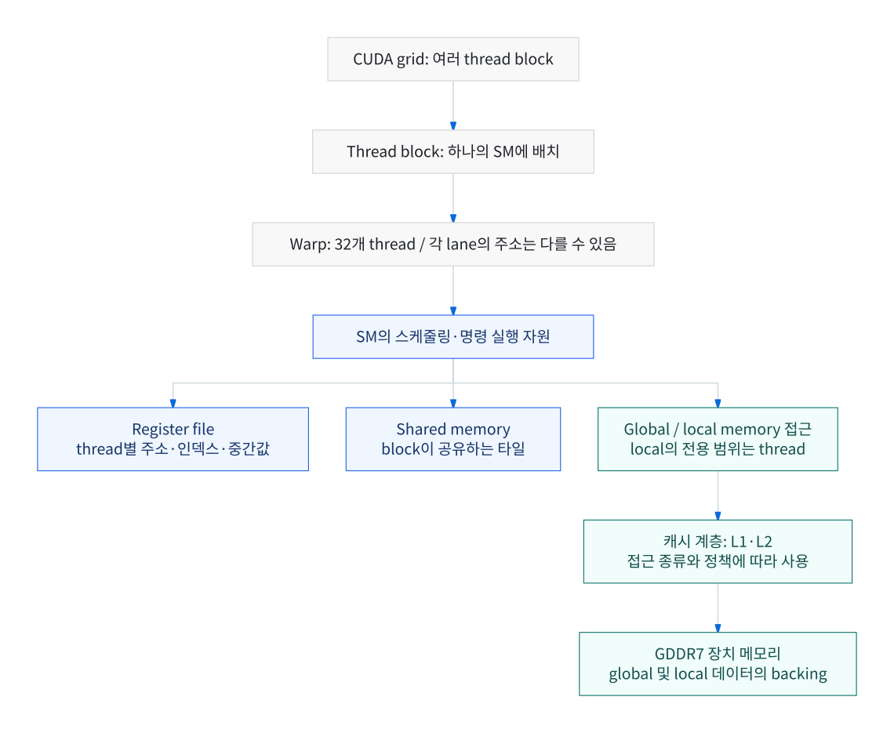
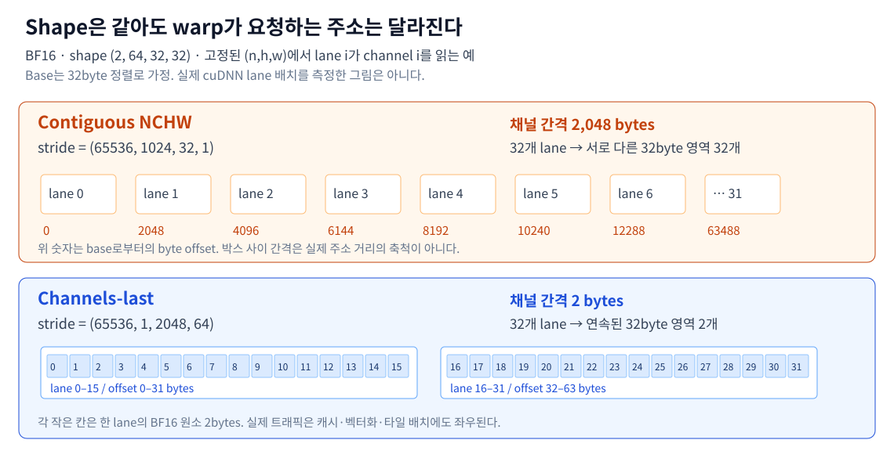
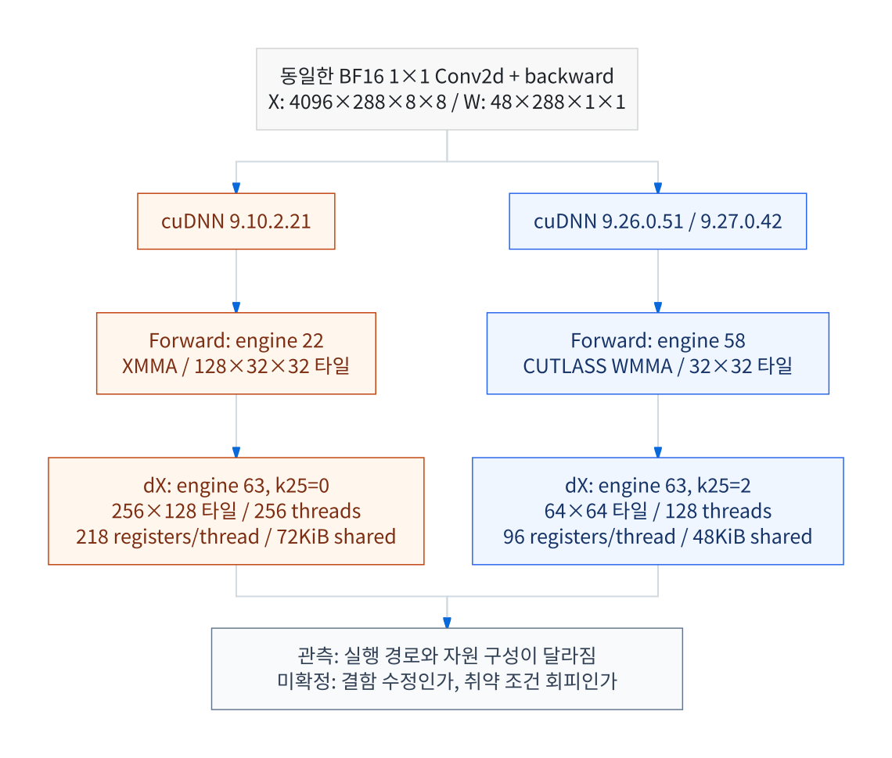
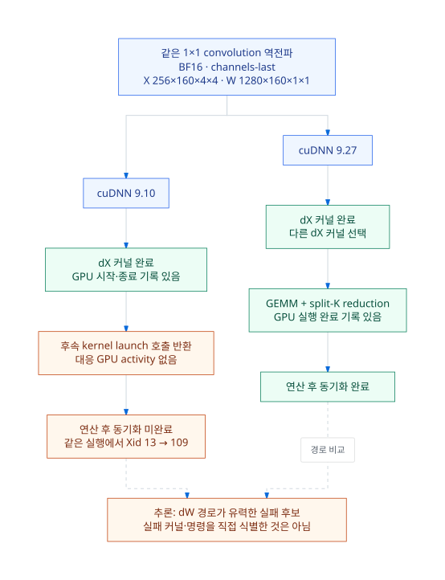

# 같은 SM에서 반복되는 GPU 오류는 하드웨어 불량의 증거일까?

RTX 5090 학습 장애로 살펴본 GPU 실행 구조, 메모리 계층, cuDNN의 커널 선택

GPU 오류 로그에 같은 SM 좌표가 계속 찍히면 하드웨어 불량부터 떠올리게 된다. 이 글은 RTX 5090에서 겪은 학습 장애를 출발점으로, 그 직관이 어디까지 맞고 어디서부터 증거가 더 필요한지 살펴본다. 사건은 간단히 소개하고, 오류를 해석하는 데 필요한 GPU의 동작 원리에 더 많은 지면을 썼다.

이 글에서 다루는 내용은 다음과 같다.

- 로그의 GPC·TPC·SM 좌표와 CUDA의 grid·block·warp는 어떻게 이어지는가
- register, shared, local, global memory는 어디에 있고 무엇이 다른가
- `channels_last` 같은 레이아웃 변경이 warp의 메모리 접근을 어떻게 바꾸는가
- cuDNN은 같은 합성곱에 어떤 커널을 고르며, 그 선택을 어떻게 관찰하는가
- SM 예외, MMU fault, Xid 109는 각각 무엇을 말해 주는가
- 실패한 실행의 trace를 Nsight로 어떻게 남기고, 어느 연산까지 좁힐 수 있는가
- 비슷한 오류를 만났을 때 어떤 순서로 범위를 좁혀 갈 수 있는가

CUDA 실행 모델과 PyTorch 학습에 익숙한 독자를 가정한다.

## 목차

- [사건 요약: 카드를 바꿔도 같은 SM에서 실패했다](#사건-요약-카드를-바꿔도-같은-sm에서-실패했다)
- [SM과 warp, 로그의 좌표가 가리키는 것](#sm과-warp-로그의-좌표가-가리키는-것)
- [GPU 메모리 계층: 접근 범위와 저장 위치는 다르다](#gpu-메모리-계층-접근-범위와-저장-위치는-다르다)
- [같은 텐서, 다른 주소: channels-last와 메모리 coalescing](#같은-텐서-다른-주소-channels-last와-메모리-coalescing)
- [cuDNN은 같은 합성곱에 어떤 커널을 고르는가](#cudnn은-같은-합성곱에-어떤-커널을-고르는가)
- [오류 로그 읽기: SM 예외와 MMU fault](#오류-로그-읽기-sm-예외와-mmu-fault)
- [같은 SM에서 반복된다는 것은 얼마나 강한 증거인가](#같은-sm에서-반복된다는-것은-얼마나-강한-증거인가)
- [비동기 실행과 오류 이후의 GPU 상태](#비동기-실행과-오류-이후의-gpu-상태)
- [실패한 실행 추적하기: Nsight Systems로 좁힌 dW 경로](#실패한-실행-추적하기-nsight-systems로-좁힌-dw-경로)
- [이번 사례에서 확인한 것과 확인하지 못한 것](#이번-사례에서-확인한-것과-확인하지-못한-것)
- [비슷한 오류를 만났을 때 제안하는 접근](#비슷한-오류를-만났을-때-제안하는-접근)
- [맺으며](#맺으며)
- [참고 자료](#참고-자료)

## 사건 요약: 카드를 바꿔도 같은 SM에서 실패했다

RTX 5090 서버에서 `channels_last`와 BF16을 쓰는 합성곱 모델의 학습이 거듭 실패했다. 그래픽카드를 리퍼 제품으로 교환하고 BIOS도 업데이트했지만 장애는 이어졌고, 다음과 같은 로그가 계속 남았다.

```text
Graphics SM Warp Exception on (GPC 2, TPC 6, SM 1):
Out Of Range Address

ENGINE GRAPHICS GPC2 GPCCLIENT_T1_13 faulted @ 0x0_00000000
FAULT_PDE ACCESS_TYPE_VIRT_READ
```

로그는 매번 `GPC 2, TPC 6, SM 1`을 가리켰다. 카드를 바꿔도 증상이 이어졌고 메인보드는 그대로였으니, 메인보드, PCIe, 전원 같은 호스트 쪽 부품까지 의심할 만했다.

그런데 소프트웨어 조건을 바꾸자 결과가 달라졌다. 당시 환경은 드라이버 580.159.03-open, PyTorch 2.10.0+cu128, cuDNN 9.10.2.21이었다.

- `channels_last`를 끄면 짧은 재현 시험을 통과했다.
- PyTorch를 2.11과 2.14로 올리면서 cuDNN도 각각 9.19와 9.24로 바뀐 환경에서도 오류는 그대로 재현됐다.
- PyTorch와 드라이버는 그대로 두고 cuDNN만 9.27로 바꾸자 재현 시험을 통과했고, 실제 학습도 끝까지 마쳤다.
- 다시 cuDNN 9.10으로 돌아가자 같은 SM에서 오류가 났다.

여기까지만 보면 새 cuDNN이 버그를 고친 것처럼 보인다. 하지만 더 들여다보니 이야기가 그렇게 단순하지 않았다. 비교 서버에서 cuDNN만 바꾸자 같은 합성곱에 전혀 다른 커널이 선택됐는데, 같은 선택은 9.26에서도 나타났다. 9.27 릴리스 노트의 illegal-address 수정은 이번 실행 방식과 맞지 않았다. 장애 서버에서 실패한 실행을 Nsight Systems로 추적하자 범위는 한 1×1 합성곱의 가중치 gradient(dW) 계산 경로까지 좁혀졌고, 9.27에서는 같은 연산이 다른 커널 경로로 끝까지 실행됐다. 그러나 실패한 커널의 GPU 실행 기록과 잘못된 접근을 일으킨 명령은 끝내 확보하지 못했다. 결국 소프트웨어를 바꾸면 장애를 피할 수 있다는 것은 확인했지만, 근본 원인이 cuDNN의 결함인지 하드웨어의 취약한 경로인지는 가리지 못했다.

이 결론에 이르기까지 가장 필요했던 것은 로그를 해석하는 배경지식이었다. 그 배경을 하나씩 살펴보자.

## SM과 warp, 로그의 좌표가 가리키는 것

로그의 `GPC 2, TPC 6, SM 1`은 하드웨어 계층을 따라 내려가는 좌표다. RTX Blackwell에서는 GPC(Graphics Processing Cluster) 안에 TPC(Texture Processing Cluster)가 있고, TPC마다 SM(Streaming Multiprocessor)이 두 개씩 들어 있다. RTX 5090은 GB202 칩의 SM 가운데 170개를 활성화한 제품이다.

SM은 연산기만 모아 둔 곳이 아니다. RTX Blackwell 백서에 따르면 SM 하나에는 CUDA 코어 128개, Tensor Core 4개, 256KB 레지스터 파일, 128KB L1·shared memory가 들어 있다. RTX 5090의 L2 캐시는 GPU 전체가 공유하는 96MB이고, 장치 메모리는 32GB GDDR7이다. 다만 L1과 shared memory를 합친 128KB를 프로그램이 모두 shared memory로 쓸 수 있는 것은 아니다.[^blackwell]



*그림 1. 위쪽은 실행 단위 사이의 관계를, 아래쪽은 명령이 실행될 때 쓰는 메모리 자원을 보여준다. 캐시 경로는 개념적으로 단순화한 것으로, 모든 접근이 L1을 거친다는 뜻은 아니다.*

CUDA 프로그램이 다루는 계층은 이와 다르다. 개발자는 grid와 thread block을 구성하고 block 안에 thread를 배치한다. GPU는 각 block을 SM 하나에 할당하고, block 안의 thread를 32개씩 묶은 warp 단위로 실행한다.

Warp의 각 thread(lane)는 자기만의 레지스터와 실행 상태를 가진다. 그래서 warp를 "같은 값을 처리하는 하나의 거대한 thread"로 생각하면 주소 계산과 분기 동작을 잘못 이해하기 쉽다. 같은 load 명령을 실행하더라도 lane마다 쓰는 포인터와 인덱스는 다를 수 있다.

Volta 이후의 NVIDIA GPU는 Independent Thread Scheduling으로 thread별 실행 상태를 관리한다. 같은 warp에 속한다고 해서 메모리 접근 순서나 동기화가 자동으로 보장되지는 않는다. 다른 thread가 쓴 shared memory를 읽는 코드에는 여전히 올바른 동기화가 필요하다.[^simt]

이 구조에서 기억할 점이 하나 있다. **로그의 SM 좌표는 잘못된 접근을 실행한 위치이지, 잘못된 주소가 만들어진 위치가 아니다.** lane 하나만 잘못된 주소에 접근해도 warp 단위 예외가 보고될 수 있다. 또 앞선 커널이 잘못된 인덱스를 메모리에 써 두고 다음 커널이 그 인덱스로 메모리를 읽는다면, fault는 값을 소비한 커널이 돌던 SM에서 보고된다. 값을 만든 커널은 전혀 다른 SM에서 실행됐을 수 있다.

## GPU 메모리 계층: 접근 범위와 저장 위치는 다르다

GPU 메모리를 이해하려면 **누가 접근할 수 있는가**(논리적 범위)와 **실제로 어디에 저장되는가**(물리적 위치)를 함께 봐야 한다. 이 둘을 섞으면 오류 메시지를 잘못 읽기 쉽다.

| 구분 | 논리적 접근 범위 | 주요 물리적 저장 위치 | 주로 담는 것 |
|---|---|---|---|
| Register | thread 전용 | SM 내부 레지스터 파일 | 주소, 인덱스, 중간 계산값 |
| Shared memory | 일반적으로 같은 block의 thread들 | SM 내부 메모리 | 타일 데이터, thread 간 통신 |
| Local memory | thread 전용 | 장치 메모리(캐시될 수 있음) | spill된 값, 큰 자동 변수, 일부 배열 |
| Global memory | 접근 권한이 있는 device thread들 | 장치 메모리와 캐시 계층 | 입력, 가중치, 출력, gradient, workspace |
| L1·L2 cache | 접근 경로와 캐시 정책에 따라 다름 | GPU 칩 내부 | 메모리 접근 지연과 트래픽 감소 |

이 가운데 가장 헷갈리기 쉬운 것이 local memory다. 이름의 "local"은 해당 thread만 접근할 수 있다는 논리적 범위를 뜻할 뿐, SM 안에 따로 있는 작고 빠른 메모리라는 뜻이 아니다. 컴파일러는 레지스터에 담기 어려운 배열이나 구조체, 레지스터가 부족해 spill된 값을 local memory에 두며, 이 데이터는 장치 메모리에 놓인다.

**Register spill 자체는 정상적인 컴파일 결과**다. spill이 일어나면 느려질 수는 있지만, 그 자체로 잘못된 메모리 접근이 생기지는 않는다.[^local-memory]

Shared memory는 성격이 다르다. 프로그램이 직접 데이터를 배치하고 동기화하는 공간이다. 합성곱이나 행렬곱 커널은 global memory에서 읽은 타일을 shared memory에 올려 두고 여러 thread가 재사용한다.

레지스터와 shared memory를 얼마나 쓰느냐는 SM 하나에 동시에 올릴 수 있는 block 수를 결정한다. Thread 수 $T$가 32의 배수인 block을 가정하면, 상주 block 수의 상한을 단순화해 다음처럼 쓸 수 있다.

$$
B_{\mathrm{resident}}
\le
\min\left(
\left\lfloor \frac{R_{\mathrm{SM}}}{T r} \right\rfloor,
\left\lfloor \frac{S_{\mathrm{SM}}}{s} \right\rfloor,
\left\lfloor \frac{T_{\mathrm{SM}}}{T} \right\rfloor,
B_{\max}
\right)
$$

여기서 $r$은 thread당 32비트 레지스터 수, $s$는 block당 shared memory 사용량이다. $R_{\mathrm{SM}}$, $S_{\mathrm{SM}}$, $T_{\mathrm{SM}}$은 각각 SM에서 쓸 수 있는 레지스터 수, shared memory 용량, 상주 thread 수의 한계이고, $B_{\max}$는 아키텍처가 정한 상주 block 수의 한계다. 실제 배치는 레지스터 할당 단위 같은 다른 제약도 받으므로 정확한 occupancy 계산을 대신하지는 못한다. 그래도 커널 구현이 바뀌면 이 네 항이 함께 바뀌고, 수학적으로 같은 연산이라도 GPU 위에서의 자원 배치와 메모리 접근 순서가 달라진다는 점은 분명히 보여준다. 뒤에서 cuDNN 커널을 비교할 때 이 식을 다시 쓴다.[^resident-blocks]

Shared memory의 bank conflict는 오류와 구분해야 한다. 32비트 접근으로 단순화하면 bank 번호는 다음과 같이 정해진다.

$$
\operatorname{bank}(a)
=
\left\lfloor \frac{a}{4} \right\rfloor \bmod 32
$$

32×32 `float` 배열의 한 열을 lane 32개가 읽으면 접근 간격이 32 word가 되어, 요청이 모두 같은 bank의 서로 다른 주소로 몰린다. 행 길이를 33으로 늘리면 요청이 여러 bank로 흩어진다. 이런 bank conflict는 유효한 접근이 직렬화되는 성능 문제일 뿐이다. "메모리 접근이 비효율적이다"라는 설명으로는 SM Warp Exception을 설명할 수 없다.[^bank-conflict]

## 같은 텐서, 다른 주소: channels-last와 메모리 coalescing

이번 장애는 `channels_last`를 끄면 재현되지 않았다. 레이아웃 하나가 왜 이렇게 큰 차이를 만들 수 있는지 주소 계산부터 보자.

PyTorch의 channels-last는 4차원 텐서의 논리적 차원 순서는 그대로 두고 메모리 stride만 바꾼다.

```python
import torch

x = torch.empty((2, 64, 32, 32), dtype=torch.bfloat16)
y = x.to(memory_format=torch.channels_last)

print(x.shape, x.stride())
print(y.shape, y.stride())
```

실행 결과는 다음과 같다.

```text
contiguous:
shape  = (2, 64, 32, 32)
stride = (65536, 1024, 32, 1)

channels_last:
shape  = (2, 64, 32, 32)
stride = (65536, 1, 2048, 64)
```

두 텐서의 shape은 같지만, $(n,c,h,w)$ 원소의 byte 주소를 계산하는 방식은 다르다.

$$
a(n,c,h,w)
=
a_{\mathrm{base}}
+
e\left(
n s_N+c s_C+h s_H+w s_W
\right)
$$

여기서는 storage 시작 주소를 $a_{\mathrm{base}}$로 두고, storage offset이 0인 텐서를 가정했다. $e$는 원소 크기로, BF16에서는 2byte다. 채널 인덱스가 하나 늘 때 주소는 contiguous에서 2,048byte, channels-last에서 2byte 증가한다.[^channels-last]

$(n,h,w)$를 고정하고 lane 32개가 연속된 채널을 읽는 가상의 커널을 생각해 보자. base 주소가 적절히 정렬돼 있다고 가정하면 다음과 같은 차이가 생긴다.

| 레이아웃 | lane 사이 주소 간격 | 접근하는 서로 다른 32byte 영역 수 |
|---|---:|---:|
| Contiguous NCHW | 2,048byte | 32개 |
| Channels-last | 2byte | 2개 |



*그림 2. shape이 같아도 stride가 달라지면 warp가 접근하는 32byte 영역의 수가 달라진다. 가정한 lane 배치에서 주소를 계산해 그린 예제다.*

GPU는 warp 안의 주소들을 32byte 단위 영역(sector)으로 묶어 메모리 요청을 만든다. 같은 32개 원소를 읽더라도 2개 영역으로 끝나느냐 32개 영역이 필요하냐에 따라 메모리 트랜잭션 수가 크게 달라진다. 이것이 coalescing이다.[^coalescing]

물론 이 예제는 주소 계산을 보여주기 위한 것일 뿐, 실제 cuDNN 커널의 lane 배치를 역분석한 결과가 아니다. 실제 트래픽은 캐시 재사용, 벡터화, 타일 배치의 영향도 받는다. 또 입력 텐서의 채널이 적더라도 합성곱을 거친 중간 feature map은 채널이 많으므로, 입력 텐서 하나의 레이아웃만 보고 전체 학습의 메모리 접근을 판단할 수는 없다.

더 중요한 변화는 라이브러리 안에서 일어난다. 레이아웃과 자료형이 바뀌면 cuDNN이 고르는 구현 자체가 바뀔 수 있다. 그러면 다음 요소가 함께 달라진다.

- 합성곱 구현과 타일 크기
- 벡터화된 load·store의 폭과 정렬 조건
- Shared memory 배치와 파이프라인 단계 수
- Workspace 크기와 사용 방식
- 레지스터 압력과 상주 warp 수
- Tensor Core 연산과 reduction 순서

## cuDNN은 같은 합성곱에 어떤 커널을 고르는가

### 연산 그래프에서 실행 계획까지

cuDNN은 합성곱을 바로 특정 커널에 연결하지 않는다. 먼저 연산을 operation graph로 기술하고, 그 그래프를 실행할 수 있는 **engine** 후보를 찾는다. engine은 특정 형태의 연산을 실행하는 구현이고, 각 engine에는 타일 크기, split-K, workspace 사용 방식 같은 세부 설정인 **knob**이 있다. engine과 knob 값을 정한 것이 engine configuration이고, 이를 실제 handle과 tensor에 맞춰 확정한 것이 **execution plan**이다.[^cudnn-graph]

어떤 계획이 선택될지는 heuristic, 지원 조건, workspace 제한, 수치적 특성이 함께 결정한다. PyTorch에서 `torch.backends.cudnn.benchmark=False`(기본값)이면 heuristic이 추천한 후보를 쓰고, `True`이면 입력 shape마다 여러 후보를 실제로 실행해 본 뒤 가장 빠른 것을 골라 쓴다. 어느 쪽이든 shape, stride, 자료형, GPU 아키텍처, cuDNN 버전이 바뀌면 다른 계획이 선택될 수 있다.

`torch.compile`을 쓰지 않는 eager 실행도 이 선택 과정을 똑같이 거친다. eager 모드에서 실패했다고 해서 cuDNN 내부의 구현 선택이나 코드 생성 경로를 조사 대상에서 뺄 수는 없다.

### 선택된 계획과 커널을 관찰하는 방법

cuDNN이 실제로 무엇을 골랐는지는 로그와 프로파일러로 확인할 수 있다. cuDNN backend API 로그는 descriptor와 API 호출 문맥을, frontend 로그는 연산 그래프와 실행 계획을 보여준다.[^cudnn-logging][^cudnn-frontend]

```bash
export CUDNN_LOGLEVEL_DBG=3                  # 0: 끔, 1: 오류, 2: 경고, 3: 정보
export CUDNN_LOGDEST_DBG=cudnn_api_%i.log    # %i는 프로세스 ID
export CUDNN_FRONTEND_LOG_INFO=1
export CUDNN_FRONTEND_LOG_FILE=cudnn_frontend.log
python repro.py
```

로그 양이 많고 실행이 느려지므로 재현용 실행에서만 켜는 것이 좋다.

실제로 실행된 GPU 커널의 이름과 launch 구성은 프로파일러 trace에 남는다. PyTorch profiler가 내보낸 trace의 커널 이벤트에는 grid, block, thread당 레지스터 수, shared memory 사용량이 함께 기록된다.

```python
from torch.profiler import profile, ProfilerActivity

# x, w는 requires_grad=True인 입력·가중치, dy는 출력 gradient
with profile(activities=[ProfilerActivity.CPU, ProfilerActivity.CUDA]) as prof:
    y = torch.nn.functional.conv2d(x, w)
    y.backward(dy)
    torch.cuda.synchronize()

prof.export_chrome_trace("trace.json")
```

더 깊이 보려면 NVIDIA의 Nsight 도구를 쓴다. **Nsight Systems**는 CPU 쪽 CUDA API 호출, GPU 커널 실행, NVTX 범위를 하나의 timeline에 기록한다. **Nsight Compute**는 커널 하나를 여러 번 재실행(replay)하면서 launch 구성, occupancy, 메모리 트래픽, warp 상태, SASS를 수집한다.

```bash
# 수집 구간은 코드에서 torch.cuda.profiler.start() / stop()으로 지정한다
sudo ncu --profile-from-start off \
    --section LaunchStats --section Occupancy \
    --section MemoryWorkloadAnalysis_Tables --section WarpStateStats \
    -o conv_report python repro.py

# report에 담긴 커널의 SASS 보기
ncu -i conv_report.ncu-rep --page source --print-source sass
```

PyTorch 역전파를 Nsight Compute로 수집할 때는 다음을 알아 두면 시행착오를 줄일 수 있다.[^ncu-cli][^ncu-guide]

- **역전파 커널은 다른 CPU thread에서 launch된다.** NVTX 범위는 thread마다 따로 관리되므로, forward를 감싼 NVTX 범위로 수집 대상을 거르면 역전파 커널이 빠진다. 이번 조사에서도 첫 시도에는 forward 커널 하나만 수집됐다. `--profile-from-start off`와 `torch.cuda.profiler.start()`/`stop()`(내부적으로 `cudaProfilerStart`/`cudaProfilerStop`)으로 구간을 지정하면 프로세스 전체에 적용된다.
- **성능 카운터 권한이 필요할 수 있다.** GPU 성능 카운터가 관리자 전용으로 설정된 시스템(`RmProfilingAdminOnly: 1`)에서는 Nsight Compute를 root로 실행해야 한다. 그렇지 않으면 `ERR_NVGPUCTRPERM` 오류가 난다.
- **측정 조건이 실제 학습과 다르다.** Nsight Compute는 기본적으로 커널을 재실행할 때마다 캐시를 비운다(`--cache-control all`). 그래서 캐시 지표는 cold cache 기준이고, 데이터가 캐시에 남아 있는 실제 학습과 다르다. 실행 시간도 계측 오버헤드와 클럭 설정(`--clock-control`)의 영향을 받으므로 학습 속도 비교 근거로 쓰지 않는다.
- 이번에 쓴 Nsight Compute 2026.3은 기본 report 확장자가 `.ncu-repz`였다. 출력 파일 이름을 가정하는 스크립트는 이 점을 확인해야 한다.

### 사례: cuDNN 9.10과 9.26·9.27의 선택 차이

cuDNN 버전에 따라 커널 선택이 어떻게 달라지는지 보기 위해, RTX 5090 비교 서버에서 드라이버, Python, PyTorch, cuBLAS를 그대로 두고 cuDNN 패키지만 9.10.2.21, 9.26.0.51, 9.27.0.42로 바꿔 가며 같은 연산을 실행했다. 각 시험은 새 프로세스에서 `cudnn.benchmark=False`, TF32 비활성화, seed 0으로 실행했다. 대상은 장애 초기에 만든 재현 코드에 있던 BF16 1×1 합성곱이다.

```text
X  = [4096, 288, 8, 8], BF16, channels_last
W  = [48, 288, 1, 1], BF16, channels_last
dY = [4096, 48, 8, 8], BF16, channels_last

Y = conv2d(X, W)
dX, dW = autograd.grad(Y, (X, W), dY)
```

미리 밝혀 두면, 이 연산은 나중에 실패 후보로 좁혀진 연산이 아니다. 장애 서버에서도 이 연산은 cuDNN 9.10으로 문제없이 실행됐다([실패한 실행 추적하기](#실패한-실행-추적하기-nsight-systems로-좁힌-dw-경로) 참고). 여기서는 cuDNN 버전이 커널 구성을 얼마나 바꾸는지 보여주는 예로 읽으면 된다.

선택된 실행 계획은 다음과 같았다. `eng63_k25=2`는 "engine 63, knob 25의 값 2"로 읽는다.

| 단계 | cuDNN 9.10 | cuDNN 9.26 및 9.27 |
|---|---|---|
| Forward | `eng22_k2=2_k13=0_k14=3_k18=0_k23=1` | `eng58_k25=2` |
| Backward-data, dX | `eng63_k25=0` | `eng63_k25=2` |
| Backward-filter, dW | `eng62_k25=1` | `eng62_k25=2` |



*그림 3. batch 4096 최소 연산에서 직접 관측한 선택이다. dW 단계는 그림에서 생략했다. engine 번호가 같아도 configuration에 따라 다른 커널이 실행될 수 있다.*

Forward는 engine 22의 XMMA 구현에서 engine 58의 CUTLASS WMMA 구현으로 바뀌었다. Backward-data는 engine 번호가 63으로 같았지만 실제로는 다른 커널이 실행됐다.

```text
9.10:
cutlass_80_tensorop_bf16_s16816gemm_relu_bf16_256x128_32x3_nn_align8

9.26 / 9.27:
cutlass_80_tensorop_bf16_s16816gemm_relu_bf16_64x64_32x6_nn_align8
```

| dX 커널의 launch 정보 | 9.10 | 9.26 및 9.27 |
|---|---:|---:|
| Grid | 4096×1×1 | 16384×2×1 |
| Block당 thread | 256 | 128 |
| Thread당 레지스터 | 218 | 96 |
| Block당 shared memory | 72KiB | 48KiB |
| 실행 계획 workspace | 0byte | 0byte |

### 커널 이름에서 자원 사용량 읽어 내기

긴 커널 이름은 암호처럼 보이지만, cuDNN이 쓰는 CUTLASS 계열 커널은 이름에 구현 정보가 상당 부분 들어 있다. CUTLASS의 명명 규칙에 따라 읽으면 다음과 같다.

| 표기 | 의미 |
|---|---|
| `cutlass_80` | SM80(Ampere) 세대의 명령을 쓰는 CUTLASS 커널. 이후 세대 GPU에서도 실행된다 |
| `tensorop` | Tensor Core를 사용 |
| `bf16` | 입출력 자료형 |
| `s16816gemm` | FP32(`s`)로 누산하고, 16×8×16 크기의 Tensor Core 행렬곱 명령을 사용하는 GEMM |
| `256x128_32x3` | thread block 하나가 256×128 출력 타일을 맡고, K 방향으로 32씩 읽으며, 3단 파이프라인을 사용 |
| `nn` | 두 입력 행렬의 메모리 레이아웃 |
| `align8` | 8원소, 즉 BF16 기준 16byte 단위로 정렬된 벡터 접근 |

다른 커널 이름에서도 비슷한 표기를 볼 수 있다. `dgrad`와 `wgrad`는 각각 입력 gradient(dX)와 가중치 gradient(dW)를 계산하는 커널, `implicit_gemm`은 im2col 행렬을 따로 만들지 않고 합성곱을 GEMM처럼 계산하는 방식, `nhwc`는 channels-last 레이아웃을 뜻한다.

`relu`처럼 이 규칙으로 설명되지 않는 표기는 여기서 해석하지 않는다. 이름에 `relu`가 들어 있다고 모델에 ReLU가 추가된 것도 아니다. `sm80`이나 `cutlass_80` 표기는 커널이 쓰는 명령 세대를 뜻할 뿐, RTX 5090을 다른 아키텍처의 장치로 다룬다는 뜻은 아니다.

이 해석이 맞는지는 shared memory 사용량으로 확인해 볼 수 있다. 이런 multistage GEMM 커널은 A 타일($M_{\mathrm{tile}}\times K_{\mathrm{tile}}$)과 B 타일($N_{\mathrm{tile}}\times K_{\mathrm{tile}}$)을 파이프라인 단계 수만큼 shared memory에 미리 올려 둔다.

$$
s
\approx
\left(M_{\mathrm{tile}}+N_{\mathrm{tile}}\right)
K_{\mathrm{tile}}\,
e\,
n_{\mathrm{stages}}
$$

| 커널 | 계산 | 결과 | 관측값 |
|---|---|---:|---:|
| `256x128_32x3` (9.10 dX, N=4096) | (256 + 128) × 32 × 2byte × 3 | 73,728byte | 72KiB |
| `64x64_32x6` (9.26·9.27 dX, N=4096) | (64 + 64) × 32 × 2byte × 6 | 49,152byte | 48KiB |
| `64x256_32x4` (9.10 dX, N=256) | (64 + 256) × 32 × 2byte × 4 | 81,920byte | 80KiB |
| `128x64_64x3` (9.10 dW, 뒤에서 다룸) | (128 + 64) × 64 × 2byte × 3 | 73,728byte | 72KiB |

네 커널 모두 계산값이 관측값과 일치한다. 다만 구조가 다른 커널에는 이 식이 그대로 맞지 않는다. 9.26·9.27이 N=256에서 고른 WMMA 커널 `32x32_32x1`은 이 식으로 4KiB지만 관측값은 5KiB였다.

레지스터도 비슷하게 짐작할 수 있다. 출력 타일을 block의 thread에 고르게 나누면 9.10 커널은 thread마다 256×128 / 256 = 128개, 새 커널은 64×64 / 128 = 32개의 FP32 누산값을 들고 있어야 한다. 관측된 thread당 레지스터 218개와 96개 가운데 상당 부분이 이 누산기라는 뜻이다.

### Nsight Compute로 측정한 occupancy, spill, 캐시

앞의 상주 block 식으로 이론 상한을 계산할 수도 있지만, Nsight Compute로 측정하면 짐작할 필요가 없다. 비교 서버에서 N=4096 dX 커널을 측정한 값은 다음과 같다. Achieved occupancy는 버전별 5회 측정의 중앙값이다.

| 항목 | 9.10 `256x128_32x3` | 9.26·9.27 `64x64_32x6` |
|---|---:|---:|
| 레지스터 기준 SM당 block 상한 | 1 | 5 |
| Shared memory 기준 SM당 block 상한 | 1 | 2 |
| 이론적 occupancy | 16.67% | 16.67% |
| Achieved occupancy | 16.58% | 15.39% |
| Local memory load/store sector | 0 / 0 | 0 / 0 |

레지스터 사용량은 block당 55,808개(256 × 218)에서 12,288개(128 × 96)로 크게 줄었지만, 이번에는 shared memory가 새 제약이 되어 이론적 occupancy는 똑같다. 9.10은 SM당 block 1개 × warp 8개, 새 커널은 block 2개 × warp 4개로, 둘 다 SM당 최대 48개 warp 가운데 8개다. Block 수가 늘었다고 상주 warp 수가 늘어나는 것은 아니다. 참고로 드라이버가 block마다 shared memory 1KiB를 따로 잡으므로, 실제 요구량은 커널이 선언한 양보다 조금 크다.

바뀐 것은 occupancy라기보다 **작업을 쪼개는 방식**이다. 큰 block이 큰 타일을 3단 파이프라인으로 처리하던 구조가, 작은 block 여러 개가 작은 타일을 6단 파이프라인으로 처리하는 구조로 바뀌었다. Grid도 4,096개 block에서 32,768개 block으로 늘었다.

thread당 레지스터 218개는 많아 보이지만 **spill은 없었다.** Local memory load/store는 세 버전 모두 0이었고, SASS에도 local memory 명령(`LDL`, `STL`)이 없었다. 레지스터 수만 보고 spill을 짐작하지 말고 local memory 트래픽이나 SASS로 확인해야 한다. 직접 빌드하는 커널이라면 `nvcc -Xptxas -v` 출력의 spill stores/loads 값으로도 확인할 수 있다.

캐시와 warp 상태 지표는 한 방향으로 좋아지지 않았다. 새 커널은 L2 read hit rate가 80.05%에서 84.80%로 올랐지만, global load sector 수는 약 334만에서 747만으로 늘었고, 메모리 결과를 기다리는 long scoreboard stall(발행 명령당 cycle)도 1.19에서 2.28로 늘었다. Long scoreboard는 메모리 지연을 기다리는 상태일 뿐 잘못된 주소 접근의 신호가 아니다. 또 이 값들은 캐시를 비우는 replay 조건에서 측정한 것이다.

**batch만 바꿔도 결과가 달라진다.** 같은 연산을 N=256으로 실행하면 dX에 전혀 다른 커널이 선택된다. 아래 achieved occupancy는 버전별 1회 측정값이다.

| 항목 | 9.10 `tensorop 64x256_32x4` | 9.26·9.27 `wmma 32x32_32x1` |
|---|---:|---:|
| Thread당 레지스터 | 242 | 46 |
| Block당 shared memory | 80KiB | 5KiB |
| 레지스터 기준 SM당 block 상한 | 2 | 10 |
| Shared memory 기준 SM당 block 상한 | 1 | 16 |
| 이론적 occupancy | 8.33% | 83.33% |
| Achieved occupancy | 8.29% | 69.6~69.7% |

N=4096에서는 occupancy가 그대로였지만 N=256에서는 10배로 뛰었다. 같은 연산이라도 shape에 따라 heuristic이 다른 타일을 고르고, 상주 block 수를 제한하는 자원도 달라진다. 물론 이론적 occupancy의 비율이 곧 속도의 비율은 아니다.

실제 학습에 더 가까운 것은 N=256 쪽이다. 실제 모델에서 이 합성곱의 batch는 256이었고, Nsight Systems trace에서 NVTX로 해당 연산을 찾아보니 커널 이름, grid·block, 레지스터, shared memory가 N=256 최소 연산과 모두 일치했다. 반대로 N=4096에서 본 `256x128_32x3` dX 커널은 실제 모델 trace에 한 번도 나오지 않았다. 재현 코드를 만들 때 shape, stride, 자료형을 실제 학습과 정확히 맞춰야 하는 이유다.

**9.26과 9.27은 SASS까지 같았다.** Nsight Compute report에 담긴 SASS에서 실행 시 주소(PC)를 함수 안의 상대 위치로 바꾸고 branch 대상 주소도 같은 방식으로 정규화한 뒤 비교했다. 두 batch 크기의 forward, dX, dW, reduction 8개 커널 모두 명령과 피연산자열의 해시가 같았다. 이름과 launch 정보가 같다는 것보다 강한 증거지만, cuDNN 전체 binary나 host 쪽의 계획 선택, workspace 관리까지 같다는 뜻은 아니다.

정리하면 cuDNN 버전에 따라 타일 구성, 파이프라인 단계, 메모리 요청 패턴이 크게 달라진다. 같은 수학 연산이라도 오류를 드러내는 실행 조건이 달라질 여지는 충분하다. 다만 측정한 커널에서 spill은 없었고 occupancy 변화도 shape마다 달랐으므로, "레지스터 spill이나 낮은 occupancy가 원인"이라는 설명은 지지되지 않는다.[^ncu-guide]

### 실행 계획 이름만으로 판단하지 않기

실행 계획 문자열과 실제 커널은 1:1로 대응하지 않는다. 이번 비교에서도 몇 가지 함정이 있었다.

- `k25`는 공개 enum의 `CUDNN_KNOB_TYPE_WORKSPACE`에 해당하지만, `k25=0 → 2`가 workspace가 2byte로 늘었다는 뜻은 아니다. dX 실행 계획이 보고한 workspace는 두 경우 모두 0byte였다.[^cudnn-knob]
- dW는 knob 값이 `k25=1`에서 `k25=2`로 달라졌는데도 같은 주 커널(`cutlass_80_tensorop_s16816gemm_bf16_64x64_32x6_nt_align8`)과 split-K reduction을 실행했고, workspace도 1,880,320byte로 같았다.
- 9.26과 9.27은 실행 계획, 커널 이름, launch 정보, SASS가 모두 같았다. 따라서 이 선택 변화는 9.27에서 처음 생긴 것이 아니다.

## 오류 로그 읽기: SM 예외와 MMU fault

이제 처음의 로그로 돌아가 보자. 이 로그에는 서로 다른 계층에서 나온 두 종류의 보고가 섞여 있다.

첫 줄의 `Graphics SM Warp Exception: Out Of Range Address`는 SM이 명령을 실행하다가 발견한 예외다. CUDA-GDB 문서는 `Warp Out of range Address`를 warp 안의 어떤 thread가 local 또는 shared memory 영역의 유효 범위를 벗어난 주소에 접근한 경우로 설명한다. global memory까지 포함하는 잘못된 접근은 `Warp Illegal Address`로 따로 분류한다. 이 설명으로 조사할 주소 공간을 좁혀 볼 수는 있지만, 드라이버 로그(Xid)와 CUDA-GDB의 예외는 분류 체계가 달라서 Xid 문구만으로 정확한 명령, lane, 주소 공간까지 확정할 수는 없다.[^cuda-gdb-errors]

여기서 "배열의 논리적 경계"와 "하드웨어가 검사하는 주소의 유효 범위"는 다르다는 점도 알아 둘 만하다. 텐서의 끝을 넘어선 주소라도 여전히 매핑된 메모리 안에 있을 수 있다. 그런 접근은 결과를 망가뜨리면서도 아무 예외 없이 지나갈 수 있다. 예외가 났다는 것은 하드웨어가 검사하는 범위까지 벗어났다는 뜻이다.

둘째 줄의 `faulted @ 0x0_00000000`과 `FAULT_PDE`는 MMU가 보고한 GPU 메모리 page fault, 즉 Xid 31이다. GPU 명령이 쓰는 가상주소는 page table과 TLB를 거쳐 물리 메모리 위치로 변환되는데, 이 변환이 실패했다는 뜻이다. 주소가 `0x0`이라고 해서 GDDR 메모리의 0번지 셀이 고장 났다고 읽을 수는 없다. Null pointer, 손상된 포인터, 잘못된 주소 계산, 드라이버나 하드웨어 문제 가운데 무엇인지 가리려면 접근을 수행한 명령과 그 포인터가 만들어진 경로를 알아야 한다. `GPCCLIENT_T1_13` 역시 보고된 client 식별자일 뿐, 이 이름과 `GPC2/TPC6/SM1`의 정확한 물리적 대응 관계는 이번에 검증하지 않았다.[^virtual-memory]

자주 마주치는 Xid를 관측 계층별로 정리하면 다음과 같다.[^xid]

| Xid | 관측 계층 | 의미 | 읽을 때 주의할 점 |
|---|---|---|---|
| 13 | SM의 명령 실행 | 명령 실행 중 예외. SM Warp Exception이 여기에 해당 | 잘못된 접근을 실행한 SM을 알려줄 뿐, 주소를 만든 곳은 아니다 |
| 31 | MMU의 주소 변환 | GPU 가상주소 변환 실패(page fault) | 보고된 주소는 가상주소다. 물리 메모리 셀 불량과 같은 뜻이 아니다 |
| 109 | 드라이버의 context 전환 | Context switch timeout | 앞선 오류의 후속으로 나타날 수 있다. NVIDIA는 GPU reset을 안내한다 |
| 79 | PCIe 연결 | GPU가 PCIe 버스에서 사라짐 | 장치 연결 문제로, SM 예외와는 다른 실패 양상이다 |

메모리 데이터의 비트 오류도 다른 체계에서 관측된다. RTX Blackwell 백서는 GDDR7의 on-die 단일 비트 오류 정정 기능을 소개하지만, 이런 보호 기능과 Xid의 주소 접근 예외는 별개다. Xid 13을 ECC 오류 카운터처럼 읽어서는 안 된다.

BF16을 의심할 때도 같은 구분이 필요하다. BF16의 반올림 오차와 잘못된 메모리 주소 접근은 전혀 다른 현상이다. Mixed precision은 특정 커널이 선택되는 조건이 될 수는 있지만, "정밀도가 낮아서 illegal address가 발생했다"는 설명에는 주소가 어떻게 잘못 계산됐는지를 잇는 중간 고리가 빠져 있다.

## 같은 SM에서 반복된다는 것은 얼마나 강한 증거인가

초기 조사에서 보존한 로그에는 Graphics SM Warp Exception이 73행 있었고, 모두 `GPC2/TPC6/SM1`을 가리켰다. 충분히 조사할 가치가 있는 집중이다. 하지만 로그 73행을 독립적인 고장 73번으로 셀 수는 없다.

- 장애 하나에서 보고가 여러 건 나올 수 있다.
- Workload와 자원 조건이 비슷하면 block 배치도 매번 비슷해질 수 있다.
- 앞선 fault가 남긴 GPU 상태가 이후 실패에 영향을 줄 수 있다.

"모든 SM에서 같은 확률로 독립적으로 오류가 난다면 한 SM에 73번 몰릴 확률은 극히 낮다"는 식의 계산은, 이 가정들부터 입증해야 성립한다.

물리 좌표를 해석할 때도 주의해야 한다. PTX의 `%smid`는 값을 읽는 시점에 thread가 실행 중인 SM 번호를 알려주지만, 번호가 연속적이라는 보장은 없고 선점 뒤 재스케줄링 같은 상황에서는 값이 바뀔 수도 있다. 드라이버 로그의 GPC·TPC 기준 좌표를 `%smid` 같은 전역 SM 번호로 바꾸려면 따로 검증이 필요하다.[^smid]

하드웨어 가설에 힘을 싣는 것은 반복 횟수보다 **조건을 바꿔도 같은 위치가 따라오는가**다. 서로 다른 workload에서, 매번 깨끗한 초기 상태에서, 소프트웨어 경로를 바꿔도 같은 SM에서 실패한다면 하드웨어 쪽 증거가 강해진다. 반대로 이번처럼 실행 경로를 바꾸자 실패가 사라졌다면, 소프트웨어 결함과 하드웨어의 특정 취약 경로를 모두 후보로 남겨 둬야 한다.

## 비동기 실행과 오류 이후의 GPU 상태

### 오류는 늦게 보고된다

CUDA 연산은 기본적으로 비동기로 실행된다. Python이 GPU 연산을 요청한 시점과 GPU가 그 연산을 마치는 시점이 다르기 때문에, 오류가 한참 뒤의 API 호출에서야 드러날 수 있다. 이번에도 일반 실행에서는 오류와 관계없어 보이는 데이터 처리 쪽 스택이 찍혔지만, `CUDA_LAUNCH_BLOCKING=1`로 실행하자 `loss.backward()` 안의 cuDNN 실행 실패로 범위가 좁혀졌다.[^pytorch-async]

그렇다고 `loss.backward()`가 원인 위치인 것은 아니다. 역전파에는 여러 연산과 커널이 들어 있다. 또 동기화를 강제하면 실행 타이밍이 달라지므로, 동기 실행에서 본 결과를 원래 실행에 그대로 옮겨 해석해서도 안 된다. 같은 이유로 커널 launch API가 성공을 반환했다고 해서 그 커널이 GPU에서 실행됐다는 뜻도 아니다. 실제로 어느 합성곱인지까지 좁히려면 뒤에서 다룰 연산 단위 추적이 필요했다.

### 오류는 프로세스와 GPU에 남는다

Illegal address 오류는 프로세스의 CUDA context를 일관성이 깨진 상태로 남기고, 이후의 CUDA 호출도 같은 오류를 반환하게 만든다. 이 상태에서는 프로세스를 종료하고 다시 시작하는 수밖에 없다. 여기에 Xid 109 같은 후속 이벤트가 이어지면 NVIDIA는 GPU reset까지 안내한다.[^illegal-address]

프로세스 재시작과 GPU reset은 다르다. `nvidia-smi` 조회가 성공하거나 간단한 연산이 통과했다고 해서 앞선 오류의 영향이 모두 사라졌다고 볼 수는 없다. `nvidia-smi`의 `GPU Recovery Action` 필드도 지금 필요한 조치를 알려줄 뿐, 과거 특정 시점의 상태를 되짚어 주지는 않는다.[^nvidia-smi]

### 초기 상태도 실험 조건이다

이번 조사에서 이 점을 실감한 일이 있었다. 조사 도중 새 cuDNN 환경으로 돌린 야간 시험이 실패했다는 기록을 발견했다. 처음에는 9.27도 소용없다는 증거처럼 보였다. 그러나 부팅 기록과 커널 로그를 맞춰 보니, 그 시험은 앞선 오류로 Xid 109가 여러 번 쌓인 뒤 GPU를 초기화하지 않은 상태에서 실행된 것이었다. 반면 9.27로 학습을 완주한 실행은 재부팅 직후, 첫 Xid가 나기 전이었다.

두 결과는 서로 다른 GPU 상태에서 나왔으므로 하나로 합쳐 판단할 수 없다. 야간 기록이 정상 상태의 9.27 실패를 증명하지도 않고, 그렇다고 모든 실패가 이전 오류의 잔여 영향 때문이라고 단정할 수도 없다. GPU 재현 실험에서 초기 상태는 부수 정보가 아니라 실험 조건 그 자체다.

## 실패한 실행 추적하기: Nsight Systems로 좁힌 dW 경로

지금까지의 비교는 모두 정상적으로 끝난 실행을 관찰한 것이다. 정말 알고 싶은 것은 실패한 실행에서 GPU가 마지막으로 무엇을 하고 있었는가다. 장애 서버에서 cuDNN 9.10으로 실제 모델을 실행하면서 Nsight Systems로 이를 추적했다.

### 실패한 프로세스의 trace는 쉽게 사라진다

Nsight Systems는 CUDA API와 GPU 실행 기록을 버퍼에 모았다가 파일로 저장한다. GPU 오류로 프로세스가 비정상 종료되면 이 버퍼가 저장되지 않을 수 있다. 첫 시도에서 정상 실행(9.27)은 GPU 커널 기록이 수천 건 남았지만, 실패 실행(9.10)에는 초기 CUDA API 기록 몇 건만 남고 GPU 커널 기록은 하나도 없었다. 주기적으로 저장하는 옵션(`--cuda-flush-interval=100`, `--flush-on-cudaprofilerstop=true`)을 켜도 마찬가지였다. 이 옵션이 아직 다 차지 않은 버퍼까지 강제로 저장해 주지는 않는다.[^nsys]

### 연산마다 checkpoint를 둔다

그래서 합성곱 연산마다 경계를 두고, 경계에서 GPU 완료를 확인하고 trace를 저장하도록 바꿨다.

1. 연산 직전 `torch.cuda.synchronize()`로 앞선 GPU 작업이 끝났는지 확인하고, `cudaProfilerStop()`과 `cudaProfilerStart()`를 차례로 호출해 여기까지의 기록을 저장한다.
2. 연산 이름과 입력의 shape·stride·dtype을 로그와 NVTX에 남기고 연산을 실행한다.
3. 연산 뒤 다시 동기화해, 호출이 반환된 시점과 GPU 작업이 실제로 끝난 시점을 구분해 기록한다.
4. 감시 프로세스가 커널 로그에서 새 Xid를 감지하면 `nsys stop`으로 Nsight 세션을 먼저 끝내 report를 저장하고, 그다음에 시험 프로세스를 종료한다.

PyTorch에서는 `TorchDispatchMode`로 학습 코드를 고치지 않고 이런 경계를 넣을 수 있다. 역전파 연산은 autograd thread에서 실행되지만 이 방식으로 함께 잡힌다.

```python
import torch
from torch.utils._python_dispatch import TorchDispatchMode

CONV_OPS = {
    torch.ops.aten.convolution.default,
    torch.ops.aten.convolution_backward.default,
}

class ConvCheckpoint(TorchDispatchMode):
    def __init__(self):
        super().__init__()
        self.index = 0

    def __torch_dispatch__(self, func, types, args=(), kwargs=None):
        kwargs = kwargs or {}
        if func not in CONV_OPS:
            return func(*args, **kwargs)

        self.index += 1
        torch.cuda.synchronize()        # 앞선 GPU 작업이 끝났는지 확인
        torch.cuda.profiler.stop()      # 여기까지의 trace를 저장
        torch.cuda.profiler.start()

        tensors = [a for a in args if isinstance(a, torch.Tensor)]
        desc = [(tuple(t.shape), t.stride(), str(t.dtype)) for t in tensors]
        print(f"[{self.index}] start {func} {desc}", flush=True)

        with torch.cuda.nvtx.range(f"conv#{self.index}"):
            out = func(*args, **kwargs)  # 반환은 launch 요청이 끝났다는 뜻일 뿐이다
        torch.cuda.synchronize()        # GPU 작업이 실제로 끝났는지 확인
        print(f"[{self.index}] completed", flush=True)
        return out

with ConvCheckpoint():
    loss = model(x).sum()
    loss.backward()
```

이렇게 바꾸자 실패한 실행에서도 실패 직전까지의 GPU 커널과 CUDA API 기록이 남았다. 다만 checkpoint와 종료 순서를 함께 바꿨기 때문에, 어느 쪽이 결정적이었는지는 따로 검증하지 않았다.

### correlation ID로 API 호출과 GPU 실행을 잇는다

Nsight Systems는 CPU 쪽 CUDA API 호출과 그 호출로 생긴 GPU 실행 기록에 같은 correlation ID를 붙인다. 이 ID를 따라가면 "launch는 요청됐는데 GPU 실행 기록이 없는 커널"을 찾을 수 있다.

실패 실행에서는 첫 학습 step 도중의 한 합성곱 역전파 연산에서 멈췄다. 그 직전 연산까지는 GPU 완료와 저장이 끝났다. 멈춘 연산은 다음과 같았다.

| 항목 | 값 |
|---|---|
| 연산 | `aten.convolution_backward.default` (dX와 dW 계산) |
| X | `[256, 160, 4, 4]`, stride `[2560, 1, 640, 160]` |
| W | `[1280, 160, 1, 1]` |
| dY | `[256, 1280, 4, 4]`, stride `[20480, 1, 5120, 1280]` |
| 형식 | BF16, channels-last, 1×1 합성곱 |

이 연산 안에서 관측된 순서는 다음과 같다.

1. 연산 전 동기화와 trace 저장이 성공했다.
2. dX 커널(`sm80_xmma_dgrad_implicit_gemm_indexed_..._tilesize128x32x32_stage4`)이 launch됐고, GPU 시작·종료 기록이 모두 남았다.
3. 이어서 `cudaMemsetAsync`와 커널 launch가 호출됐다. 마지막 launch는 성공(0)을 반환했지만, 대응하는 GPU 실행 기록은 없었다.
4. 연산 뒤 동기화가 끝나지 않았다. 커널 로그에는 `GPC 2 / TPC 6 / SM 1: Out Of Range Address`(Xid 13)가, 4초쯤 뒤에는 같은 프로세스의 Xid 109가 기록됐다.
5. cuDNN frontend 로그의 마지막 실행 계획은 가중치 gradient용인 `ConvBwdFilter_eng24_k0=5_k2=1_k5=4_k14=2`였다.

dX 커널은 끝났고, 그 뒤에 요청된 작업은 GPU 실행 기록이 없으며, 마지막 실행 계획은 dW를 가리킨다. 이 세 관측을 합치면 **이 합성곱의 dW 경로가 가장 유력한 실패 후보**다.



*그림 4. 장애 서버에서 같은 역전파 연산을 cuDNN 9.10과 9.27로 실행했을 때의 관측 경계. 실선은 관측한 실행 순서이고, 점선은 두 경로를 비교해 얻은 추론이다.*

### 9.27은 같은 연산을 어떻게 계산했나

같은 서버에서 9.27로 같은 실행을 하면 이 연산은 세 커널로 끝까지 완료됐다. 9.10의 dW 커널은 장애 서버에서 실행 기록이 남지 않았으므로, 비교 서버의 9.10 성공 trace에서 같은 연산에 쓰인 커널을 적었다.

```text
9.10 (dX는 장애 서버, dW는 비교 서버에서 관측):
  dX    sm80_xmma_dgrad_implicit_gemm_indexed_..._tilesize128x32x32_stage4
  dW    cutlass_tensorop_bf16_s16816wgrad_analytic_bf16_128x64_64x3_nhwc_align8

9.27 (장애 서버에서 완료):
  dX    sm80_xmma_dgrad_implicit_gemm_..._tilesize128x64x64_stage3
  dW    cutlass_80_tensorop_bf16_s16816gemm_relu_bf16_128x64_32x6_nt_align8
  합산  cublasLt::splitKreduce_kernel
```

9.10은 NHWC 텐서에서 바로 가중치 gradient를 계산하는 전용 wgrad 커널을 쓰고, 9.27은 dW를 일반 GEMM으로 계산한 뒤 부분합을 별도 커널로 합친다. 9.10의 wgrad 커널은 thread당 레지스터 168개, block당 shared memory 72KiB를 썼는데, 이 값은 앞의 shared memory 식으로 계산한 값((128 + 64) × 64 × 2byte × 3 = 72KiB)과 같다.

9.27 경로의 split-K는 1×1 합성곱 dW의 모양을 보면 이해가 된다. dW를 식으로 쓰면 다음과 같다.

$$
dW_{k,c}=\sum_{n,h,w} dY_{n,k,h,w}\,X_{n,c,h,w}
$$

출력은 1280×160으로 작은데, 합산 축은 $N\times H\times W = 256\times4\times4 = 4096$으로 길다. 128×64 타일로 출력을 나누면 타일이 수십 개뿐이라 SM 170개를 다 채울 수 없다. split-K는 합산 축을 여러 조각으로 나눠 block마다 부분합을 계산하고, reduction 커널이 이를 합친다. 부분합을 담을 workspace가 필요하고, 합산 순서가 달라지므로 결과의 마지막 비트가 조금 달라질 수 있다.

### 이 추적이 말해 주는 것과 말해 주지 않는 것

이 결과는 실패 범위를 크게 좁혔지만, 원인을 증명하지는 않는다.

- **launch 성공은 실행 성공이 아니다.** 비동기 launch API가 0을 반환한 것은 요청이 큐에 들어갔다는 뜻일 뿐이다. 반대로 GPU 실행 기록이 없다는 사실만으로는 어느 커널의 어느 명령이 잘못된 주소에 접근했는지 알 수 없다.
- **앞 연산이 정상이었다는 보장도 없다.** 직전 연산 뒤의 동기화가 성공했다는 것은 그 연산이 오류 없이 끝났다는 뜻이지, 올바른 값을 만들었다는 뜻이 아니다. 앞에서 본 것처럼 잘못된 주소는 다른 곳에서 만들어져 이 연산에서 소비됐을 수도 있다.
- **관찰이 실행을 바꾼다.** checkpoint를 넣자 같은 9.27 실행의 GPU 커널 수가 약 9% 늘었다. 동기화가 들어가면서 실행 스케줄과 일부 커널 구성이 바뀐 것이다.
- **시계가 다르다.** Nsight가 남긴 GPU 타임스탬프와 커널 로그의 수신 시각은 약 0.65초 어긋나 있었다. 서로 다른 시계를 빼서 나노초 단위의 인과관계를 주장할 수는 없다. 비정상 종료된 report에는 끝나지 않은 NVTX 범위에 다른 기준의 시각이 남기도 해서, 순서는 correlation ID와 checkpoint 기록으로 맞췄다.
- **깨끗한 상태가 아니었다.** 이 추적은 앞선 Xid 109 이력이 남은 상태에서 재부팅 없이 진행했다.

흥미로운 점은 앞서 집중했던 `[N, 288, 8, 8]` 최소 연산이 장애 서버에서도 cuDNN 9.10으로 통과했다는 것이다. 실패는 실제 모델을 돌릴 때만 났다. 다음 최소 재현은 이번에 좁힌 dW 연산을 대상으로 해야 한다. 다만 연산을 떼어 내면 cuDNN이 다른 실행 계획을 고를 수 있으므로, 분리한 재현에서도 같은 계획과 커널이 선택되는지 먼저 확인해야 한다.

## 이번 사례에서 확인한 것과 확인하지 못한 것

9.27 릴리스 노트에도 illegal-address 관련 수정이 있다. runtime compilation으로 만든 커널 코드가 CUDA Graph에서 아직 쓰일 수 있는데도 너무 일찍 unload되던 문제다. 하지만 이번 비교는 모두 eager 실행이었고 CUDA Graph를 쓰지 않았다. 오류 이름이 같다는 이유만으로 같은 버그가 고쳐졌다고 연결할 수는 없다. 9.10과 9.27 사이의 다른 변경 사항(9.11의 convolution heuristics 정렬 조건 수정, 9.21의 Blackwell용 TensorIR GEMM fusion 경로 등)도 이번 선택 차이와 연결할 증거는 찾지 못했다.[^cudnn-release]

새 환경에서 학습을 끝까지 마친 뒤에는 같은 평가 데이터로 정확도도 비교했다. 뚜렷한 차이는 없었지만, 허용 오차를 미리 정하지 않았고 반복 학습 사이의 변동을 반영하지 않았으므로 두 환경이 동등하다는 증명은 아니다. 커널이 바뀌면 연산 순서와 reduction 방식이 바뀌므로, seed가 같아도 같은 학습 궤적을 기대할 수는 없다.

정리하면 다음과 같다.

| 주장 | 현재 증거 수준 |
|---|---|
| cuDNN 9.27 환경에서 실제 학습을 완료할 수 있다 | 재부팅 직후, 첫 Xid 이전의 실제 학습 1회와 평가로 확인 |
| cuDNN만 바꿔도 선택되는 커널이 달라진다 | 비교 서버의 로그, Nsight trace, SASS 비교로 확인 |
| 실패 후보는 특정 1×1 합성곱의 dW 경로다 | 실패 실행의 Nsight trace로 범위를 좁힘. 실패 커널의 GPU 기록과 오류 명령은 미확보 |
| 레지스터 spill이나 낮은 occupancy가 원인이다 | 측정한 커널에 spill이 없고 occupancy 변화도 shape마다 달라 지지되지 않음 |
| 이 선택 변화는 9.27에서 처음 생겼다 | 9.26에서도 같은 커널과 SASS가 관찰돼 지지되지 않음 |
| 9.27은 정상 초기 상태에서도 실패한다 | 실패 기록이 초기화되지 않은 상태에서 나와 판정 불가 |
| 특정 SM·메인보드의 물리적 결함이 확정됐다 | 현재 증거로는 확정할 수 없음 |

## 비슷한 오류를 만났을 때 제안하는 접근

이번 조사를 돌아보며 "처음부터 이렇게 했다면 더 빨리 좁힐 수 있었겠다"고 생각한 순서를 정리했다. 이 장애의 후속 계획이라기보다, 비슷한 증상을 만난 독자를 위한 제안이다.

### 1. 설치된 버전이 아니라 로딩된 라이브러리를 기록한다

PyTorch wheel은 cuDNN을 의존성으로 함께 설치하고, 환경에 따라 다른 경로의 라이브러리가 로딩될 수도 있다. `pip list`에 보이는 버전보다 프로세스가 실제로 로딩한 버전이 중요하다.

```python
import torch

print(torch.__version__, torch.version.cuda, torch.backends.cudnn.version())

# 합성곱을 한 번 실행한 뒤 확인하면 실제로 쓰인 하위 라이브러리까지 보인다.
with open("/proc/self/maps") as f:
    print(sorted({line.split()[-1] for line in f if "libcudnn" in line}))
```

`/proc/self/maps`는 CPU 쪽 프로세스에 매핑된 공유 라이브러리를 보여줄 뿐, GPU page table과는 관계가 없다. 여기에 드라이버 버전, GPU UUID, boot ID(`/proc/sys/kernel/random/boot_id`)를 함께 남겨 두면 나중에 실행 조건을 되짚기 쉽다.

### 2. 동기화로 위치를 좁히고, 실행마다 첫 오류만 센다

`CUDA_LAUNCH_BLOCKING=1`로 오류가 난 연산을 먼저 찾는다. 그리고 실행 하나에서 처음 난 오류만 그 실행의 결과로 기록한다. 그 뒤에 이어지는 오류는 앞선 오류의 여파일 수 있으므로 별개의 사건으로 세지 않는다. 실패하는 실행의 trace까지 남기려면 앞에서 소개한 연산별 checkpoint와 `nsys stop` 종료 순서를 함께 쓴다.

### 3. 실행 경로를 하나씩 바꿔 본다

같은 모델에서 실행 경로만 바꾸는 실험은 비용이 적고 정보가 많다. 한 번에 하나만 바꾼다.

| 바꾸는 것 | 방법 | 달라지는 것 |
|---|---|---|
| 메모리 레이아웃 | `channels_last` 끄기 | stride와 선택되는 커널 |
| cuDNN 사용 여부 | `torch.backends.cudnn.enabled = False` | cuDNN 대신 PyTorch 자체 구현 사용 |
| 커널 선택 방식 | `torch.backends.cudnn.benchmark` 전환 | heuristic 추천 후보 ↔ 실측 최속 후보 |
| cuDNN 버전 | 별도 가상환경에서 `nvidia-cudnn-cu12`만 교체 | engine과 커널 구성 |
| 자료형 | BF16 ↔ FP32(TF32 끔) | Tensor Core 경로와 타일 구성 |

실패가 특정 경로를 따라 움직이면 소프트웨어나 실행 조건 쪽 가설이 힘을 얻는다. 어떤 경로를 택해도 같은 위치에서 실패하면 하드웨어 가설이 강해진다.

### 4. 실패와 통과를 같은 shape의 커널 단위로 비교한다

앞에서 소개한 cuDNN 로그와 프로파일러 trace를 실패한 실행과 통과한 실행 모두에서 남긴다. 그리고 같은 shape·stride·자료형의 연산끼리 실행 계획과 커널 이름, launch 정보를 맞대어 본다. 최소 재현 코드에서 본 커널이 실제 학습에서도 쓰이는지 반드시 확인한다. 커널 단위로 더 깊이 비교하려면 Nsight Compute로 launch 구성, occupancy, local memory 트래픽, SASS를 함께 남긴다. 버전 간 SASS를 비교할 때는 PC와 branch 대상을 상대 위치로 정규화해야 의미 있는 비교가 된다.

### 5. 최초의 잘못된 접근을 붙잡는다

근본 원인에 가장 가까운 정보는 처음 잘못된 접근이 일어난 순간의 실행 문맥이다. 두 가지 도구를 함께 쓸 수 있다.

**Compute Sanitizer**는 커널을 계측해 잘못된 접근을 커널 이름, thread, 주소와 함께 보고한다.

```bash
compute-sanitizer --tool memcheck python repro.py
```

다만 도구마다 검사 범위가 다르다. `memcheck`는 범위·정렬 오류와 하드웨어 예외를, `racecheck`는 shared memory의 데이터 hazard를, `initcheck`는 초기화되지 않은 메모리 읽기를, `synccheck`는 동기화 primitive의 잘못된 사용을 본다. `racecheck`를 통과했다고 global memory race까지 없다고 볼 수는 없다. 또 계측 때문에 실행이 크게 느려지고 타이밍이 바뀌므로, 도구 아래에서 재현되지 않았다고 원래 실행이 정상이라는 뜻도 아니다. 실제로 이번 조사에서 수집한 `memcheck` 기록에는 정확한 load·store 위치 없이 API 수준의 illegal-address 오류만 남았다.[^sanitizer]

**GPU core dump**는 계측 없이 원래 속도로 실행하다가, 예외가 난 순간의 GPU 상태를 파일로 남긴다. 타이밍에 민감해 sanitizer 아래에서는 재현되지 않는 오류에 특히 유용하다.

```bash
export CUDA_ENABLE_COREDUMP_ON_EXCEPTION=1
export CUDA_COREDUMP_FILE=gpu_core_%p.nvcudmp
python repro.py

cuda-gdb
(cuda-gdb) target cudacore gpu_core_<pid>.nvcudmp
```

core dump를 열면 예외가 난 커널, 명령 위치, block·thread 좌표, 레지스터 값을 볼 수 있다. cuDNN처럼 소스가 공개되지 않은 라이브러리 커널이라도 어느 커널의 어느 명령에서 멈췄는지는 남는다.[^cuda-gdb-coredump]

최소 재현은 trace로 좁힌 연산을 대상으로 만들고, 떼어 낸 뒤에도 같은 실행 계획과 커널이 선택되는지 확인한다. 이렇게 모은 정보는 그대로 라이브러리 개발사에 보고할 수 있는 자료가 된다. 정확한 shape·stride·자료형을 담은 최소 재현 코드, 버전 정보, cuDNN 로그, core dump를 함께 전달하면 내부 구현을 아는 쪽에서 원인을 훨씬 빨리 좁힐 수 있다.

### 6. 독립 시험을 설계한다

버전을 비교할 때는 시험마다 GPU를 reset하거나 재부팅해 초기 상태를 맞춘다. 시험 직전의 boot ID와 기존 Xid 유무를 기록하고, 이미 오류가 난 GPU에서는 다음 시험을 시작하지 않는다. 비교할 환경은 A-B-B-A처럼 순서를 번갈아 배치해, 한 환경이 늘 오류 직후의 GPU를 물려받지 않게 한다. 통과 기준(몇 스텝 동안 새 Xid 없음 등)도 시험 전에 정해 둔다.

### 7. 하드웨어 분리는 교차 장착으로 한다

소프트웨어와 환경을 그대로 두고 GPU와 호스트를 교차 장착하면, 실패가 카드를 따라가는지 호스트를 따라가는지 직접 확인할 수 있다. FurMark나 OCCT 같은 부하 시험은 전력과 발열 조건은 잘 만들지만, 문제가 된 커널의 주소 계산·정렬·동기화 조건은 실행하지 않는다. 부하 시험을 통과했다고 특정 커널의 정상 실행까지 보장되지는 않는다.

### 8. 운영에서는 우회와 원인 규명을 따로 관리한다

원인을 모르더라도 통과하는 환경을 찾았다면 우선 그 환경으로 학습을 이어 갈 수 있다. 이때 몇 가지를 함께 챙기는 것이 좋다.

- **버전 고정은 최상위 프로젝트에서 한다.** PyTorch가 선언한 cuDNN 의존성과 다른 버전을 쓰려면 패키지 관리자의 override가 필요하다. uv의 `override-dependencies`는 라이브러리 저장소에 두면 그 라이브러리를 설치하는 프로젝트로 전파되지 않으므로, 실제 학습 프로젝트의 최상위 설정에 둬야 한다.[^uv-override]
- **실행 시점에 확인한다.** 학습 시작 시 로딩된 cuDNN 버전을 검사해, 의도와 다르면 바로 멈추게 한다.

  ```python
  EXPECTED_CUDNN = 92700  # cuDNN 9.27.0 (major*10000 + minor*100 + patch)
  assert torch.backends.cudnn.version() == EXPECTED_CUDNN, torch.backends.cudnn.version()
  ```

- **되돌릴 스위치를 남겨 둔다.** `channels_last`처럼 문제 경로를 피하는 설정을 플래그로 둬서, 새 버전에서 재발하면 바로 우회할 수 있게 한다.
- **첫 Xid에서 멈춘다.** 커널 로그의 Xid를 감시해, 오류가 난 GPU에는 reset 전까지 새 작업을 배치하지 않는다. 오류 이후의 결과는 실패든 통과든 해석하기 어렵다.
- **정확도는 허용 오차를 먼저 정하고 비교한다.** 라이브러리를 바꾸면 수치 경로가 바뀐다. 기존 환경 대비 허용할 정확도 차이를 미리 정하고, 여러 seed로 반복해 비교한다.

### 증상별로 먼저 확인할 것

| 증상 | 먼저 확인할 것 |
|---|---|
| Python 스택이 엉뚱한 곳을 가리킨다 | `CUDA_LAUNCH_BLOCKING=1`로 재실행 |
| 실패한 실행의 Nsight trace가 비어 있다 | 연산별 동기화와 profiler stop/start, 종료 전 `nsys stop` |
| 레지스터가 많아 spill이 의심된다 | Nsight Compute의 local memory sector, SASS의 `LDL`·`STL` 명령 |
| SM Warp Exception(Xid 13)이 반복된다 | 실패한 커널 이름과 shape, core dump, 실행 경로를 바꿨을 때 실패가 움직이는지 |
| MMU fault(Xid 31), 주소 `0x0` | 포인터가 만들어진 경로, workspace와 텐서의 수명 |
| Xid 109 이후 실패가 이어진다 | GPU reset이나 재부팅 후 재시험, boot ID 기록 |
| 버전을 올렸더니 통과한다 | 실제 로딩된 버전, 선택된 커널의 변화, 정확도 비교 |
| 같은 SM 좌표가 반복된다 | 독립 시험 횟수, 경로 변경 시 위치 유지 여부, 교차 장착 결과 |

## 맺으며

같은 SM에서 반복되는 오류는 조사를 시작할 이유이지 결론은 아니다. 로그의 좌표는 잘못된 접근을 실행한 위치일 뿐이다. 그 주소를 만든 코드, 그 코드를 고른 라이브러리, 실행 직전의 GPU 상태는 각각 따로 확인해야 한다.

이번 사례에서는 cuDNN 버전만 바꿨는데도 같은 합성곱이 타일 크기, 파이프라인 단계, 레지스터, shared memory 구성이 전혀 다른 커널로 실행됐다. 실패한 실행을 추적하자 범위는 한 합성곱의 dW 경로까지 좁혀졌고, 9.27은 그 연산을 GEMM과 split-K reduction이라는 다른 경로로 계산했다. 그 변화가 결함을 고친 것인지, 하드웨어의 취약한 조건을 피한 것인지는 아직 모른다. 다만 다음에 무엇을 해야 하는지는 분명해졌다. 깨끗한 GPU 상태에서 그 dW 연산을 떼어 내 재현하고, 최초의 잘못된 접근을 붙잡는 것이다.

## 참고 자료

[^blackwell]: [NVIDIA, RTX Blackwell GPU 아키텍처 백서](https://images.nvidia.com/aem-dam/Solutions/geforce/blackwell/nvidia-rtx-blackwell-gpu-architecture.pdf)
[^simt]: [CUDA Programming Guide, SIMT 실행과 스케줄링](https://docs.nvidia.com/cuda/cuda-programming-guide/03-advanced/advanced-kernel-programming.html#hardware-implementation)
[^local-memory]: [CUDA Programming Guide, local memory](https://docs.nvidia.com/cuda/cuda-programming-guide/02-basics/writing-cuda-kernels.html#local-memory)
[^resident-blocks]: [CUDA Programming Guide, SM 자원과 상주 block](https://docs.nvidia.com/cuda/cuda-programming-guide/03-advanced/advanced-kernel-programming.html#hardware-multithreading)
[^bank-conflict]: [CUDA Programming Guide, shared memory 접근 패턴과 bank](https://docs.nvidia.com/cuda/cuda-programming-guide/02-basics/writing-cuda-kernels.html#shared-memory-access-patterns)
[^channels-last]: [PyTorch Tutorials, channels-last 메모리 형식](https://docs.pytorch.org/tutorials/intermediate/memory_format_tutorial.html)
[^coalescing]: [CUDA C++ Best Practices Guide, global memory coalescing](https://docs.nvidia.com/cuda/cuda-c-best-practices-guide/index.html#coalesced-access-to-global-memory)
[^cudnn-graph]: [cuDNN Developer Guide, Graph API의 engine과 execution plan](https://docs.nvidia.com/cudnn/latest/developer/graph-api/)
[^cudnn-logging]: [cuDNN 9.10.2 문서, API logging](https://docs.nvidia.com/deeplearning/cudnn/backend/v9.10.2/reference/troubleshooting.html)
[^cudnn-frontend]: [NVIDIA cuDNN Frontend 저장소, logging 설정](https://github.com/NVIDIA/cudnn-frontend)
[^ncu-cli]: [Nsight Compute CLI 문서](https://docs.nvidia.com/nsight-compute/NsightComputeCli/index.html)
[^ncu-guide]: [Nsight Compute Profiling Guide, replay·캐시·occupancy·warp 상태](https://docs.nvidia.com/nsight-compute/ProfilingGuide/index.html)
[^cudnn-knob]: [cuDNN 9.27 Graph API 문서, backend knob 정의](https://docs.nvidia.com/deeplearning/cudnn/backend/v9.27.0/api/cudnn-graph-library.html)
[^cuda-gdb-errors]: [CUDA-GDB 문서, GPU 예외 분류](https://docs.nvidia.com/cuda/cuda-gdb/index.html#gpu-error-reporting)
[^virtual-memory]: [CUDA C++ Programming Guide 12.8.1, 가상주소와 page table](https://docs.nvidia.com/cuda/archive/12.8.1/cuda-c-programming-guide/index.html#virtual-memory)
[^xid]: [NVIDIA Xid 오류 카탈로그](https://docs.nvidia.com/deploy/xid-errors/analyzing-xid-catalog.html)
[^smid]: [PTX ISA, `%smid` 특수 레지스터](https://docs.nvidia.com/cuda/parallel-thread-execution/index.html#special-registers-smid)
[^pytorch-async]: [PyTorch 2.10 문서, CUDA 비동기 실행](https://docs.pytorch.org/docs/2.10/notes/cuda.html#asynchronous-execution)
[^illegal-address]: [CUDA Runtime API, `cudaErrorIllegalAddress`](https://docs.nvidia.com/cuda/cuda-runtime-api/cuda_runtime_api/group__CUDART__TYPES.html)
[^nvidia-smi]: [nvidia-smi 문서, GPU Recovery Action](https://docs.nvidia.com/deploy/nvidia-smi/index.html)
[^nsys]: [Nsight Systems User Guide](https://docs.nvidia.com/nsight-systems/UserGuide/index.html)
[^cudnn-release]: [cuDNN 9.27 릴리스 노트](https://docs.nvidia.com/deeplearning/cudnn/backend/v9.27.0/release-notes.html)
[^sanitizer]: [Compute Sanitizer 문서, 도구별 검사 범위](https://docs.nvidia.com/compute-sanitizer/ComputeSanitizer/index.html)
[^cuda-gdb-coredump]: [CUDA-GDB 문서, GPU core dump](https://docs.nvidia.com/cuda/cuda-gdb/index.html)
[^uv-override]: [uv 문서, `override-dependencies`](https://docs.astral.sh/uv/reference/settings/#override-dependencies)
